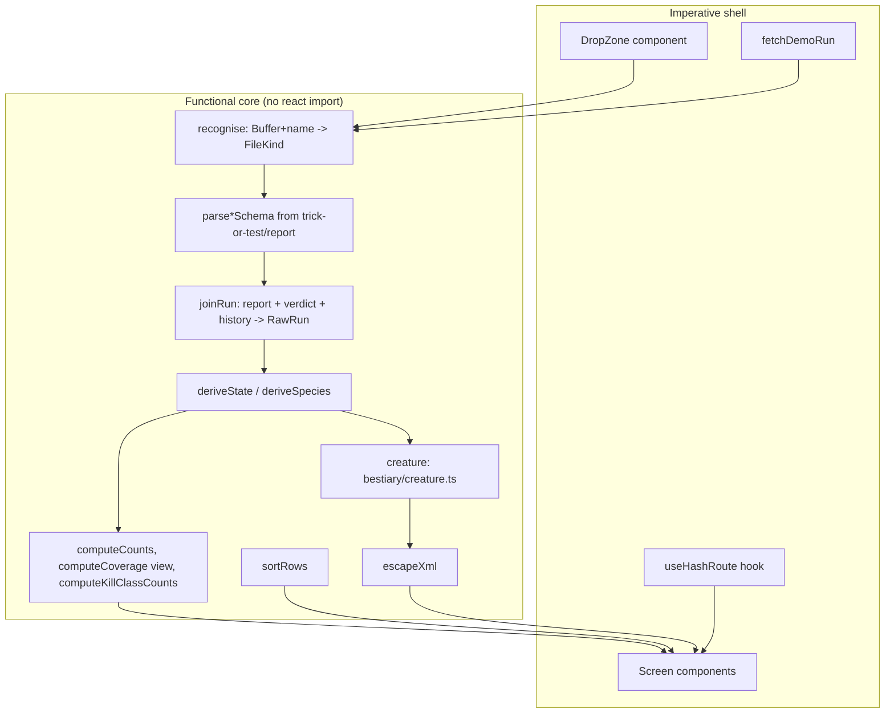

# Design Document

## Overview

The bestiary viewer is the static single-page app in `apps/viewer`. It turns a Mutation_Report, plus optional Verdict_File and History_File, into a Run_Model held in memory, and renders that Run_Model as a field guide: a Landing_Screen, a Verdict_Screen, a Specimen_Screen, a Hunt_Screen and a Plain_View, all reachable by URL hash. It makes no backend calls. The only data it ever reads leaves the user's machine: it never leaves the browser (Requirement 1.1, 11.9).

Two engineering constraints from `tech.md` and `structure.md` drive every decision below:

1. **Functional core, imperative shell** (ADR 0005). Loading, recognising, joining, deriving state and species, counting, sorting and the Creature_Generator are plain functions with no `react` import, living outside `src/screens/`. React components only call these functions and render; they hold no business logic (Requirement 12.8).
2. **The engine boundary is one subpath.** `apps/viewer` imports only `trick-or-test/report` — types and zod schemas, never `packages/engine/src/core/*` directly, and never a `node:` module (Requirement 12.2, `structure.md`).

## Architecture



Data flow, restated as the pipeline the user asked to cover:

**files → recognise → parse → join → Run_Model → derived views**

1. **files**: `File` objects from the drop zone, the file picker, or `fetch` responses for `#/demo/before` / `#/demo/after`.
2. **recognise** (`src/loader/recognise.ts`): reads each file's text and classifies it from its content, never from its file name (Requirement 1.6), as `mutation-report`, `verdict`, `history`, or `unknown`, in this order of precedence: (a) if the whole text is one JSON document with the shape of a Mutation_Report or a Verdict_File, that is the kind, and the History_File test is skipped (Requirement 1.6); (b) otherwise, the text is split into lines, blank lines are dropped, and the file is a `history` when at least one non-empty line parses as JSON and validates with `historyRecordSchema` (Requirement 1.12); (c) otherwise it is `unknown`, or an empty-file or invalid-JSON error (Requirements 1.7, 1.14). A Plain_Stryker_Report and a Trick-or-Test Mutation_Report have the same shape (`schemaVersion`/`files`), so both recognise as `mutation-report`; the species/requirement extension fields are optional in `reportMutantSchema` already.
3. **parse** (`src/loader/parse.ts`): runs the matching zod schema from `trick-or-test/report` (`mutationReportSchema`, `verdictSchema`, and `historyRecordSchema` once per non-empty line of a History_File) and returns a `Result<T, LoadError>` — never throws (Requirement 1.7, 1.8, 1.13). A History_File is validated line by line; the first line that fails rejects the whole file (see "History_File format").
4. **join** (`src/loader/join-run.ts`): merges a parsed Mutation_Report with an optional Verdict_File by mutant id (Requirement 1.3), merges the records of an optional History_File into a time-ordered list, stable on file line order (Requirement 1.4), and counts Verdict_File entries that have no matching report mutant (Requirement 1.10).
5. **Run_Model** (`src/loader/run-model.ts`): the joined, typed, immutable structure every screen reads. Building it never mutates the parsed report or verdict in place.
6. **derived views** (`src/bestiary/state.ts`, `species.ts`, `counts.ts`, `src/plain-view/sort.ts`): pure functions that project the Run_Model into what each screen renders — per-mutant state/species, per-criterion seal status, aggregate counts, and sorted table rows.

## Components and Interfaces

### Module layout

```text
apps/viewer/
  src/
    main.tsx                 # mounts <App/>, no logic
    App.tsx                  # reads hash route, renders a screen
    router/
      use-hash-route.ts      # pure parse of location.hash -> Route (tested without react render)
      routes.ts               # Route type + matcher, no react import
    loader/
      recognise.ts            # pure: text -> FileKind | error; report/verdict document first, then JSON Lines history
      parse.ts                 # pure: text + FileKind -> Result<Parsed, LoadError>
      join-run.ts               # pure: Parsed[] -> Result<RawRun, LoadError>
      run-model.ts               # pure: RawRun -> RunModel
      fetch-demo-run.ts           # impure: fetch() the two demo routes, then calls the pure loader
      file-reader.ts               # impure: File -> ArrayBuffer via FileReader, then calls recognise/parse
    bestiary/
      species.ts                # pure: mutatorName/isSpecMutant -> Species (Requirement 4.1-4.3)
      state.ts                   # pure: reportStatus/statusReason/verdictEntry -> CreatureState | "not-counted"
      counts.ts                  # pure: RunModel -> headline/legend/kill-class counts
      glyph.ts                    # pure: species + original/replacement -> glyph text (pre-escape)
      escape-xml.ts                 # pure: string -> string, escapes & < > " '
      creature.ts                    # pure: Creature_Generator, creature(species, seed, state, mutant) -> string (SVG)
      creature.config.ts               # pure: viewBox, per-species curve topology table, colour tokens
      Creature.tsx                      # React: dangerouslySetInnerHTML of creature()'s output only
    plain-view/
      sort.ts                    # pure: rows + column + direction -> sorted rows
      columns.ts                  # pure: column definitions (id, label, accessor, comparator)
    screens/
      Landing.tsx
      Verdict.tsx
      Specimen.tsx
      Hunt.tsx
      PlainView.tsx
    fonts/
      fonts.ts                   # side-effect imports of the @fontsource CSS files (bundled by Vite)
      licences.ts                # pure: the two OFL texts, imported with `?raw`
    app/
      run-context.tsx            # React context holding the current RunModel | undefined
      FontLicences.tsx           # React: renders the two OFL texts on the Landing_Screen
  public/
    demo/                         # generated by the engine's measure command; never hand-edited
  test/
    fixtures/                     # small hand-written Fixture_Runs for loader/join/derive tests
```

This matches `structure.md`: screens in `src/screens/`, everything that draws a creature in `src/bestiary/`, and `loader/`, `plain-view/`, `router/` hold the remaining pure logic modules required to have no `react` import (Requirement 12.8). Only `Creature.tsx` and the files in `screens/` and `app/` import `react`; a lint/test check (see Testing Strategy) enforces this boundary mechanically rather than by convention alone.

### Resolving `trick-or-test/report`

**Decision: resolve it through the published package export, backed by the engine's real build output — not a source alias.**

What the engine actually exposes (`packages/engine/package.json`):

```json
"exports": {
  ".": { "types": "./dist/index.d.ts", "default": "./dist/index.js" },
  "./report": { "types": "./dist/report/index.d.ts", "default": "./dist/report/index.js" }
}
```

`./report` only resolves once `npm run build` (i.e. `tsc -b`) has produced `packages/engine/dist/report/index.js`. `packages/engine/src/report/index.ts` itself is proven free of `node:` imports by `packages/engine/test/report/no-node-imports.test.ts`, so the compiled output is browser-safe by construction — this is the property the viewer's bundle safety depends on, and it is already enforced in the engine's own test suite, not duplicated here.

Consequences of this choice, weighed against the alternative (a TypeScript path alias straight to `packages/engine/src/report/index.ts`):

| Concern | Package export (chosen) | Source alias (rejected) |
| --- | --- | --- |
| Viewer scripts on a fresh checkout | Work, because each script builds the engine first (see "Engine build order") | Work, no build step needed |
| Matches what a real consumer of `trick-or-test` sees | Yes — the viewer uses the same resolution path as any external package | No — the viewer would see source the npm package never ships |
| Risk of `node:` imports leaking into the browser bundle | None beyond what the engine's own `no-node-imports.test.ts` already guarantees for the subpath | Same guarantee, same test, same source file |
| Extra moving parts | One: the engine must be built before the viewer runs, handled by the script prefix below | None |

A source alias was rejected for a second reason beyond the table: it would let the viewer type-check against private engine internals re-exported from `src/report/index.ts` by accident during refactors, defeating the purpose of having one narrow subpath as the contract (`structure.md`: "Types shared by engine and viewer go in `packages/engine/src/report/`").

The "must build first" cost is paid by the viewer's own scripts, described next. `apps/viewer/package.json` lists `trick-or-test` as a workspace dependency (`0.0.0`, pinned per Requirement 12.4), and the root `tsconfig.json` gains a project reference from `apps/viewer/tsconfig.json` to `packages/engine/tsconfig.json`, so `tsc -b` at the root (`npm run typecheck`, `npm run build`) also builds the engine before the viewer.

### Engine build order

**Decision: the viewer's `dev`, `build`, `preview` and `test` scripts each run the engine build first, so `apps/viewer` works on a fresh checkout on its own.** The engine's workspace name was checked in `packages/engine/package.json`: it is `trick-or-test`, and its `build` script is `tsc -b`. The prefix is therefore `npm run build -w trick-or-test`:

```json
"scripts": {
  "dev": "npm run build -w trick-or-test && vite",
  "build": "npm run build -w trick-or-test && tsc --noEmit && vite build",
  "preview": "npm run build -w trick-or-test && vite preview",
  "test": "npm run build -w trick-or-test && vitest run"
}
```

(The `build` script's `tsc --noEmit` step is shown only as an example of what follows the engine build; the exact tail of each script is an implementation choice.) Resolution still goes through the package export and the built `dist/`, as decided above; the script prefix only guarantees that `dist/` exists and is current. `tsc -b` is incremental, so a repeat run with no engine change is fast.

Interplay with Requirement 12.12: that criterion obliges the commit that adds `dev`, `build` or `preview` to add each script to the commands table of `.kiro/steering/tech.md`. Requirement 12.15 adds the engine-first behaviour, so the same rows of that table must say that the command builds the engine first. `tech.md` has no row for a per-workspace `test` script; the root `npm test` row is unchanged, so the viewer `test` script needs no `tech.md` entry under 12.12 and the engine-first prefix on it is covered by Requirement 12.15 alone.

The root `npm run check` is unaffected: its `typecheck` step runs `tsc -b`, which builds the engine before `npm test` runs. The viewer's Vitest project is also picked up by the root `npm test` (Requirement 12.6), which is `vitest run` and does not call the viewer's `test` script. A bare root `npm test` on a fresh checkout, before any build, is therefore not covered by this decision; the supported entry points on a fresh checkout are `npm run check` and the four viewer scripts.

### Component responsibilities

| Module | Exports | React? |
| --- | --- | --- |
| `loader/recognise.ts` | `recognise(text: string): FileKind \| { kind: "invalid-json"; error: string }` | No |
| `loader/parse.ts` | `parseFile(kind: FileKind, text: string, fileName: string): Result<ParsedFile, LoadError>` | No |
| `loader/join-run.ts` | `joinRun(files: ParsedFile[]): Result<RawRun, LoadError>` | No |
| `loader/run-model.ts` | `buildRunModel(raw: RawRun): RunModel` | No |
| `loader/file-reader.ts` | `readFiles(files: File[]): Promise<ParsedFile[]>` (enforces the 50 MB limit before reading, Requirement 1.11) | No (uses `FileReader`, not React) |
| `loader/fetch-demo-run.ts` | `fetchDemoRun(which: "before" \| "after", baseUrl: string): Promise<Result<RawRun, LoadError>>` | No |
| `bestiary/species.ts` | `speciesOf(mutatorName: string, isSpecMutant: boolean): Species` | No |
| `bestiary/state.ts` | `deriveState(input: StateInput): CreatureState \| "not-counted"` | No |
| `bestiary/counts.ts` | `computeHeadlineCounts`, `computeKillClassCounts`, `computeSpeciesLegend`, `computeCoverageView` | No |
| `bestiary/creature.ts` | `creature(species: Species, seed: string, state: CreatureState \| "not-counted", mutant: CreatureMutant): string` | No |
| `bestiary/glyph.ts` | `glyphFor(species: Species, original: string \| undefined, replacement: string \| undefined): string` | No |
| `bestiary/escape-xml.ts` | `escapeXml(s: string): string` | No |
| `bestiary/Creature.tsx` | `<Creature mutant seed state species />` | Yes — the only place `creature()`'s output reaches the DOM |
| `plain-view/sort.ts` | `sortRows(rows: PlainRow[], column: ColumnId, direction: "asc" \| "desc"): PlainRow[]` | No |
| `router/use-hash-route.ts` | `parseHashRoute(hash: string): Route` (pure) + `useHashRoute()` (React hook wrapping it with `useSyncExternalStore`) | Hook is React; `parseHashRoute` is not and is tested directly |
| `screens/*.tsx` | One component per screen | Yes |

### Routing

`Route` is a discriminated union: `{ kind: "landing" }`, `{ kind: "demo", which: "before" | "after" }`, `{ kind: "specimen", mutantId: string }`, `{ kind: "hunt" }`, `{ kind: "plain" }`, `{ kind: "verdict" }`. `parseHashRoute` maps `#/demo/before`, `#/demo/after`, `#/mutant/<id>`, `#/hunt`, `#/plain`, `#/verdict`, `""`/`"#/"` and anything else (→ `landing`, Requirement 11.7). `useHashRoute` subscribes to `window.hashchange` through `useSyncExternalStore` so a reload re-parses `location.hash` fresh (Requirement 11.8) — no route state is persisted outside the URL (Requirement 11.9). `App.tsx` matches the route: `demo` triggers `fetchDemoRun` and discards any in-memory `RunModel` on every route that is not `demo` on reload, matching Requirement 11.8's "discard the loaded Run" rule for non-demo routes.

Vite's `base` is set to `/trick-or-test/` in `vite.config.ts` (Requirement 12.3); the demo fetch path is built from `import.meta.env.BASE_URL + "demo/..."` so it resolves correctly both in dev and under the Pages path, satisfying "fetch every file of the selected Demo_Run from the same origin under `/trick-or-test/demo/`" in production while still working with Vite's dev server base.

## Data Models

All domain types and zod schemas are imported, not redefined: `ReportMutant`, `MutationTestingReport`, `Verdict`, `CriterionCoverage`, `HistoryRecord`, `MutantId`, `CriterionId`, `Species`, `MutantStatus` (report-level: `ReportStatus`), `CoverageStatus`, `KillClass`, `Witness` from `trick-or-test/report` (`packages/engine/src/report/index.ts`).

Viewer-local types, defined in `apps/viewer/src/loader/run-model.ts` and `src/bestiary/`:

```ts
// loader/run-model.ts
export type RunModel = {
  report: MutationTestingReport;
  verdict: Verdict | undefined;
  history: HistoryRecord[]; // already ordered per Requirement 1.4
  ignoredVerdictEntryCount: number; // Requirement 1.10
  mutants: Mutant[]; // every report mutant, joined
};

export type Mutant = {
  id: string;
  file: string;
  location: ReportLocation;
  mutatorName: string;
  reportStatus: ReportStatus;
  statusReason: string | undefined;
  original: string | undefined; // from file.source + location, when derivable
  replacement: string | undefined;
  requirement: CriterionId | undefined;
  verdictEntry: MutantResult | undefined; // present only when a Verdict_File joined this id
  species: Species; // derived once, memoised on the Mutant (Requirement 4.9)
  state: CreatureState | "not-counted"; // derived once (Requirement 4.*)
};

// bestiary/state.ts
export type CreatureState = "survivor" | "killed" | "in-the-dark" | "ghost";

// bestiary/creature.ts
export type CreatureMutant = {
  file: string | undefined;
  line: number | undefined;
  glyph: string; // already computed by glyphFor, pre-escape; creature() escapes it
};

// plain-view/sort.ts
export type ColumnId = "id" | "species" | "state" | "status" | "requirement" | "file" | "line" | "killClass";
export type PlainRow = {
  mutantId: string;
  species: Species;
  stateLabel: string; // "survived" | "killed by <test>" | "no test runs this code" | "ghost, not counted" | "not counted"
  status: ReportStatus;
  requirement: CriterionId | undefined;
  file: string;
  line: number;
  killClass: KillClass | undefined;
};

// loader/parse.ts
export type LoadError = {
  fileName: string;
  message: string;
  line?: number; // 1-based, History_File errors only; counts blank lines
  fieldPaths?: string[];
  truncatedCount?: number;
};
export type FileKind = "mutation-report" | "verdict" | "history" | "unknown";
```

`Mutant.species` and `Mutant.state` are computed once in `buildRunModel` (not per render), so every screen reading the same `RunModel` sees identical values — this is what makes Requirement 4.11 ("identical numbers for the same Run") structurally true rather than something each screen must separately get right.

### History_File format: JSON Lines

**Decision** (engine contract): the engine writes history as JSON Lines to `history.jsonl`. Each line is one `HistoryRecord` serialised as JSON on a single line, and each run appends exactly one line. Append-only writing keeps diffs readable (one added line per run). The engine's `historyRecordSchema` (`packages/engine/src/core/report.ts`) validates one line. The viewer accepts the file under any name, because recognition is by content (Requirement 1.6).

**Recognition rules** (`loader/recognise.ts`), applied in this order of precedence:

1. If the whole text parses as one JSON document with the shape of a Mutation_Report or a Verdict_File, the file is that kind and is never tested as a History_File. A single-line JSON file that validates as a mutation report or verdict is therefore never a History_File. A Mutation_Report or Verdict_File never validates as a `historyRecordSchema` line anyway, because the schema is a strict object, so the order only decides which error is shown for a broken file.
2. Otherwise the text is split on `\n`, with `\r` before it ignored. Blank lines (empty or whitespace-only) are ignored, and a trailing newline is fine. The file is a History_File when at least one non-empty line parses as JSON and validates with `historyRecordSchema`.
3. Otherwise the file is not recognised. A file with zero non-empty lines (zero bytes, or whitespace only) is never a History_File; it is rejected with an error naming the file and stating that it is empty (Requirement 1.14). Any other unrecognised file gets the invalid-JSON error or the "Mutation_Report required" error (Requirements 1.7, 1.9).

Rule 2 is looser than "every non-empty line validates" on purpose. If recognition required every line to validate, a History_File with one bad line would fall through as unrecognised and the user would never see which line is wrong. With rule 2, one valid line is enough to recognise the file as history, and the parse step then judges every line.

**Parse rules** (`loader/parse.ts`): every non-empty line must parse as JSON and validate with `historyRecordSchema`. The first line that fails rejects the whole file. The error names the file, the 1-based line number counted over all lines including blank ones, and either the JSON parse failure or the failing field paths of that line (up to 10, then the count of further failures), as in Requirement 1.8. The previous Run_Model stays unchanged (Requirement 1.13). No partial history is ever kept.

Consequence for the Hunt_Screen: a History_File always holds at least one record, so the "history has no records" message (Requirement 8.10) is reachable only when a Run_Model is built with an empty history list, not from a loaded file. It stays as a defensive branch, and it is covered by a unit test on the screen with an empty list.

If the engine later changes the format, only `loader/recognise.ts` and `loader/parse.ts` change; `join-run.ts` and everything downstream consume `HistoryRecord[]`.

### Lock_Log format — assumption

The format of the Lock_Log is explicitly out of scope of this spec (owned by the agent-guard spec, per the requirements' Introduction and Requirement 8.6/8.7). Requirement 8.6 only requires that *if* one is loaded, blocked attempts show on the Hunt_Screen timeline in `--amber` labelled "blocked", and 8.7 requires the Hunt_Screen to work with no error when none is loaded. **Assumption**: until the agent-guard spec defines and ships a Lock_Log schema, `loader/recognise.ts` has no `FileKind` for it and the Hunt_Screen's "blocked" rendering path is implemented against a minimal local type (`{ time: string; file: string }[]`) behind a feature-detecting loader branch, so it is additive and does not block this spec. This is flagged as an open point rather than a numbered requirement because Requirement 8 never defines the Lock_Log's shape.

## Creature Generator design

`creature(species, seed, state, mutant)` in `src/bestiary/creature.ts` is the one function `dangerouslySetInnerHTML` is ever given (see Error Handling for why that is safe).

**Seeded PRNG.** The `seed` argument is the mutant id string. `creature()` hashes it with a small deterministic string hash (e.g. a 32-bit FNV-1a, computed inline — no dependency, pure arithmetic) into a `uint32`, then drives a seeded PRNG (`mulberry32`, a well-known one-line generator) from that integer. No `Math.random()`, no `Date`, matching Requirement 5.3. Hashing the id rather than requiring a pre-hashed number means every call site can pass the mutant id directly.

**Per-species fixed topology.** `creature.config.ts` holds, per `Species`, an ordered list of element descriptors (`{ kind: "curve" | "limb" | "eye" | "pattern-shade", baseControlPoints: [...] }`) — the same count and sequence of elements for every seed of that species (Requirement 5.5). The PRNG only perturbs each control point by up to 8% of the fixed `viewBox` width (Requirement 5.4); it never adds, removes or reorders elements. This is what keeps a species recognisable across seeds while still testable as a count-and-kind-sequence invariant (see Correctness Properties, Property V2's scope note).

**State rendering.** A `stateStyle(state)` lookup returns stroke width, fill, opacity and dash-array, implementing the four rows of `bestiary.md`'s States table directly: survivor is full ink + lit eyes; killed is bones only at half survivor stroke width, no fill, no eyes; in-the-dark is a single-colour filled silhouette with no eye elements; ghost is a dashed, unfilled outline at exactly opacity `0.4`. `"not-counted"` is not a `CreatureState` and `creature()` is never called for it — the caller (`Mutant.state === "not-counted"`) renders no creature, matching Requirement 4.8.

**Glyph rule.** `glyphFor(species, original, replacement)` (`bestiary/glyph.ts`) implements the per-species "glyph shown" column of `bestiary.md`'s Species table: Borderling shows the comparison operator token found in `replacement`; Miscount shows the arithmetic/update/unary/assignment operator token; Two-Face shows `&&`, `||`, `true` or `false`; Hollow shows `{}`, `[]` or `""`; Impostor shows the swapped call name pair (e.g. `min → max`); Oathbreaker shows the criterion id; Unclassified shows `?`. When `original`/`replacement` are both `undefined` or empty, `glyphFor` returns `"?"` regardless of species (Requirement 5.15). `creature()` always escapes the returned glyph with `escapeXml` before writing it into the SVG text node.

**Escaping.** `escape-xml.ts` exports one function, `escapeXml`, replacing `&→&amp;`, `<→&lt;`, `>→&gt;`, `"→&quot;`, `'→&#39;`, applied to every string `creature()` writes into the output: the glyph, the file path, and the `<title>` text (Requirement 5.14). No other escaping function exists in the codebase; this is the single implementation V11 tests against.

**Fixed `viewBox`.** One constant, `VIEW_BOX = "0 0 200 200"` (exact numbers are an implementation choice, not copied from `.trickortest/design/project/`, per Requirement 12.13), used for every species, seed and state (Requirement 5.4, 5.6).

**Missing-value fallbacks.** When `mutant.file` or `mutant.line` is missing (a Plain_Stryker_Report's mutant with no location, or any mutant lacking one), the `<title>` text becomes `"<Species>, <state>: unknown location"` instead of interpolating `undefined` (Requirement 5.6, 5.15, 5.16 — see Property V2). When the glyph is unavailable, `glyphFor` already returns `"?"` so `creature()` never has to special-case an empty glyph string at the call site.

**`role="img"` and `<title>`.** The generated root element is always `<svg role="img" viewBox="0 0 200 200" ...><title>...</title>...</svg>`; the title's text content is built from the (already-decided) file/line or the `"unknown location"` fallback and is escaped like every other text value.

## Fonts

**Decision: take both fonts from the `@fontsource` npm packages and let Vite bundle them. Nothing is downloaded by hand, and nothing is placed in `public/fonts/`.**

| Font | Package | Version | Published | Licence |
| --- | --- | --- | --- | --- |
| IM Fell English | `@fontsource/im-fell-english` | 5.3.0 | 2026-07-19 | OFL-1.1 |
| JetBrains Mono | `@fontsource/jetbrains-mono` | 5.3.0 | 2026-07-19 | OFL-1.1 |

The package names, versions and publish dates were read from the npm registry with `npm view <package> time` on 2026-11-25, which makes both versions more than 14 days old on that date (Requirement 12.4). The 14-day rule is evaluated on the day the dependency is added, so the install step re-checks the date and takes the newest version that satisfies it. Both go in `dependencies` of `apps/viewer/package.json` as exact versions, and the commit body states the reason for each (Requirement 12.5). `tech.md` asks for confirmation before a new runtime dependency in the viewer; the decision that introduces these two packages is that confirmation.

**Import through Vite.** `src/fonts/fonts.ts` imports `@fontsource/im-fell-english/latin-400.css`, `@fontsource/jetbrains-mono/latin-400.css` and `@fontsource/jetbrains-mono/latin-700.css`. These files exist in the packages (checked in the 5.3.0 tarballs). Each declares `@font-face` with `font-display: swap` and `src: url(./files/….woff2) format('woff2'), url(./files/….woff) format('woff')`. Vite resolves those `url()` references, emits the font files into `assets/` with hashed names, and rewrites the URLs under the configured `base`, so the fonts are served from the app's own origin at `/trick-or-test/assets/…` (Requirement 10.3, 12.3). Only the Latin subset is imported, to keep the bundle small. Vite emits both the `.woff2` and the `.woff` file of each face, because both are referenced in the CSS; browsers fetch only the first format they support. No `@import` of a remote stylesheet and no `<link>` to a font CDN exists anywhere, which keeps the font-CDN ban (Requirement 10.3, 12.11).

**Fallback.** The `font-family` stacks stay `"IM Fell English", Georgia, serif` and `"JetBrains Mono", ui-monospace, monospace`. `font-display: swap` shows the fallback at once and swaps when the font arrives, and a failed font request leaves the fallback in place (Requirement 10.12).

**Licence texts.** Both packages ship a `LICENSE` file at the package root (checked in the 5.3.0 tarballs: it holds the SIL Open Font License 1.1 with the font's copyright line) and export it as `./LICENSE`. `src/fonts/licences.ts` imports each one with Vite's `?raw` suffix: `import fellLicence from "@fontsource/im-fell-english/LICENSE?raw"` and the same for `@fontsource/jetbrains-mono`. `FontLicences.tsx` renders the two texts in a `<details>` element on the Landing_Screen, one per font, headed by the font name. The licence text is part of the JS bundle, so it ships with the built app on the same origin, and the user can read it in the page.

Why `?raw` instead of `?url`: an asset imported with `?url` is emitted as `LICENSE-<hash>` without an extension, which GitHub Pages serves as a download instead of text. `?raw` needs no build step, no Vite plugin and no file copied by hand, and the text cannot drift from the installed package version. A copy step into `dist/` was rejected because it adds a build script that must be kept in sync with the package layout. Each text is about 4.5 KB.

## Correctness Properties

*A property is a characteristic or behavior that should hold true across all valid executions of a system — essentially, a formal statement about what the system should do. Properties serve as the bridge between human-readable specifications and machine-verifiable correctness guarantees.*

### Property 1: V1 — Deterministic creatures

For any species, seed and state, two calls to `creature(species, seed, state, mutant)` with the same arguments return byte-identical SVG strings.

**Validates: Requirements 5.2, 5.18**

### Property 2: V2 — Well-formed creatures

For any species, seed and state, including a missing file, line or glyph, `creature()` never throws, and its output parses as well-formed XML with exactly one root `<svg>` element that has the fixed `viewBox` and a `<title>` child, and every numeric coordinate attribute in the output is finite and lies inside the `viewBox` bounds (accounting for the 8% jitter bound).

**Validates: Requirements 5.4, 5.6, 5.15, 5.16**

*Scope note:* this property's XML parse also lets the test assert, for the same generated inputs, that the element-kind sequence (count and kind per Requirement 5.5's topology invariant) is identical across different seeds of the same species — folded in here rather than as a twelfth property, per the user's fixed V1–V11 list.

### Property 3: V3 — The glyph is present

For any mutant with a code change (a defined, non-empty `original` or `replacement`), the SVG `creature()` returns contains the escaped glyph text that `glyphFor(species, original, replacement)` computes for that species and change.

**Validates: Requirements 5.11, 5.14**

### Property 4: V4 — Species is total

For any string used as a mutator name, `speciesOf(mutatorName, isSpecMutant)` returns one of the seven `Species` values and never throws; for every mutator name listed in `bestiary.md`'s table, it returns the species of that row; and whenever `isSpecMutant` is `true`, it returns `"Oathbreaker"` regardless of the mutator name.

**Validates: Requirements 4.1, 4.2, 4.3**

### Property 5: V5 — State is total

For any `ReportStatus`, any `statusReason` string (or absence of one), and any presence or absence of a Verdict_File entry, `deriveState()` returns exactly one of the four `CreatureState` values or the literal `"not-counted"` — never a `CreatureState` value *and* `"not-counted"` for the same input, and never neither.

**Validates: Requirements 4.4, 4.5, 4.6, 4.7, 4.8, 4.9, 4.10, 4.12**

### Property 6: V6 — Counts are conserved

For any valid Run_Model, the Plain_View has exactly one row per `Mutant` in `RunModel.mutants`, and for every `CreatureState`, the count of mutants in that state in the Plain_View equals the count the Verdict_Screen headline shows for that state.

**Validates: Requirements 4.11, 6.1, 6.15, 6.16, 9.2, 9.8**

### Property 7: V7 — No false seal

For any Verdict_File whose coverage list contains a criterion with at least one `Survived` Spec_Mutant among its mutants, `computeCoverageView()` never reports that criterion's seal status as `"guarded"`.

**Validates: Requirements 6.3, 6.4**

### Property 8: V8 — Loading never crashes

For any text (valid JSON of any shape, JSON Lines with blank or malformed lines, an empty or whitespace-only string, or arbitrary characters) and any file name string, `recognise()` followed by `parseFile()` always returns a `Result` — either a successfully typed parsed file or a `LoadError` — and never throws. When the result is a `LoadError` for a History_File, it carries the file name and a 1-based line number that points at a non-empty line of the input.

**Validates: Requirements 1.6, 1.7, 1.8, 1.9, 1.12, 1.13, 1.14**

### Property 9: V9 — Hunt is ordered

For any non-empty array of `HistoryRecord`s (including records with equal `time` values), serialised as JSON Lines with arbitrary blank lines between records and either line ending, loading the text yields the same records, and the Hunt_Screen's timeline is sorted by `time` ascending, with records of equal `time` keeping their original relative order from the file, and the survivor count shown for each entry equals that record's `statusCounts.Survived`.

**Validates: Requirements 1.4, 1.12, 8.1, 8.3**

### Property 10: V10 — Sorting is a permutation

For any array of `PlainRow`s, any `ColumnId`, and any sort direction, `sortRows()` returns an array containing the same multiset of rows (by mutant id) as the input, and calling `sortRows()` again on the result with the same column and direction returns rows in the same order as the first sort.

**Validates: Requirements 9.3, 9.4, 9.5, 9.12, 9.13**

### Property 11: V11 — Escaping is safe

For any string used as a mutant's file path, glyph text, or id when building a creature, the SVG that `creature()` returns contains no unescaped occurrence of `&`, `<`, `>`, `"` or `'` originating from that string — every occurrence appears only inside its corresponding XML entity (`&amp;`, `&lt;`, `&gt;`, `&quot;`, `&#39;`).

**Validates: Requirements 5.14, 10.9, 12.9**

## Error Handling

- **Parsing boundary.** Every file read from disk or network is untrusted JSON. `loader/parse.ts` never calls a schema's `.parse()` — only `.safeParse()` — and converts a failed parse into a `LoadError` naming the file and, for schema failures, up to 10 field paths plus a count of any remaining failures (Requirement 1.8). A `JSON.parse` syntax error becomes a `LoadError` naming the file and the parse failure (Requirement 1.7). Neither path ever throws past `loader/parse.ts`; `App.tsx` therefore does not need a top-level error boundary to stay usable, though one is added anyway as defense in depth for a programming bug, per Requirement 12.14 ("no untrusted file crashes the Viewer").
- **History_File lines.** A non-empty line that is not valid JSON, or that fails `historyRecordSchema`, rejects the whole file with a `LoadError` that holds the file name, the 1-based `line`, and the parse failure or up to 10 field paths. A file with zero non-empty lines gets a `LoadError` that states the file is empty. In both cases the previous Run_Model is kept (Requirements 1.13, 1.14).
- **Oversized files.** `loader/file-reader.ts` checks `File.size > 52_428_800` before calling `FileReader.readAsText`, so an oversized file is rejected without its content ever being read into memory (Requirement 1.11).
- **Demo fetch failures.** `fetchDemoRun` wraps each `fetch()` in a 10-second `AbortController` timeout; a network failure, non-2xx response, or timeout all produce the same `LoadError` shape naming the failing file, and `App.tsx` keeps rendering the Landing_Screen with both demo links still enabled (Requirement 2.3). A fetched-but-unparseable file goes through the same `parseFile` path as a locally opened file (Requirement 2.4).
- **Unknown mutant id in a route.** `Specimen.tsx` checks `runModel.mutants` for the requested id; a miss renders the "not found" message with a link back to the Verdict_Screen and leaves the `RunModel` untouched (Requirement 11.5), rather than routing through the error-message path used for load failures.
- **Unrecognised report status, coverage status, or species mapping miss.** These are modeled as total functions (`deriveState`, `computeCoverageView`, `speciesOf`) that return a defined "fallback" value (`"not-counted"`, an "unrecognised" coverage display, `"Unclassified"`) rather than ever throwing — this is why V4, V5 and the coverage-status handling in Requirement 6.7 are expressed as *totality* properties, not error paths.
- **SVG insertion.** `Creature.tsx` is the only component that calls `dangerouslySetInnerHTML`, and the only value it is ever given is the return value of `creature()` from the same render — never a raw file, verdict, or history value, and never string-concatenated with one. `creature()` escapes every text value it receives before writing it into the markup it returns (glyph, file path, title), so by the time `Creature.tsx` inserts the string, no loaded-file content can appear as unescaped markup. This is checked statically (one `grep`-style test asserting `dangerouslySetInnerHTML` appears in exactly one file and only wraps a call to `creature()`) and dynamically (Property V11).
- **Font load failure.** Fonts are declared by the `@fontsource` CSS (see "Fonts") and a `font-family` stack (`"IM Fell English", Georgia, serif` / `"JetBrains Mono", ui-monospace, monospace`) so a failed font fetch falls back within the same family type automatically — no JS error path needed (Requirement 10.12).

## Testing Strategy

**Vitest project.** `apps/viewer` adds its own Vitest config (`apps/viewer/vitest.config.ts`) with `test.name: "viewer"`, picked up by the root `vitest.config.ts`'s `projects: ["apps/*", ...]` glob, so `npm test` and `npm run check` run it automatically (Requirement 12.6). It uses `jsdom` as the test environment (needed for the handful of React/DOM tests; pure-function tests do not need it but sharing one environment keeps the config small) and a `setupFiles` entry mirroring the engine's: `fc.configureGlobal({ seed: <fixed>, numRuns: 100 })` (Requirement 12.10, `tech.md`'s "never pass an ad-hoc seed to `fc.assert`").

**Test naming and file conventions**, following `tech.md`:
- Example tests: `*.test.ts(x)`, named `it("<criterion id> <description>", ...)`, e.g. `it("1.7 invalid JSON names the file and the parse failure", ...)`.
- Property tests: `*.property.test.ts`, one file per module under test (e.g. `creature.determinism.property.test.ts`, `creature.well-formed.property.test.ts`, `species.property.test.ts`, `state.property.test.ts`, `counts.property.test.ts`, `coverage.no-false-seal.property.test.ts`, `loader.never-throws.property.test.ts`, `hunt.order.property.test.ts`, `sort.permutation.property.test.ts`, `escape.property.test.ts`), each tagged in a header comment: `// Feature: bestiary-viewer, Property V<n>: <property text>`.
- Each property test uses exactly one `fc.assert(fc.property(...))` call implementing its design property, at the shared `numRuns: 100` minimum (Requirement 12.10).

**Unit tests** cover what properties don't: the specific rendering/accessibility examples (focus ring, `aria-sort`, tab order), the fixed set of concrete demo-link labels and error message copy (field-notes voice checks), the 50 MB boundary example, the Specimen_Screen's "not found" message, the three screen-level "N creatures, up to 60/50" truncation examples, the History_File examples (blank line, CRLF, trailing newline, bad line number, empty file, single-line report that is not history), a check that the `dev`, `build`, `preview` and `test` scripts in `apps/viewer/package.json` each start with `npm run build -w trick-or-test` (Requirement 12.15), a check that the dependencies on the two `@fontsource` packages are exact versions and that no `apps/viewer/public/fonts/` directory exists (Requirement 12.16), a check that `FontLicences` renders the text "SIL Open Font License" for both fonts, and the `module boundary` check that no file under `loader/`, `bestiary/`, `plain-view/`, or `router/` (excluding `.tsx` files) imports `react`.

**Fixtures.** `apps/viewer/test/fixtures/` holds small, hand-written Mutation_Report and Verdict_File JSON files and a `history.jsonl` History_File (one record per line, plus variants with a blank line, a CRLF ending, a bad line and an empty file) exercising the join and derivation logic, used until `apps/viewer/public/demo/` exists. `apps/viewer/public/demo/` itself is produced by the engine's `measure` command and is never hand-edited (`structure.md`); no test asserts on its specific numbers (Requirement 12.13), and the viewer's own tests do not depend on its presence (Requirement 2.6) — `fetchDemoRun`'s tests mock `fetch` against the fixtures instead.

**Property-based testing is appropriate here**: the modules under test (`creature`, `speciesOf`, `deriveState`, `computeHeadlineCounts`/`computeCoverageView`, the loader's recognise/parse pipeline, the hunt timeline builder, `sortRows`, `escapeXml`) are all pure functions over a large, structured input space (arbitrary mutant data, arbitrary malformed JSON, arbitrary sort columns), exactly the profile PBT is suited to. Library: **fast-check**, already a dependency pattern established in `packages/engine` (`devDependencies.fast-check`); `apps/viewer` adds the same dependency, pinned exact per Requirement 12.4. No PBT is used for anything DOM-measurement-related (focus rings, computed font size, scroll width) or for the Vite/GitHub Pages build configuration itself — those stay as unit/example tests and build-config assertions, consistent with "PBT is not appropriate for UI rendering/layout or configuration validation."
