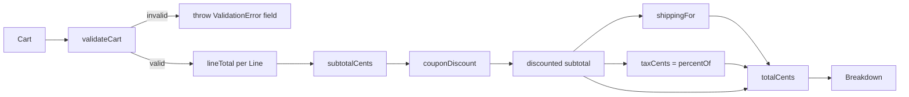

# Design Document

## Overview

Cart_Pricing_Library is a small, pure TypeScript module. `priceCart(cart)` validates a `Cart`, then computes a `Breakdown` in integer cents through a fixed pipeline: line totals, subtotal, coupon discount, shipping, tax, total. `percentOf(amount, bps)` is the single rounding primitive. It performs Round_Half_Up with integer arithmetic. Every percentage computation (bulk discount, percent coupon, tax) goes through it.

Constraints:
- Pure functions, no I/O, no mutation of inputs, no dependencies.
- Erasable TypeScript syntax only (`erasableSyntaxOnly: true`). No enums, namespaces, parameter properties, or `import x = require`.
- Tests are Vitest plus fast-check under `test/**/*.test.ts`. `test/setup.ts` configures fast-check globally (seed 20261116, 200 runs).
- `package.json`, `tsconfig.json`, `vitest.config.ts`, and `test/setup.ts` are not modified. `tsconfig.json` includes `src` and `test`, so all new code goes in those folders.

### Design Decisions

1. **Integer arithmetic with `Math.floor((amount * bps + 5000) / 10000)`.** Adding half of the divisor and flooring gives Round_Half_Up for non-negative inputs. The numerator is an exact safe integer as long as `amount * bps + 5000 <= 2^53 - 1` (about 9.007e15). The division result is then floored. The division of two safe integers by 10000 can produce a non-exact float, but `Math.floor` of `n / 10000` is correct for safe integers n. The quotient is below 2^53 / 10000, so the nearest double cannot cross an integer boundary incorrectly. The test suite checks this against a BigInt reference model. If a reviewer prefers zero floating point, the equivalent `(n - (n % 10000)) / 10000` is an acceptable alternative, since `%` on safe integers is exact.
2. **Range budget.** Validated inputs bound the amounts, so overflow cannot occur in `priceCart`:

   | Quantity | Bound | Worst case value |
   |---|---|---|
   | line raw total | 999 × 1,000,000 | 999,000,000 |
   | line raw total × bps (bulk discount, 1000 bps) | 999,000,000 × 1000 | about 1.0e12 |
   | subtotal × 10000 (tax, `taxBps` ≤ 10000) | N lines × 999,000,000 × 10000 | about 1e13 per line |

   The safe limit is about 9.0e15, so a cart can hold about 900 maximum-value lines before the tax numerator leaves the safe range. The library does not cap the number of lines. Carts beyond this size are out of scope. This is documented in the JSDoc of `priceCart`.
3. **Bulk discount rounding.** Requirement 4.1 says the Line_Total is the raw total reduced by 10% using Round_Half_Up. The design rounds the discount amount half up: `lineTotal = raw - percentOf(raw, 1000)`. This was confirmed by the user. The rejected alternative `percentOf(raw, 9000)` rounds the final amount half up and would differ by 1 cent on exact halves. For example, quantity 11 at unit price 5 gives raw 55, discount `percentOf(55, 1000) = 6` (5.5 rounds up), and line total 49.
4. **Coupon values are not validated** (Requirement 3.5). To still guarantee Requirement 7.4 and 5.5, the final discount is clamped to `[0, subtotal]` with `Math.max(0, Math.min(...))`. Non-finite or non-integer coupon values are outside the supported input domain.
5. **Validation before computation.** All validation runs first, so no partial result is ever produced. Order among multiple invalid fields is unspecified (Requirement 3.4). The implementation happens to check `taxBps` first and then lines in index order, and tests must not depend on it.
6. **Integer check.** `Number.isInteger(v)` is used, which rejects `NaN`, `Infinity`, fractions, and non-numbers (it returns false for non-number types at runtime).

## Architecture



### File layout

```
src/
  index.ts        // public re-exports only
  types.ts        // Cart, Line, Coupon, Breakdown (type-only declarations)
  errors.ts       // ValidationError
  percent.ts      // percentOf
  validate.ts     // validateCart (internal)
  price.ts        // priceCart and internal helpers
test/
  percent.test.ts
  validation.test.ts
  price.test.ts
  helpers/arbitraries.ts   // fast-check arbitraries and reference model (not matched by *.test.ts)
```

`vitest.config.ts` only includes `test/**/*.test.ts`, so `test/helpers/arbitraries.ts` is not run as a test file.

Because `erasableSyntaxOnly` and `moduleResolution: Bundler` are in use, type-only exports use `export type { ... }` and relative imports follow the bundler resolution (extension-less is accepted).

## Components and Interfaces

### `src/types.ts`

```ts
export type Line = {
  quantity: number;        // integer 1..999
  unitPriceCents: number;  // integer 0..1_000_000
};

export type PercentCoupon = {
  kind: 'percent';
  bps: number;
  maxDiscountCents: number;
  minSubtotalCents: number;
};

export type FixedCoupon = {
  kind: 'fixed';
  amountCents: number;
  minSubtotalCents: number;
};

export type Coupon = PercentCoupon | FixedCoupon;

export type Cart = {
  lines: Line[];
  coupon?: Coupon;
  shipping: 'standard' | 'express';
  taxBps: number;          // integer 0..10000
};

export type Breakdown = {
  subtotalCents: number;
  discountCents: number;
  shippingCents: number;
  taxCents: number;
  totalCents: number;
};
```

The requirements describe the Coupon union by its fields only. The design adds a literal `kind` discriminant so the union can be narrowed in code and in tests. The requirement language does not forbid it. Without it, narrowing would rely on `'bps' in coupon`, which also works. If the original request fixed the Coupon shape without a discriminant, replace `coupon.kind === 'percent'` with `'bps' in coupon`; no other design element changes. This is an open point to confirm.

`PercentCoupon` and `FixedCoupon` are also exported as types for convenience. The required type exports are `Cart`, `Line`, `Coupon`, and `Breakdown`.

### `src/errors.ts`

```ts
export class ValidationError extends Error {
  readonly field: string;
  constructor(field: string, message?: string) {
    super(message ?? `Invalid value for ${field}`);
    this.name = 'ValidationError';
    this.field = field;
  }
}
```

`readonly field: string;` declared as a class field with explicit assignment in the constructor is erasable. A parameter property (`constructor(readonly field: string)`) is not erasable and must not be used. With target ES2022, `useDefineForClassFields` defaults to true, and a field declared without an initializer is initialized to `undefined` before the constructor body runs. The assignment afterwards sets it, so behavior is correct.

### `src/percent.ts`

```ts
const BPS_DENOMINATOR = 10000;
const HALF = 5000;

/** Round-half-up of amount * bps / 10000. No validation. */
export function percentOf(amount: number, bps: number): number {
  return Math.floor((amount * bps + HALF) / BPS_DENOMINATOR);
}
```

Contract: for non-negative integer `amount` and `bps` with `amount * bps + 5000 <= Number.MAX_SAFE_INTEGER`, the result is the exact Round_Half_Up value. Outside this contract the behavior is unspecified, and the function does not throw (Requirement 2.3).

### `src/validate.ts`

```ts
import { ValidationError } from './errors';
import type { Cart } from './types';

function isIntInRange(v: unknown, min: number, max: number): boolean {
  return typeof v === 'number' && Number.isInteger(v) && v >= min && v <= max;
}

export function validateCart(cart: Cart): void {
  if (!isIntInRange(cart.taxBps, 0, 10000)) {
    throw new ValidationError('taxBps');
  }
  for (let i = 0; i < cart.lines.length; i++) {
    const line = cart.lines[i];
    if (!isIntInRange(line.quantity, 1, 999)) {
      throw new ValidationError(`lines[${i}].quantity`);
    }
    if (!isIntInRange(line.unitPriceCents, 0, 1_000_000)) {
      throw new ValidationError(`lines[${i}].unitPriceCents`);
    }
  }
}
```

Coupon fields and `shipping` are not inspected here. (`shipping` is constrained by the type system. Requirement 3 lists no runtime check for it.)

### `src/price.ts`

```ts
import { percentOf } from './percent';
import { validateCart } from './validate';
import type { Breakdown, Cart, Coupon, Line } from './types';

const BULK_THRESHOLD = 10;
const BULK_DISCOUNT_BPS = 1000;        // 10%
const FREE_SHIPPING_THRESHOLD = 10000;
const STANDARD_SHIPPING = 799;
const EXPRESS_SHIPPING = 1499;

function lineTotal(line: Line): number {
  const raw = line.quantity * line.unitPriceCents;
  return line.quantity >= BULK_THRESHOLD ? raw - percentOf(raw, BULK_DISCOUNT_BPS) : raw;
}

function couponDiscount(coupon: Coupon | undefined, subtotal: number): number {
  if (coupon === undefined || subtotal < coupon.minSubtotalCents) return 0;
  const raw = coupon.kind === 'percent'
    ? Math.min(percentOf(subtotal, coupon.bps), coupon.maxDiscountCents)
    : coupon.amountCents;
  return Math.max(0, Math.min(raw, subtotal));
}

function shippingFor(method: Cart['shipping'], lineCount: number, discounted: number): number {
  if (lineCount === 0) return 0;
  if (method === 'express') return EXPRESS_SHIPPING;
  return discounted >= FREE_SHIPPING_THRESHOLD ? 0 : STANDARD_SHIPPING;
}

export function priceCart(cart: Cart): Breakdown {
  validateCart(cart);
  let subtotalCents = 0;
  for (const line of cart.lines) subtotalCents += lineTotal(line);
  const discountCents = couponDiscount(cart.coupon, subtotalCents);
  const discounted = subtotalCents - discountCents;
  const shippingCents = shippingFor(cart.shipping, cart.lines.length, discounted);
  const taxCents = percentOf(discounted, cart.taxBps);
  const totalCents = discounted + shippingCents + taxCents;
  return { subtotalCents, discountCents, shippingCents, taxCents, totalCents };
}
```

Notes:
- An empty cart yields subtotal 0, discount 0 (the clamp to subtotal 0 forces this even if a coupon has `minSubtotalCents` 0), shipping 0, tax `percentOf(0, x) = 0`, total 0. This satisfies Requirement 4.4 with no special case.
- Shipping depends on the Discounted_Subtotal (Requirement 6), and tax is computed on the Discounted_Subtotal without shipping (Requirement 7.2).
- A coupon with `minSubtotalCents` of 0 or negative applies on any subtotal, including 0 for the clamp reasons above.
- `NaN` in unvalidated coupon fields: comparisons with `NaN` are false, so `subtotal < NaN` is false and the coupon proceeds; `Math.min` with `NaN` yields `NaN`, and the output would be `NaN`. This is outside the supported domain (coupon values are unvalidated by requirement). No guard is added, to respect Requirement 3.5 and avoid unrequested behavior.

### `src/index.ts`

```ts
export { priceCart } from './price';
export { percentOf } from './percent';
export { ValidationError } from './errors';
export type { Cart, Line, Coupon, Breakdown } from './types';
```

## Data Models

| Type | Field | Domain |
|---|---|---|
| Line | quantity | integer, 1..999 (validated) |
| Line | unitPriceCents | integer, 0..1,000,000 (validated) |
| Cart | taxBps | integer, 0..10000 (validated) |
| Cart | shipping | `'standard'` or `'express'` |
| Cart | lines | array, any length (0 allowed) |
| Cart | coupon | optional, not validated |
| Breakdown | all five fields | non-negative integers |

Derived relations in a Breakdown:
- `0 <= discountCents <= subtotalCents`
- `totalCents = (subtotalCents - discountCents) + shippingCents + taxCents`

## Error Handling

- Invalid cart input throws `ValidationError` with `field` set to `taxBps`, `lines[i].quantity`, or `lines[i].unitPriceCents`. `i` is the zero-based index. Nothing is returned in that case.
- With several invalid fields, exactly one error is thrown naming one of them. Callers and tests must not rely on which.
- `percentOf` never throws.
- Unvalidated inputs (coupon fields, `shipping` at runtime) do not raise `ValidationError`. Coupon discounts are clamped to `[0, subtotal]` so Breakdown invariants hold for any finite numeric coupon values.

## Testing Strategy

Vitest with fast-check. Property tests use the global configuration from `test/setup.ts` (200 runs, fixed seed), which meets the minimum of 100 iterations. No per-test `numRuns` below 100 is set. Each property test carries a comment tag: `Feature: cart-pricing, Property N: <title>`.

### Arbitraries (`test/helpers/arbitraries.ts`)

- `validLine`: `fc.record({ quantity: fc.integer({min:1,max:999}), unitPriceCents: fc.integer({min:0,max:1_000_000}) })`. A second variant biases quantities toward 9, 10, 11 using `fc.oneof` to hit the bulk boundary.
- `coupon`: `fc.oneof` of percent (`bps` 0..10000, `maxDiscountCents` 0..1e7, `minSubtotalCents` 0..1e7) and fixed (`amountCents` 0..1e7, `minSubtotalCents` 0..1e7) variants.
- `validCart`: lines array of 0..20 `validLine` entries, optional coupon, `shipping` from `fc.constantFrom('standard','express')`, `taxBps` 0..10000. Line count 20 keeps the numerators far inside the safe range.
- Invalid value generators: for quantity, `fc.oneof(fc.constantFrom(0, 1000, -1, 1.5, NaN, Infinity), fc.integer({min:-1000,max:0}), fc.integer({min:1000,max:100000}))`. Similar for unit price (`-1`, `1_000_001`, `0.5`, `NaN`) and `taxBps` (`-1`, `10001`, `0.5`, `NaN`).

### Reference model

`test/helpers/arbitraries.ts` also exports `refPercentOf(amount, bps)` using `BigInt`: `Number((BigInt(amount) * BigInt(bps) * 2n + 10000n) / 20000n)`, a floor division of non-negative values, which is independent of the floating-point implementation. The model prices carts with the same pipeline written independently in BigInt so tests do not just re-run the implementation's own code path.

### Unit tests (examples and edge cases)

- `percentOf` exact halves: `percentOf(1, 5000) = 1`, `percentOf(5, 1000) = 1` (0.5 rounds up), `percentOf(15, 1000) = 2`, `percentOf(14, 1000) = 1`, `percentOf(0, 10000) = 0`, `percentOf(1, 4999) = 0`, `percentOf(1, 5000) = 1`. (Requirement 8.3)
- `percentOf` does not throw for out-of-domain inputs such as `percentOf(5, 10001)`. (Requirement 2.3)
- Validation field names: one example each for `lines[0].quantity`, `lines[2].unitPriceCents`, `taxBps` with boundary values 0, 1000, 999 (valid), 1,000,000 (valid), 1,000,001. (Requirement 8.2)
- Multiple invalid fields: assert only that `error instanceof ValidationError` and `error.field` is one of the invalid fields. (Requirement 8.4)
- Shipping thresholds: discounted subtotal 9999 gives 799, 10000 gives 0; express with discounted subtotal 10000 gives 1499.
- Bulk boundary: quantity 9 versus 10 with unit price 5 (raw 45 stays 45; raw 50 becomes 45; quantity 10 with price 1 gives raw 10, so total 9). Exact-half example: quantity 11 at unit price 5 gives raw 55, discount 6, line total 49.
- Coupon below minimum gives discount 0; coupon with `minSubtotalCents` exactly equal to the subtotal applies; unusual coupon values do not throw `ValidationError`. (Requirement 3.5)
- Empty cart with coupon, express shipping, and nonzero `taxBps` yields all zeros.
- Public API smoke test: `import { priceCart, percentOf, ValidationError } from '../src/index'` and a type-only import of `Cart`, `Line`, `Coupon`, `Breakdown`. `npm run typecheck` covers type exports and erasable syntax.
- A final check (`git diff --exit-code -- package.json tsconfig.json vitest.config.ts test/setup.ts`) confirms the protected files are unchanged. It is a manual verification step and not part of the test suite.

### Property tests

Each correctness property below is implemented as one fast-check property test.

## Correctness Properties

*A property is a characteristic or behavior that should hold true across all valid executions of a system-essentially, a formal statement about what the system should do. Properties serve as the bridge between human-readable specifications and machine-verifiable correctness guarantees.*

### Property 1: percentOf is exact Round_Half_Up

For any non-negative integer `amount` and non-negative integer `bps` with `amount * bps + 5000` within the safe integer range, `percentOf(amount, bps)` equals the exact value of `amount * bps / 10000` rounded to the nearest integer with halves rounded up (as computed by a BigInt reference model), and the result is an integer.

**Validates: Requirements 2.1, 2.2**

### Property 2: A single invalid field is reported by name

For any valid cart in which exactly one field among `taxBps`, `lines[i].quantity`, and `lines[i].unitPriceCents` is replaced by an invalid value (non-integer, NaN, or outside its allowed range), `priceCart` throws a `ValidationError` whose `field` is exactly the name of that field, using the zero-based index `i`.

**Validates: Requirements 3.1, 3.2, 3.3**

### Property 3: Multiple invalid fields yield one of them

For any cart in which two or more of the validated fields are invalid, `priceCart` throws a `ValidationError` whose `field` is a member of the set of invalid field names. The test does not assert which member.

**Validates: Requirements 3.4**

### Property 4: Subtotal equals the sum of line totals with bulk discount

For any valid cart, `subtotalCents` equals the sum over all lines of `quantity * unitPriceCents` when `quantity < 10`, and of `quantity * unitPriceCents - percentOf(quantity * unitPriceCents, 1000)` when `quantity >= 10`.

**Validates: Requirements 4.1, 4.2, 4.3**

### Property 5: Empty carts price to zero

For any coupon (or none), any shipping method, and any valid `taxBps`, a cart with zero lines returns a Breakdown whose five fields are all 0.

**Validates: Requirements 4.4, 6.1**

### Property 6: Coupon discount matches the coupon rules

For any valid cart, `discountCents` is 0 when there is no coupon or when `subtotalCents < minSubtotalCents`. Otherwise it equals `min(percentOf(subtotalCents, bps), maxDiscountCents)` for a percent coupon, or `amountCents` for a fixed coupon, in both cases limited to at most `subtotalCents`.

**Validates: Requirements 5.1, 5.2, 5.3, 5.4, 5.5, 5.6**

### Property 7: Shipping follows method and threshold

For any valid cart with at least one line, `shippingCents` is 1499 when the method is `express`, 799 when the method is `standard` and the Discounted_Subtotal is below 10000, and 0 when the method is `standard` and the Discounted_Subtotal is 10000 or more.

**Validates: Requirements 6.2, 6.3, 6.4**

### Property 8: Tax is computed on the discounted subtotal only

For any valid cart, `taxCents` equals `percentOf(subtotalCents - discountCents, taxBps)`. For any valid cart, changing only the shipping method leaves `taxCents` unchanged.

**Validates: Requirements 7.1, 7.2**

### Property 9: Breakdown invariants

For any valid cart, every Breakdown field is a non-negative integer, `discountCents <= subtotalCents`, and `totalCents = (subtotalCents - discountCents) + shippingCents + taxCents`.

**Validates: Requirements 5.5, 7.3, 7.4**
