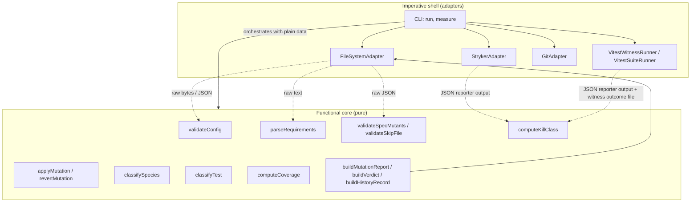
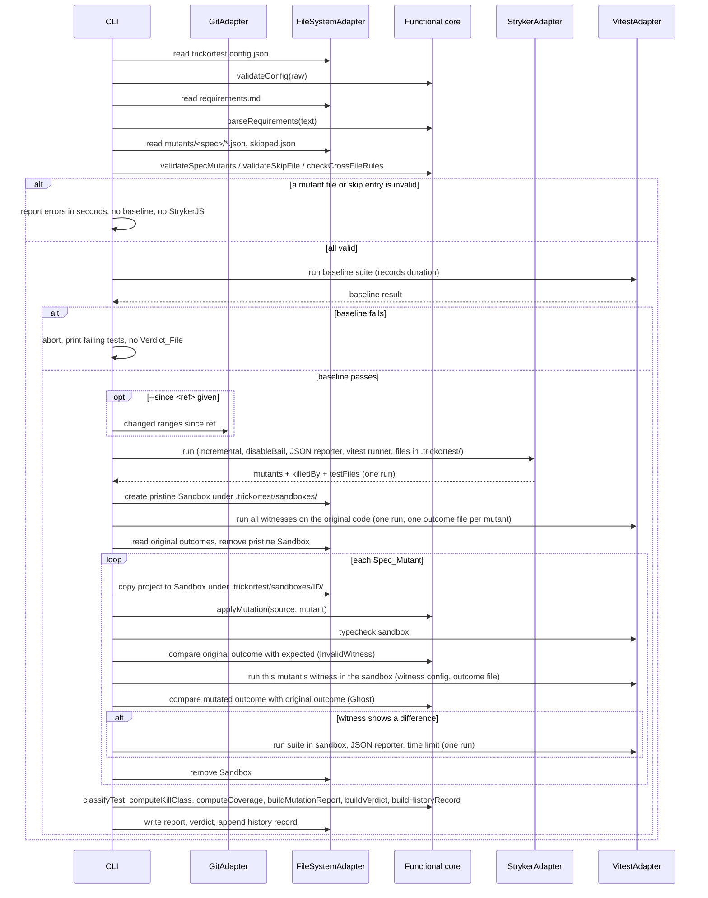

# Design Document

## Overview

The mutant engine is the `trick-or-test` npm package in `packages/engine`. It attacks a Target_Project with two kinds of mutants, mechanical mutants from StrykerJS and spec mutants (Oathbreakers) written by a Kiro agent, runs the Target_Project's own Vitest suite against each one, and reports which acceptance criteria of a Kiro spec would notice a broken promise.

The engine makes no LLM calls (ADR 0004): spec mutants arrive as files under `<mutants dir>/<spec name>/`, already written by an agent session. The engine's job is to validate, apply, witness, run and report them, and to drive StrykerJS for the mechanical half.

Three findings from exploratory runs against `examples/pricing` shape this design and are treated as hard constraints, not implementation details to revisit later:

1. **Mechanical attribution is single-run.** StrykerJS with `disableBail` already runs every test against every mutant and records `killedBy` per mutant plus `testFiles` on the report. A second run to separate "would examples alone kill this" from "would properties alone kill this" is unnecessary and would double the mutation run time for no new information: the same `killedBy` list, split by test classification, answers both questions.
2. **Witnesses must run inside the target's Vitest, not plain Node.** The target project's test files use extensionless imports and TypeScript syntax that only resolve through the project's own Vite/Vitest transform pipeline; a plain `node witness.ts` fails to resolve those imports. Vitest also swallows `console.log` output from passing tests, so the witness cannot report its outcome by printing — it must write the outcome to a file that the engine reads back.
3. **Spec mutant attribution is also single-run per mutant.** One Vitest run with the JSON reporter per spec mutant produces the list of failing tests; examples-only, properties-only, both and unattributed are computed by classifying each failing test after the fact, never by running an examples-only suite and a properties-only suite separately.

## Architecture

The engine follows ADR 0005 (functional core, imperative shell). The core is deterministic, synchronous, and free of file system, process, and network access. The core imports nothing from `node:` except `node:crypto` in `core/mutant-id.ts`, where `createHash('sha256')` is a pure function of its input. Everything that touches the outside world — the file system, child processes, StrykerJS, Vitest, and git — is an adapter behind a small interface that the core depends on through a parameter, never an import.



The CLI (`packages/engine/src/cli/`) is the only orchestrator. It calls adapters to gather raw data, passes that data into core functions, and calls adapters again to write output. No core function is aware that StrykerJS, Vitest, or the file system exist.

### Run sequence



## Components and Interfaces

### Core (pure, `packages/engine/src/core/`)

| Module | Exports | Responsibility |
| --- | --- | --- |
| `config.ts` | `validateConfig(raw: unknown): Result<EngineConfig, ConfigError>`, `resolveConfigPaths(config, projectRoot)` | Requirement 1. zod schema with defaults; resolving paths is a pure string-join function given a root. Only a missing file gives defaults, and that decision is made by the caller, which does not call `validateConfig` for a missing file. `validateConfig(null)` (a file that parses to JSON `null`) is an error that names the file, as is any other non-object value. |
| `requirements.ts` | `parseRequirements(text: string, filePath: string): Result<Criterion[], ParseError>` | Requirement 2. Line-oriented Markdown scan; no file I/O. Lines inside a fenced code block (opened by ``` or ~~~ and closed by a fence of the same character) are neither headings nor criteria. |
| `species.ts` | `classifySpecies(mutatorName: string, replacementText: string): Species` | Requirement 3.11-3.13, 8.14. Table lookup, total function, loaded from `.kiro/steering/bestiary.md` species table (embedded as a data constant checked against the steering file by a unit test, not parsed from Markdown at run time). |
| `mutation.ts` | `applyMutation(source: string, mutant: SpecMutant): Result<{ mutated: string; span: Span }, NotApplicableError>`, `revertMutation(mutated: string, mutant: SpecMutant, span: Span): string` | Requirement 5.2. Pure string surgery: find `original` text, require exactly one occurrence. |
| `spec-mutants.ts` | `validateSpecMutant(raw: unknown, filePath: string): Result<SpecMutant, LoadError>`, `validateSkipFile(raw: unknown, filePath: string): Result<SkipEntry[], LoadError>`, `checkCrossFileRules(mutants, skipEntries, criteria): LoadError[]` | Requirement 4. Per-file validation is pure; cross-file checks (duplicate id, requirement exists, 4.9's strict skip-vs-mutant rule) take the already-loaded list. |
| `suite-time-limit.ts` | `computeSuiteTimeLimit(baselineMs: number, timeoutMs?: number): number` | Requirement 5.15. Returns `timeoutMs` when set, otherwise `baselineMs * 1.5 + 5000`. |
| `witness-compare.ts` | `compareWitnessOutcome(expected: WitnessExpectation, actual: WitnessOutcome): "match" \| "mismatch"` | Requirement 5.6, 5.12. Deep structural equality over the JSON form of the values (each value is serialized and parsed before comparison), so `-0` and `0` are equal. |
| `test-classification.ts` | `classifyTest(test: { filePath: string; bodySource: string }, propertyTestGlobs: string[]): "property" \| "example"` | Requirement 6.3-6.5. Glob match on `filePath` (the matcher expands braces, so `test/**/*.{property,prop}.test.ts` matches `test/a.property.test.ts`), or a syntactic scan of `bodySource` for a call to `fc.assert`, `fc.check`, or `test.prop`. |
| `kill-classification.ts` | `computeKillClass(killingTests: ClassifiedTest[]): KillClass` | Requirement 6.6-6.10. |
| `mutant-id.ts` | `computeMutantId(file: string, original: string, replacement: string, occurrenceIndex: number): MutantId` | Requirement 8.7. Used for Mechanical_Mutants only. Content hash computed with `createHash('sha256')` from `node:crypto` (hex-truncated), never a hand-written hash, never a timestamp and never a line number. The `occurrenceIndex` is the Occurrence_Index: the 0-based position of the mutant among all Mechanical_Mutants with the same file, original text and replacement, ordered by location (line, then column). It keeps two mutants with the same file, original text and replacement at different locations apart. `computeMutantId` does not compute the index. The caller (the CLI) groups the Mechanical_Mutants by (file, original, replacement), sorts each group by line then column, and passes each mutant's position in its group. Because the index depends only on the order inside a group, ids stay stable when unrelated lines move. This is the only core module that imports from `node:`. Spec_Mutants do not pass through this function: a Spec_Mutant keeps the id from its file (`oath-<criterion>-<slug>`), which Requirement 4.5 makes unique. The CLI passes the ids to `report.ts` as data, so `report.ts` does not import `mutant-id.ts`. |
| `coverage.ts` | `computeCoverage(criteria: Criterion[], mutantResults: MutantResult[], skipEntries: SkipEntry[]): CriterionCoverage[]` | Requirement 7. |
| `report.ts` | `buildMutationReport(input): MutationTestingReport`, `buildVerdict(input): Verdict`, `buildHistoryRecord(verdict, previousRecord): HistoryRecord` | Requirement 8. `buildMutationReport` records whether the `ignoreStatic` retry happened in the schema's free-form `config` object (Requirement 3.5), and `buildVerdict` records it in `ignoreStaticRetried`. Takes mutant ids as input (Spec_Mutants keep their file ids, Mechanical_Mutants carry the hash computed by the CLI) and never computes them. Deduplicates same-change spec/mechanical pairs by comparing file, span and replacement, not ids (8.15), maps statuses (8.3-8.4), computes newly-killed ids (8.9) from the previous history record passed in as data. |
| `result.ts` | `Result<T, E>` union, `ok`, `err` helpers | ADR 0005. Used by every fallible core function; exceptions are reserved for programming errors. |

### Adapters (imperative, `packages/engine/src/adapters/`)

| Module | Interface it implements | Responsibility |
| --- | --- | --- |
| `file-system-adapter.ts` | `FileSystem` (`readFile`, `writeFile`, `copyDir`, `removeDir`, `exists`) | All disk access. Sandbox copy and teardown live here, never in the core. |
| `stryker-adapter.ts` | `MechanicalRunner.run(options): MechanicalRunResult` | Requirement 3. Owns every StrykerJS-specific detail: builds the Stryker config object with `plugins: ['@stryker-mutator/vitest-runner']`, `coverageAnalysis: 'perTest'`-compatible incremental mode, the JSON reporter, and `disableBail: true` so one run yields `killedBy` and `testFiles` for every mutant (finding 1). By default StrykerJS writes `reports/stryker-incremental.json` and `reports/mutation/mutation.json` into the target, so the adapter sets `incrementalFile`, the JSON reporter's `fileName`, and `tempDirName` to paths under `.trickortest/`; StrykerJS then writes nothing outside `.trickortest/` (Requirement 3.14). Sets `tsconfigFile` to a nonexistent path only when the resolved TypeScript is 7 or newer (the TS7 workaround belongs here, not in the core, because it depends on reading the target's installed TypeScript version). Builds `mutate` patterns as `file:start-end` from `Changed_Range`s when `--since` is given, and reports zero mutants without invoking Stryker when no line changed. Excludes every non-build directory, including symlinked ones, and excludes `.stryker-tmp` from both execution and counting, by composing Stryker's `ignorePatterns`/sandbox file list in this adapter. On an initial run failing because of static mutants, retries exactly once with `ignoreStatic: true` and flags the retry in its result, which the core records in the Mutation_Report and in the Verdict_File (Requirement 3.5); a non-retryable StrykerJS error returns the first error line as a `Result` error. |
| `vitest-witness-runner.ts` | `WitnessRunner.run(sandboxRoot, witnesses): Record<MutantId, WitnessOutcome>` | Requirement 5.4-5.7. Witnesses run twice per mutant: once on the original code and once on the mutated code, because 5.6 (InvalidWitness) needs the original outcome and 5.7 (Ghost) compares the two. First, one Vitest run in one pristine sandbox executes every mutant's witness against the original code. Then each mutant's witness runs alone in that mutant's own sandbox after the mutation is applied. For each witness the adapter generates one file, `.trickortest/witnesses/<mutant id>.witness.test.ts`, inside the sandbox. It imports the witness's `export` from `witness.from`, calls it with `witness.args`, and writes the JSON-serialized outcome (`{ kind: 'value', value }` or `{ kind: 'error', className }`) to its own outcome file `.trickortest/witnesses/<mutant id>.outcome.json`. It never prints the outcome, because Vitest hides console output of passing tests. The generated files stay out of the target's test globs, so the suite run in the same sandbox never picks them up. They run through a generated Vitest config, `.trickortest/witnesses/vitest.config.ts`, that extends the target's config (so `resolve`, aliases and transforms match, and extensionless imports and TypeScript syntax resolve as in the tests) but sets `include` to only the witness files (finding 2). |
| `vitest-suite-runner.ts` | `SuiteRunner.run(root, options): SuiteResult` where `SuiteResult` holds `durationMs` and, per test file, each test's name, status and start line | Requirement 5.8-5.11, 5.15, 6.2, 9.1. Runs the target's own Vitest config with the JSON reporter and `includeTaskLocation` enabled, so each test carries its start line. It runs once for the baseline, whose duration is recorded, and once per spec mutant (finding 3) with the suite time limit passed as the process timeout. The time limit is the baseline duration times 1.5 plus 5 seconds, the same formula StrykerJS uses, unless `timeoutMs` is set in the config, which replaces it (Requirements 1.1, 1.7, 5.15). The limit is computed by the pure function `computeSuiteTimeLimit(baselineMs, timeoutMs?)` in the core. |
| `test-body-extractor.ts` | `extractTestBody(fileText: string, startLine: number): string` | Requirement 6.2-6.4. See "Test bodies" below. |
| `git-adapter.ts` | `Git.changedRanges(ref): ChangedRange[]` | Requirement 3.9-3.10. Shells out to `git diff` and parses hunks into `file:start-end`. |
| `sandbox.ts` | `Sandbox.create(projectRoot, id): SandboxHandle`, `Sandbox.destroy(handle)` | Requirement 5.1, 5.13. `examples/pricing` has no `node_modules` of its own: npm workspaces hoist `vitest` and `typescript` to the repository root, so a copy in the system temp directory could not resolve them. Each sandbox is therefore created inside the target project, at `.trickortest/sandboxes/<id>/`, so module resolution walks up to the same `node_modules` folders as the original. The copy excludes `node_modules`, `.git`, `.trickortest`, `.stryker-tmp` and the configured output directory (the last three also prevent a sandbox from copying itself or earlier results). The adapter also writes `.trickortest/.gitignore` containing `*`, so any target ignores the engine's working files. Removal runs in a `finally`, so a failing, timing-out, or crashing mutant run never leaves a sandbox behind or touches the real working tree. |
| `typecheck-adapter.ts` | `Typecheck.run(sandboxRoot): Result<void, CompileError>` | Requirement 5.3. Runs `tsc --noEmit` (or the target's configured type-check command) against the sandbox. |

### CLI (`packages/engine/src/cli/`)

Two commands, `run` and `measure`, parsed with a minimal, dependency-free argument parser (no new runtime dependency — ADR-driven restraint from `tech.md`). Both commands call the same orchestration function with a different output directory; `measure` always targets the configured output path meant for `reports/`. The CLI never changes its exit code based on survivors (Requirement 9.7-9.8): exit 0 for a completed run regardless of survivors, exit 1 for configuration, parsing, baseline, StrykerJS, or runtime errors, exit 1 with usage text for an unknown command or option.

### Test bodies

`classifyTest` needs the body of each killing test. The engine gets it in three steps:

1. The line comes from the runner. Vitest's JSON reporter with `includeTaskLocation` gives each failing test's start line (Spec_Mutants). StrykerJS's report gives each test's location in `testFiles` (Mechanical_Mutants).
2. The adapter reads the test file and `extractTestBody` takes the text from that line to the end of the test call. A small scanner finds the end by matching brackets while it skips string literals, template literals, regular expression literals and comments. The scanner treats a `/` as the start of a regular expression when the previous token is an operator, an opening bracket, or one of the keywords `return`, `typeof`, `case`, `in`, `of`, `delete`, `void`, `throw`, `new`, `instanceof`, `yield`, `await`; otherwise it treats `/` as division.
3. The body text goes to the pure `classifyTest`.

TypeScript 7 has no JavaScript API, so the engine does not use the TypeScript compiler for this. Limit: a test that reaches fast-check only through a helper function has no `fc.assert`, `fc.check` or `test.prop` in its own body, so it is classified by its file glob alone.

### Report subpath

`trick-or-test/report` re-exports only the report types and zod schemas from `core/report.ts` and the other type and schema modules in `core/`. It does not import `core/mutant-id.ts`, because that module imports `node:crypto`. No `node:` import appears anywhere in the subpath's dependency graph (Requirement 10.4), so `apps/viewer` can import it directly.

## Data Models

```ts
// Branded ids (ADR 0005)
// A Spec_Mutant's MutantId is the id from its file (oath-<criterion>-<slug>), unique per Requirement 4.5.
// A Mechanical_Mutant's MutantId is the sha256 hash of file, original text, replacement and Occurrence_Index (Requirement 8.7).
// Occurrence_Index: 0-based position among Mechanical_Mutants with the same file, original and replacement, ordered by line then column.
type OccurrenceIndex = number;
type MutantId = string & { readonly __brand: "MutantId" };
type CriterionId = string & { readonly __brand: "CriterionId" }; // "<requirement>.<criterion>"
type TestId = string & { readonly __brand: "TestId" }; // file path + test full name

type Criterion = {
  id: CriterionId;
  requirement: number;
  criterion: number;
  text: string;
  line: number;
};

type Species =
  | "Borderling" | "Miscount" | "Two-Face" | "Hollow" | "Impostor"
  | "Oathbreaker" | "Unclassified";

type MutantStatus =
  | "Killed" | "Survived" | "Timeout" | "Ghost"
  | "InvalidWitness" | "CompileError" | "NotApplicable";

type KillClass = "examples-only" | "properties-only" | "both" | "unattributed";

type CoverageStatus = "guarded" | "unguarded" | "unattacked" | "skipped";

type Witness = {
  from: string;
  export: string;
  args: unknown[];
} & ({ expected: unknown } | { expectedError: string });

type SpecMutant = {
  id: MutantId;
  requirement: CriterionId;
  file: string;
  original: string;
  mutated: string;
  why: string;
  witness: Witness;
};

type SkipEntry = { requirement: CriterionId; reason: string };

type MutantResult = {
  id: MutantId;
  species: Species;
  status: MutantStatus;
  requirement?: CriterionId; // present for Spec_Mutants, absent for strays
  killingTests: TestId[];
  killClass?: KillClass; // present only when status is Killed; a Timeout has no failing tests, so no kill class
};

type EngineConfig = {
  specDir: string;
  sourceGlobs: string[];
  testGlobs: string[];
  propertyTestGlobs: string[];
  mutantsDir: string;
  outputDir: string;
  timeoutMs?: number; // unset when absent: suite time limit = baseline * 1.5 + 5 s (Requirements 1.7, 5.15)
};

type CriterionCoverage = {
  criterion: CriterionId;
  status: CoverageStatus;
  reason?: string; // present only when status is "skipped"
};

type RunMetadata = {
  gitCommit: string;
  seed: number;
  engineVersion: string;
  nodeVersion: string;
  strykerVersion: string;
  vitestVersion: string;
  typescriptVersion: string;
  timestamp: string; // excluded from byte-identity comparisons (Requirement 8.13)
};

type Verdict = {
  coverage: CriterionCoverage[];
  mutants: MutantResult[];
  witnesses: Record<MutantId, Witness>;
  ignoreStaticRetried: boolean;
  metadata: RunMetadata;
};

type HistoryRecord = {
  time: string;
  gitCommit: string;
  seed: number;
  config: EngineConfig;
  mutants: { id: MutantId; status: MutantStatus }[];
  statusCounts: Record<MutantStatus, number>;
  coverageCounts: Record<CoverageStatus, number>;
  newlyKilledIds: MutantId[];
};
```

In the Verdict, `kill class` entries exist only for mutants with status Killed. Coverage still counts Timeout as killed (Requirement 7.1). The `mutation-testing-report-schema` document type and all zod schemas live beside these types in `core/`. Every type that crosses an adapter boundary (config JSON, mutant JSON, Stryker JSON reporter output, Vitest JSON reporter output, witness outcome JSON, git diff output) is parsed with a zod schema at the adapter boundary per ADR 0005; the adapter never hands the core an unparsed `unknown`.

## Correctness Properties

*A property is a characteristic or behavior that should hold true across all valid executions of a system — essentially, a formal statement about what the system should do. Properties serve as the bridge between human-readable specifications and machine-verifiable correctness guarantees.*

### Property 1: Replacement round trip

For any source text and any mutant whose `original` text occurs exactly once in that source, applying the mutant and then reverting it yields the original source text exactly, and applying it changes no character outside the replaced span.

**Validates: Requirements 5.2**

### Property 2: Uniqueness

For any source text in which the mutant's `original` text occurs zero times or more than once, applying the mutant SHALL produce the status NotApplicable and SHALL leave the source text unchanged.

**Validates: Requirements 4.4, 5.2**

### Property 3: No invalid mutant is counted

For any set of mutant results, a mutant with status Ghost, InvalidWitness, CompileError, or NotApplicable is never included in the count of killed mutants or the count of survived mutants.

**Validates: Requirements 7.6, 7.7**

### Property 4: Coverage partition

For any spec's criteria, any set of mutant results, and any set of skip entries, every criterion is assigned exactly one of guarded, unguarded, unattacked, or skipped, and the four resulting counts sum to the total number of criteria.

**Validates: Requirements 7.1, 7.2, 7.3, 7.4, 7.5, 7.8**

### Property 5: Attribution partition

For any set of mutants and their killing tests, each mutant with status Killed is assigned exactly one of the kill classes examples-only, properties-only, both, or unattributed, and the four resulting counts sum to the number of mutants with status Killed. A mutant with status Timeout is never assigned a kill class and is not counted in the sum.

**Validates: Requirements 6.6, 6.7, 6.8, 6.9, 6.10**

### Property 6: Deterministic ids

For any list of mechanical mutants, each id depends only on the mutant's file, original text, replacement text and Occurrence_Index. Two mutants with the same file, original text and replacement at different locations get different ids. Moving unrelated lines (changing line numbers of mutants without changing their order within a group) does not change any id. For any list that also contains spec mutants, each spec mutant keeps the id from its file. Shuffling the input list does not change the id of any mutant. The report-order clause is checked by shuffling the input of `buildMutationReport` itself and comparing the two outputs for equality, not by comparing against a sorted stand-in. The generators include groups of mutants that share file, original text and replacement.

**Validates: Requirements 4.5, 8.7, 8.13**

### Property 7: Report validity

For any generated set of mutant results, the mutation report built from them validates against `mutation-testing-report-schema`, maps every engine `MutantStatus` to a schema status exactly as Requirements 8.3 and 8.4 specify, and parsing the written report back SHALL produce a value equal to the result that was built. The report's `config` object records whether the `ignoreStatic` retry happened.

**Validates: Requirements 3.5, 8.1, 8.2, 8.3, 8.4**

### Property 8: Parser

For any generated requirements document with N requirements of K criteria each, the parser returns exactly the ids `n.k` for n from 1 to N and k from 1 to K, in document order, even when the document also contains fenced code blocks (``` or ~~~) whose lines look like requirement headings, criteria headings or numbered items; for any document with no acceptance criteria at all, the parser returns an error that names the file.

**Validates: Requirements 2.1, 2.2, 2.3, 2.4, 2.7, 2.8**

### Property 9: Species is total

For any `mutatorName` and replacement text, the species classifier returns exactly one species or Unclassified and never throws; for any replacement that only changes a comparison between `<`/`<=` or `>`/`>=` at a boundary, the classifier always returns Borderling; for any Spec_Mutant, the classifier always returns Oathbreaker.

**Validates: Requirements 3.11, 3.12, 3.13, 8.14**

### Property 10: Single-run attribution

For any set of killing tests with known kinds (example or property), the kill class computed from one combined run's results is the same kill class that would be computed from a hypothetical separate example-only run and a separate property-only run of the same mutant.

**Validates: Requirements 6.1, 6.2**

### Property 11: Property-test classification

For any generated test file that mixes test bodies that call a fast-check entry point (`fc.assert`, `fc.check`, or `test.prop`) with test bodies that do not, a test is classified as a Property_Test if and only if its own body calls one of those entry points, or its file path matches one of the configured property-test globs, where a glob with a brace group such as `test/**/*.{property,prop}.test.ts` matches each expansion of the group.

**Validates: Requirements 6.3, 6.4, 6.5**

### Property 12: Skip is not attack

For any spec's criteria, any set of mutant results, and any set of skip entries, a criterion that has at least one valid Spec_Mutant is never assigned the skipped status, and every criterion assigned the skipped status carries a non-empty reason.

**Validates: Requirements 4.8, 4.9, 7.3, 7.4, 7.5**

### Property 13: Sandbox isolation

For any sequence of mutant runs, including runs that fail, time out, or crash partway through, the files of the real working tree outside `.trickortest/` and their contents are identical before and after the sequence, and no directory remains under `.trickortest/sandboxes/` afterwards.

**Validates: Requirements 3.14, 5.1, 5.13, 10.10**

### Property 14: History is append-only

For any sequence of runs, appending a new history record never changes the content of any earlier record, and the `newlyKilledIds` of a record is exactly the set of mutant ids killed in that run that the immediately preceding record did not already list as killed. This set comparison is only meaningful because ids are unique per mutant (Property 6): two mutants that shared an id would hide a newly killed mutant behind an earlier one. The generators therefore include runs with several mechanical mutants of the same file, original text and replacement.

**Validates: Requirements 8.8, 8.9**

### Property 15: One creature per change

For any Spec_Mutant and any Mechanical_Mutant that make the same change (same file, same span, same replacement), the mutation report contains exactly one mutant for that change: the Spec_Mutant, tied to its criterion. A Spec_Mutant without a mechanical twin is always kept, and a Mechanical_Mutant that differs from a Spec_Mutant in file, span start, span end or replacement is always kept. The generators include Spec_Mutants with mechanical twins and Spec_Mutants without them, plus an example in which a Spec_Mutant and a Mechanical_Mutant differ only in the end of the span, so that a deduplication key that ignores the span end is caught.

**Validates: Requirements 8.15**

### Property 16: Verdict round trip

For any valid Verdict value, writing it to a file, reading it back, and writing it again produces identical file content both times.

**Validates: Requirements 8.5, 8.10, 8.12**

## Error Handling

- Every function in `core/` returns `Result<T, E>` for an expected failure (invalid config, malformed mutant file, witness mismatch, parse error) and throws only when an internal invariant is violated (a programming error). Adapters catch adapter-specific exceptions (a failed `fs` call, a non-zero StrykerJS exit, a git command failure) at the boundary and convert them into the same `Result` error shapes before handing control back to the CLI.
- Every error that names "the file and the field" or "the file and the id" (Requirements 1.4, 1.5, 2.5, 2.6, 2.7, 4.4, 4.5, 4.6, 4.8, 4.9) carries structured data (`{ filePath, field?, line? }`) in the `Result`'s error variant, not just a message string, so the CLI can format it consistently and a future caller (MCP server) can act on the structured fields instead of parsing text.
- Spec mutant files and the skip file are loaded and validated right after the requirements are parsed, before the baseline and before StrykerJS. A malformed mutant fails in seconds instead of after a full mutation run (Requirements 4.4-4.9).
- A StrykerJS error (Requirement 3.6) and a baseline test failure (Requirement 3.15) both short-circuit the run before any Spec_Mutant is attempted and before any Verdict_File is written; the CLI's orchestration function checks for these two conditions first and returns early.
- A sandbox is always torn down through a `try/finally` in `sandbox.ts`, so a crash inside mutation, type-check, witness execution, or the suite run still reaches `Sandbox.destroy`.
- `CompileError` and `InvalidWitness` are terminal statuses for a single mutant — they stop that mutant's pipeline (no suite run follows) but do not abort the overall run; they are recorded and reported like any other status, subject to Property 3's exclusion from killed/survived counts.

## Testing Strategy

The feature mixes pure transformation logic (well suited to property-based testing) with adapter wiring to external tools and processes (StrykerJS, Vitest, git, the file system), which is not. Per the project's testing conventions (`tech.md`, `no-fake-tests.md`), both kinds are used deliberately rather than defaulting to one.

### Where PBT applies

All sixteen correctness properties above describe pure, deterministic core functions (`applyMutation`, `classifySpecies`, `computeCoverage`, `computeKillClass`, `classifyTest`, `computeMutantId`, `buildMutationReport`, `buildVerdict`, `buildHistoryRecord`, `parseRequirements`) operating over plain data with a large or structured input space (arbitrary source text, arbitrary mutant lists, arbitrary generated requirements documents, arbitrary test-classification scenarios). Each gets exactly one property-based test, using **fast-check**, per Requirement 10.6 ("a property test for each correctness property in design.md").

- Property tests live in `*.property.test.ts` files, never mixed with example tests in the same file (Requirement 10.5, `tech.md`).
- fast-check is configured once in a Vitest setup file with a fixed `seed` and `numRuns` of at least 100 (Requirement 10.6's companion rule in `tech.md`); no test calls `fc.assert` with an ad-hoc seed.
- Each property test opens with the tag comment: `// Property <n>: <title>. Validates: Requirements <ids>`, matching the property's own heading and requirement references above.
- The requirements-document generator used for Property 8 lives in test helpers (`packages/engine/test/helpers/`), outside the published package (Requirement 10.7).
- Generators are built to reach documented boundaries on purpose (per `no-fake-tests.md`): e.g., Property 2's generator produces source texts with the original text occurring exactly 0, exactly 2, and many times, not just "some random count"; Property 9's generator includes the literal operator pairs `<`/`<=` and `>`/`>=` among its replacement samples, not only arbitrary strings.

### Where PBT does not apply

The following are infrastructure wiring, external-service behavior, or CLI control flow over a small, discrete option space — none vary meaningfully with a large input domain, so integration and example tests are used instead:

- **StrykerJS invocation** (plugins list, incremental mode, JSON reporter, `disableBail`, the TS7 `tsconfigFile` workaround, the `ignoreStatic` retry, symlink and `.stryker-tmp` exclusion) — `stryker-adapter.ts` is covered by integration tests that run the real adapter against a small fixture project and assert on the resulting Stryker options object and on the retry behavior when a static-mutant failure is simulated.
- **Witness execution inside the target's Vitest** and **outcome read from a file, not stdout** — covered by the end-to-end test described below, because the behavior being verified (import resolution, console suppression) only manifests when the real target Vitest runs.
- **CLI commands, flags, and exit codes** (Requirement 9) — covered by example tests, one per documented flag combination and one per error condition (bad command, bad option, StrykerJS error, baseline failure), asserting on exit code and stream (stdout/stderr) contents.
- **Config defaults and invalid-input messages** (Requirements 1.2-1.6), **loader ordering and per-file error reporting** (Requirements 4.1, 4.3, 4.10), **specific status transitions** (CompileError on type-check failure, Ghost on witness non-difference, Killed/Survived/Timeout from a mocked suite result) — covered by example and edge-case unit tests at the three boundary points each (just below, at, just above) per `no-fake-tests.md`.
- **Output-directory write failure** (Requirement 8.11) and **StrykerJS/baseline error short-circuiting** (Requirements 3.6, 3.15) — edge-case unit tests using a fake `FileSystem`/`SuiteRunner` adapter that is told to fail.

### End-to-end test

One end-to-end test runs the real CLI against `examples/pricing` with `.kiro/specs/cart-pricing`, using the real StrykerJS and the real Vitest of that example project, and checks that the mutation report, verdict, and history files are written with the expected shape and that `examples/pricing/src/` and `examples/pricing/test/` remain byte-identical afterward (Requirement 10.8, 10.10). This test is defined with the npm script `test:e2e` and is excluded from `npm test` and therefore from the quality gate run on every turn, because it takes roughly 20 seconds including a real StrykerJS pass (Requirement 10.9). It is the only place that exercises the real combination of the three findings above (single Stryker run attribution, in-Vitest witness execution, single Vitest run per spec mutant) end to end; the adapter-level integration tests exercise each finding in isolation with smaller fixtures for faster feedback.

### Unit test balance

Per `no-fake-tests.md` and `tech.md`: unit tests are reserved for specific examples, edge cases at the three boundary points, and integration points between adapters and the core; they are not used to re-cover input ranges that a property test already covers with 100+ generated cases. Every test name starts with the acceptance criterion id it guards (e.g. `it('5.6 original code must match the expected witness outcome', …)`).
