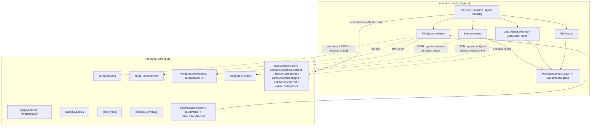

# Design Document

## Overview

The mutant engine is the `trick-or-test` npm package in `packages/engine`. It attacks a Target_Project with two kinds of mutants, mechanical mutants from StrykerJS and spec mutants (Oathbreakers) written by a Kiro agent, runs the Target_Project's own Vitest suite against each one, and reports which acceptance criteria of a Kiro spec would notice a broken promise.

The engine makes no LLM calls (ADR 0004): spec mutants arrive as files under `<mutants dir>/<spec name>/`, already written by an agent session. The engine's job is to validate, apply, witness, run and report them, and to drive StrykerJS for the mechanical half.

Three findings from exploratory runs against `examples/pricing` shape this design and are treated as hard constraints, not implementation details to revisit later:

1. **Mechanical attribution is single-run.** StrykerJS with `disableBail` already runs every test against every mutant and records `killedBy` per mutant plus `testFiles` on the report. A second run to separate "would examples alone kill this" from "would properties alone kill this" is unnecessary and would double the mutation run time for no new information: the same `killedBy` list, split by test classification, answers both questions.
2. **Witnesses must run inside the target's Vitest, not plain Node.** The target project's test files use extensionless imports and TypeScript syntax that only resolve through the project's own Vite/Vitest transform pipeline; a plain `node witness.ts` fails to resolve those imports. Vitest also swallows `console.log` output from passing tests, so the witness cannot report its outcome by printing. It must write the outcome to a file that the engine reads back.
3. **Spec mutant attribution is also single-run per mutant.** One Vitest run with the JSON reporter per spec mutant produces the list of failing tests; examples-only, properties-only, both and unattributed are computed by classifying each failing test after the fact, never by running an examples-only suite and a properties-only suite separately.

### Design decisions added with the latest requirements

- **One run attacks exactly one spec.** The CLI chooses the spec in the load stage with the pure function `selectSpec(specNames, requested?)` (Requirements 9.5, 9.16): with `--spec <name>` it attacks that spec; without the option it attacks the only spec directory that has a `requirements.md`; when several such directories exist and `--spec` is absent, it fails with an error that lists the names and asks for `--spec <name>`. The shell supplies the directory listing, so the function does no file system access. Because a run covers one spec, criterion ids (`<requirement>.<criterion>`) and mutant ids keep their plain format and are unique within the run, and the report, verdict and history layout carry no spec qualifier.
- **Paths in outputs are project-relative, produced in the core.** The core receives the project root as plain data and relativizes at report construction (Requirement 8.17). Absolute paths exist only in the shell and at run time.
- **Symlinks in a Sandbox.** A symbolic link whose target resolves inside the Target_Project is recreated in the Sandbox as a relative link to the corresponding location inside the Sandbox. A symbolic link whose target resolves outside the Target_Project is skipped (not copied) and a warning is logged. Skipping is chosen over rewriting because a link that leaves the project has no meaningful counterpart inside the Sandbox (Requirements 5.17, 5.18).

### Design decisions added for the viewer and the MCP server

The viewer and the coming MCP server read the three files and derive nothing. Seven decisions follow from that.

- **One set of mutant ids per run (Requirement 8.21).** `buildMutationReport`, `buildVerdict` and `buildHistoryRecord` all take the same list of mutants after the Twin removal. The function that removes Twins (today inside `buildMutationReport`) becomes one exported pure function, `dropTwins(mutants): { kept; twinsMerged }` in `core/twins.ts`. Each of the three builders calls it on the raw list it receives, so the three outputs agree whatever the caller passes, and `dropTwins` is idempotent (a list without Twins comes back unchanged), which keeps the committed tests of the Mutation_Report valid. `buildVerdict` gets the raw list, so it computes `twinsMerged` and `strykerCounts` from the list *before* `dropTwins` itself, as data in the file, and no reader subtracts. Rule 8.15 itself does not change.
- **Two totals with two names (Requirements 8.22 to 8.24).** `mutantCounts` describes the files: kind by status, Twins excluded, plus `twinsMerged`. `strykerCounts` describes the StrykerJS run: `detected` (Killed plus Timeout), `undetected` (Survived), `total` (every produced Mechanical_Mutant, Twins and CompileError ones included). `total` is not the denominator of the StrykerJS score (that is `detected + undetected`); the schema description says so. The two fields share no key name.
- **The Baseline_Run keeps its tests (Requirements 6.11 to 6.13).** `SuiteResult` already holds every test with name, file, status and start line. The CLI keeps the passed ones as `BaselineTest[]`, classifies each with `classifyTest` (the body comes from `extractTestBody`, as for killing tests), and `buildVerdict` writes them as `baselineTests`. The id is built by the same function that builds the id of a killing test, `toTestId(file, fullName)`, so the two formats cannot drift.
- **Claims are read above the call, not inside it (Requirement 11).** `extractTestBody` starts at the start line and never sees the lines above. A second pure function, `extractLeadingComments(fileText, startLine)`, reads upward from `startLine - 1` while the lines are comment lines. Everything after that is pure functions over strings (`parseClaimComments`, `resolveClaimRefs`, `computeClaimOutcome`), so the parsing has property tests and no adapter. A comment above a `describe` is not inherited, because the reader only looks above the test's own start line. `it.each` and `test.each` need no special case: Vitest reports one start line for every generated test, so every generated test reads the same lines.
- **Scope is data on every output (Requirements 8.28, 9.17 to 9.22).** `RunScope` is `"full" | "spec-only"`. The CLI passes it to the three builders, which write it in `metadata.scope`, in `HistoryRecord.scope` and in the Mutation_Report `config`. A spec-only run never calls the Stryker adapter or git, and builds no Mechanical_Mutant list, so `mutantCounts.mechanical`, `strykerCounts` and strays are absent, not zero. An absent `scope` means `full`.
- **History comparison across scopes (Requirement 8.30).** `selectComparisonRecord(records, scope)` is pure. A `full` run compares with the latest earlier `full` record, so the mechanical ids a spec-only record lacks are never reported as newly killed by the next full run. A `spec-only` run compares with the latest earlier record of any scope, on Spec_Mutant ids only, so a hunt that starts after a full run reports only what the hunt killed. A Spec_Mutant that a spec-only run killed is therefore newly killed again in the next full run, relative to the last full record. That is the meaning "since the last full run".
- **A test for a Witness is a string function (Requirement 12).** `buildWitnessTest` lives in `core/witness-test.ts`, is re-exported from `trick-or-test/report`, uses no `node:` import (it computes the relative import path itself, on `/`-separated strings), and prints the arguments and the expected value as readable JSON text, two-space indented, placed directly in the source as a JavaScript expression. Only a value that holds the key `__proto__` at some depth falls back to the `JSON.parse("...")` form, because a literal would set a prototype instead of an own property, as the mutant file does not.

## Architecture

The engine follows ADR 0005 (functional core, imperative shell). The core is deterministic, synchronous, and free of file system, process, and network access. The core imports nothing from `node:` except `node:crypto` in `core/mutant-id.ts`, where `createHash('sha256')` is a pure function of its input. Everything that touches the outside world (the file system, child processes, StrykerJS, Vitest, git and operating-system signals) is an adapter or shell code behind a small interface that the core depends on through a parameter, never an import.



The CLI (`packages/engine/src/cli/`) is the only orchestrator. It calls adapters to gather raw data, passes that data into core functions, and calls adapters again to write output. No core function is aware that StrykerJS, Vitest, or the file system exist.

### Run sequence

```mermaid
sequenceDiagram
    participant CLI
    participant Git as GitAdapter
    participant FS as FileSystemAdapter
    participant Core as Functional core
    participant Stryker as StrykerAdapter
    participant Vitest as VitestAdapter

    CLI->>CLI: install SIGINT/SIGTERM handlers
    CLI->>FS: remove leftover .trickortest/sandboxes/*
    CLI->>FS: read trickortest.config.json
    CLI->>Core: validateConfig(raw)
    CLI->>FS: list spec directories that contain requirements.md
    CLI->>Core: selectSpec(specNames, requested?)
    alt several specs and no --spec, or --spec names no spec
        CLI->>CLI: print error that lists the spec names and asks for --spec name to stderr, exit 1
    else one spec chosen
        CLI->>FS: read requirements.md
        CLI->>Core: parseRequirements(text, filePath)
        CLI->>FS: read mutants/spec-name/*.json, skipped.json
        CLI->>Core: validateSpecMutants / validateSkipFile / checkCrossFileRules
    end
    alt a requirements file, mutant file or skip entry is invalid
        CLI->>CLI: report errors in seconds, no baseline, no StrykerJS
    else all valid
        CLI->>Vitest: run baseline suite once, with --exclude '.trickortest/**' (records duration)
        Vitest-->>CLI: baseline result (file-level failures count as Failing_Tests)
        alt baseline has a Failing_Test
            CLI->>CLI: abort, print failing tests, no Verdict_File
        else baseline passes
            opt --since <ref> given
                CLI->>Git: git diff --relative, limited to the project, paths relative to it
                CLI->>Core: parseChangedRanges(diff, sourceGlobs)
            end
            CLI->>FS: list project directories and symlinked directories
            CLI->>Core: buildRootsOf(project-relative source globs, test globs, test files of the Baseline_Run), in core/stryker-exclusions.ts
            CLI->>Core: computeStrykerExclusions(listing, buildRoots), only when buildRootsOf gave an answer (no wildcard or `..` in the first segment of a glob)
            CLI->>Stryker: run once (incremental, disableBail, JSON reporter, vitest runner, files in .trickortest/)
            Stryker-->>CLI: mutants with locations + killedBy + testFiles, or an error line
            CLI->>Core: findUnrunTestFiles(test files of the Baseline_Run, testFiles keys of the StrykerJS report)
            CLI->>FS: remove StrykerJS temp dir (also on failure)
            CLI->>FS: create pristine Sandbox under .trickortest/sandboxes/
            CLI->>Vitest: run all witnesses of the spec on the original code (one run, one outcome file per mutant)
            CLI->>FS: read original outcomes, remove pristine Sandbox
            loop each Spec_Mutant
                CLI->>Core: planSandboxCopy(listing, outputDir) then FS copies the plan
                CLI->>Core: applyMutation(source, mutant)
                CLI->>Vitest: typecheck sandbox
                CLI->>Core: compare original outcome with expected (InvalidWitness, keeps both outcomes)
                CLI->>Vitest: run this mutant's witness in the sandbox (witness config, outcome file, timeout)
                CLI->>Core: compare mutated outcome with original outcome (Ghost; a witness timeout is a difference)
                alt witness shows a difference
                    CLI->>Vitest: run suite in sandbox with --exclude '.trickortest/**', JSON reporter, suite time limit (one run)
                end
                CLI->>FS: remove Sandbox
            end
            CLI->>Core: classifyTest, computeKillClass, computeCoverage
            CLI->>Core: buildMutationReport, buildVerdict, buildHistoryRecord (project root passed as data)
            CLI->>FS: write report, verdict; append one line to history.jsonl
        end
    end
    Note over CLI: On SIGINT/SIGTERM at any point: kill child process groups, remove sandboxes, exit 130/143
```

## Components and Interfaces

### Core (pure, `packages/engine/src/core/`)

| Module | Exports | Responsibility |
| --- | --- | --- |
| `config.ts` | `validateConfig(raw: unknown): Result<EngineConfig, ConfigError>`, `resolveConfigPaths(config, projectRoot)` | Requirement 1. zod schema with defaults; resolving paths is a pure string-join function given a root. Only a missing file gives defaults, and that decision is made by the caller, which does not call `validateConfig` for a missing file. `validateConfig(null)` (a file that parses to JSON `null`) is an error that names the file, as is any other non-object value. |
| `select-spec.ts` | `selectSpec(specNames: string[], requested?: string): Result<string, SpecSelectionError>` | Requirements 9.5, 9.16. Pure. `specNames` is the list of spec directories that contain a `requirements.md`, supplied by the shell from a directory listing. When `requested` is given and is in the list, it returns `requested`; when `requested` is given and not in the list, it returns an error that lists the names. When `requested` is absent and the list has exactly one name, it returns that name. When `requested` is absent and the list has more than one name, it returns an error whose message lists the names (sorted) and asks for `--spec <name>`. When the list is empty, it returns an error that says no spec was found. The CLI prints the error message to stderr and exits with code 1. |
| `requirements.ts` | `parseRequirements(text: string, filePath: string): Result<Criterion[], ParseError>` | Requirement 2. Line-oriented Markdown scan; no file I/O. A Criterion is identified by its plain id `<requirement>.<criterion>`. A repeated id is a plain duplicate-id error that names the file, the id and both line numbers (2.5). Lines inside a fenced code block (opened by ``` or ~~~ and closed by a fence of the same character) are neither headings nor criteria. |
| `species.ts` | `classifySpecies(mutatorName: string, replacementText: string): Species` | Requirement 3.11-3.13, 8.14. Table lookup, total function, loaded from `.kiro/steering/bestiary.md` species table (embedded as a data constant checked against the steering file by a unit test, not parsed from Markdown at run time). |
| `mutation.ts` | `applyMutation(source: string, mutant: SpecMutant): Result<{ mutated: string; span: Span }, NotApplicableError>`, `revertMutation(mutated: string, mutant: SpecMutant, span: Span): string` | Requirement 5.2. Pure string surgery: find `original` text, require exactly one occurrence. The returned `Span` holds the character offsets and the `Location` (1-based start and end line and column, the convention of `mutation-testing-report-schema` and of StrykerJS), so the 8.15 same-change check compares like with like. |
| `spec-mutants.ts` | `validateSpecMutant(raw: unknown, filePath: string): Result<SpecMutant, LoadError>`, `validateSkipFile(raw: unknown, filePath: string): Result<SkipEntry[], LoadError>`, `checkCrossFileRules(specName, mutants, skipEntries, criteria): LoadError[]`, `isSafeRelativePath(p: string): boolean`, `isSafeMutantId(id: string): boolean` | Requirement 4. Per-file validation is pure. `validateSpecMutant` rejects (4.11) a `file` or `witness.from` that is absolute (POSIX `/`, Windows drive letter or UNC prefix, or a leading `~`), contains a `..` segment, contains a backslash or a NUL character, or is empty; and rejects (4.12) an `id` that does not match `^[A-Za-z0-9._-]+$` or contains `..`. Each error names the mutant file and the field. Cross-file checks (duplicate id within one spec, requirement exists in that spec, 4.9's strict skip-vs-mutant rule) take the already-loaded list of the one spec under attack. A duplicate id is a plain error that names both files (4.5). |
| `sandbox-plan.ts` | `resolveInside(root: string, relative: string): Result<string, PathEscapeError>`, `planSandboxCopy(entries: ProjectEntry[], outputDirRelative: string): CopyPlan` | Requirements 5.17-5.19. `resolveInside` joins and normalizes and fails when the result is not inside `root`; the sandbox adapter calls it for every write. `planSandboxCopy` takes a listing of project entries (`{ path, kind: 'file' \| 'dir' \| 'symlink', target?: string }`, all project-relative, with symlink targets already resolved by the shell and expressed relative to the project root) and returns, for each entry, `copy`, `skip` or `link` (with the relative link target inside the Sandbox). It always skips `node_modules`, `.git`, `.trickortest`, `.stryker-tmp` and exactly the entry whose project-relative path equals `outputDirRelative`; a directory with the same name at another depth (`src/reports/` when the output directory is `reports`) is copied. A symlink whose resolved target is outside the project is `skip`; one inside is `link`. |
| `stryker-exclusions.ts` | `buildRootsOf(sourceGlobs: string[], testGlobs: string[], baselineTestFiles: string[]): string[] \| undefined`, `computeStrykerExclusions(listing: ProjectEntry[], buildRoots: string[]): { nonBuildDirs: string[]; symlinkedDirs: string[]; ignorePatterns: string[] }` | Requirements 3.7, 3.8, 3.22. `buildRootsOf` is pure and sits next to `computeStrykerExclusions`; it takes project-relative globs and project-relative paths (the CLI makes the globs relative to the project root before it calls it) and is described under "Build roots" below. A top-level directory is a build directory when it is a Build_Root (`buildRoots`): the first path segment of a source glob, of a test glob, or of the project-relative path of a test file that the Baseline_Run ran (computed by `buildRootsOf`). WHEN `buildRootsOf` gives no answer, the CLI does not call `computeStrykerExclusions`. A test folder outside the globs, such as `extra/`, is therefore never excluded. Every other top-level directory is listed in `nonBuildDirs`; every directory entry of kind `symlink` whose target is a directory is listed in `symlinkedDirs`. `ignorePatterns` is the union of both lists, `.stryker-tmp`, `.trickortest` and the output directory, each as a glob (`<dir>/**`), sorted and de-duplicated. It is a pure function of the listing and the build roots; the shell supplies the listing. |
| `unrun-test-files.ts` | `findUnrunTestFiles(baselineTestFiles: readonly string[], strykerTestFiles: readonly string[]): { count: number; paths: string[] }` | Requirements 3.23, 3.24. Pure. Both inputs are project-relative paths with `/` separators: the test files of the Baseline_Tests and the keys of `testFiles` of the StrykerJS report. `paths` holds each path of the first set that is not in the second, de-duplicated and sorted, and `count` is its length. A path that only StrykerJS ran is ignored. The result does not depend on the order or on duplicates in either input, and the function changes neither input. It feeds the CLI summary only (9.23); no builder receives it. |
| `changed-ranges.ts` | `parseChangedRanges(diffText: string, sourceGlobs: string[]): ChangedRange[]` | Requirements 3.9, 3.10. Parses the output of `git diff --relative --unified=0` (paths already relative to the Target_Project) into `{ file, start, end }`, keeps only files that match the source globs, drops pure-deletion hunks (zero added lines), and returns them sorted by file then start line. An empty result means "no line changed". |
| `stryker-output.ts` | `extractStrykerError(output: string): string`, `shouldRetryWithIgnoreStatic(attempt: StrykerAttempt): boolean` (`StrykerAttempt = { exitCode: number; output: string }`), `parseStrykerReport(raw: unknown): Result<StrykerReport, ParseError>` | Requirements 3.5, 3.6, 3.16, 3.17. `extractStrykerError` returns the first line whose level is ERROR, or the last non-empty line when no ERROR-level line exists; it is total on any string. `shouldRetryWithIgnoreStatic` is true only when the attempt failed (non-zero exit) and its output contains the real dry-run-failure line of StrykerJS 10.1.1 (the `ERROR DryRunExecutor One or more tests failed in the initial test run` line, copied from captured output). StrykerJS prints no "static mutants" text when the dry run fails, so the retry marker is the failed dry run itself, with or without static mutants. A failure after a successful dry run is never retried (3.17). The exact log markers are copied from the captured StrykerJS 10.1.1 fixtures, not guessed. `parseStrykerReport` validates the Stryker JSON with zod and keeps each mutant's `location` (start and end line and column). |
| `suite-result.ts` | `extractFailingTests(vitestJson: VitestJson): FailingTest[]` | Requirements 3.15, 5.9, 5.10 and the Failing_Test definition. Every test with status `failed` is a Failing_Test. A test file whose status is `failed` and which has no assertion results (an error at import or collection) is one Failing_Test whose name is the file path and whose `filePath` is that file. A failed file that also has failed assertions yields only those assertions. |
| `suite-time-limit.ts` | `computeSuiteTimeLimit(baselineMs: number, timeoutMs?: number): number` | Requirement 5.15. Returns `timeoutMs` when set, otherwise `baselineMs * 1.5 + 5000`. |
| `witness-compare.ts` | `matchesExpectation(expected: WitnessExpectation, actual: WitnessOutcome): boolean`, `compareOutcomes(original: WitnessOutcome, mutated: WitnessOutcome): "same" \| "different"` | Requirements 5.6, 5.7, 5.12, 5.16. A `WitnessOutcome` is `value`, `error`, `timeout` or `no-outcome` (the outcome file was not written; it carries a message). Values are compared by deep structural equality over their JSON form (each value is serialized and parsed before comparison), so `-0` and `0` are equal. A `timeout` or `no-outcome` never matches an expectation, and a `timeout` of the mutated code against any original outcome that is not itself a `timeout` is `different`. The caller never maps a witness `timeout` to the Mutant_Status Timeout or Killed. |
| `test-classification.ts` | `classifyTest(test: { filePath: string; bodySource: string }, propertyTestGlobs: string[]): "property" \| "example"` | Requirement 6.3-6.5. Glob match on `filePath` (the matcher expands braces, so `test/**/*.{property,prop}.test.ts` matches `test/a.property.test.ts`), or a syntactic scan of `bodySource` for a call to `fc.assert`, `fc.check`, or `test.prop`. |
| `kill-classification.ts` | `computeKillClass(killingTests: ClassifiedTest[]): KillClass` | Requirement 6.6-6.10. |
| `mutant-id.ts` | `computeMutantId(file: string, original: string, replacement: string, occurrenceIndex: number): MutantId` | Requirement 8.7. Used for Mechanical_Mutants only. `test/core/mutant-id.test.ts` checks only the 32-character hex format of the id. One exact-id pin test for a fixed input lives with the CLI-phase tests. Content hash computed with `createHash('sha256')` from `node:crypto` (hex-truncated), never a hand-written hash, never a timestamp and never a line number. The `occurrenceIndex` is the Occurrence_Index: the 0-based position of the mutant among all Mechanical_Mutants with the same file, original text and replacement, ordered by location (start line, then start column, using the real location StrykerJS reports). It keeps two mutants with the same file, original text and replacement at different locations apart. `computeMutantId` does not compute the index. The pure helper `assignOccurrenceIndexes(mutants): Map<…, number>` in `core/occurrence.ts` (no `node:` import) groups the Mechanical_Mutants by (file, original, replacement), sorts each group by line then column, and returns each mutant's position in its group; the CLI passes the positions in. Because the index depends only on the order inside a group, ids stay stable when unrelated lines move. `core/mutant-id.ts` is the only core module that imports from `node:`. Spec_Mutants do not pass through this function: a Spec_Mutant keeps the id from its file (`oath-<criterion>-<slug>`), which Requirement 4.5 makes unique. The CLI passes the ids to `report.ts` as data, so `report.ts` does not import `mutant-id.ts`. |
| `coverage.ts` | `computeCoverage(criteria: Criterion[], mutantResults: MutantResult[], skipEntries: SkipEntry[]): CriterionCoverage[]` | Requirement 7. Called once per run with the criteria, results and skip entries of the one spec under attack. |
| `paths.ts` | `relativizePath(projectRoot: string, p: string): string`, `scrubAbsolutePaths(text: string, projectRoot: string): string`, `containsAbsolutePath(text: string): boolean` | Requirement 8.17. `relativizePath` turns a path under the root into a project-relative path with `/` separators and turns any other absolute path into `<outside-project>/<basename>`. `scrubAbsolutePaths` applies the same rule to every absolute path found inside free text (error messages, mutant descriptions, NotApplicable read errors, NoOutcome messages). `containsAbsolutePath` is the detector the property test and the e2e test use (a POSIX path starting with `/` that is not part of a URL, or a Windows drive or UNC path). |
| `report.ts` | `buildMutationReport(input): MutationTestingReport`, `buildVerdict(input): Verdict`, `buildHistoryRecord(verdict, previousRecord): HistoryRecord`, `serializeHistoryRecord(record): string`, `parseHistoryLines(text): Result<HistoryRecord[], HistoryError>` | Requirement 8. The `input` of the builders includes `projectRoot` as plain data and every builder relativizes every path and scrubs every free-text field through `paths.ts` before it creates a field, so no builder can emit an absolute path (8.17). `serializeHistoryRecord` returns the record as a single-line JSON object with no embedded newline. `parseHistoryLines` parses each non-empty line as one complete JSON object, in order, and returns an error that names the line number for a malformed line. The History_File `history.jsonl` is JSON Lines: one HistoryRecord per line, and appending a run adds exactly one line and leaves earlier lines unchanged (8.8, 8.9, 8.16). Each record is validated with its zod schema before the line is appended (8.10). The viewer (bestiary-viewer spec) reads exactly this format through `trick-or-test/report`. `buildMutationReport` records whether the `ignoreStatic` retry happened in the schema's free-form `config` object (Requirement 3.5), and `buildVerdict` records it in `ignoreStaticRetried`. It writes the start and end line and column of each Mechanical_Mutant from the Stryker data into the schema `location` (3.16), and the span's location for each Spec_Mutant. Takes mutant ids as input (Spec_Mutants keep their file ids, Mechanical_Mutants carry the hash computed by the CLI) and never computes them. Deduplicates same-change spec/mechanical pairs by comparing file, start and end location and replacement, not ids (8.15), maps statuses (8.3-8.4), computes newly-killed ids (8.9) from the previous history record passed in as data. For an InvalidWitness mutant it writes `originalOutcome` and `expected` into the Verdict (5.6). It also writes the criterion text and the mutated witness outcome (8.18-8.20), both taken from plain input data: `VerdictInput.coverage[i].text` holds the `text` of the matching `Criterion` returned by `parseRequirements`, and `VerdictInput.witnesses[id].mutatedOutcome` holds the `mutatedOutcome` of the matching `SpecMutantOutcome` that `cli/orchestrate.ts` already computes. The builder trims the text and passes it through `scrubAbsolutePaths`; it passes `mutatedOutcome` through the same scrubbing function as `originalOutcome`; it omits the field when the input has none. The builder reads no file and runs no witness. |
| `requirement-titles.ts` | `parseRequirementTitles(text: string, filePath: string): Result<RequirementTitle[], ParseError>` | Requirements 2.9, 2.10. Same line scan and fence rule as `parseRequirements`, but reads only `### Requirement N: <title>` headings. The title is trimmed. A repeated number or an empty title is an error that names the file, the number and the lines. It is a new module so that `parseRequirements` and the type `Criterion` stay as they are. |
| `twins.ts` | `dropTwins(mutants: ReportableMutant[]): { kept: ReportableMutant[]; twinsMerged: number }` | Requirements 8.15, 8.21. The 8.15 same-change comparison (file, start and end location, replacement, never ids), moved out of `buildMutationReport` so that the CLI removes Twins once and the three builders receive the same list. Pure; the order of `kept` is stable. |
| `totals.ts` | `computeMutantCounts(kept, twinsMerged, scope): MutantCounts`, `computeStrykerCounts(produced: { status: MutantStatus }[]): StrykerCounts` | Requirements 8.22, 8.23. `computeMutantCounts` counts the kept mutants per kind and per status (all seven statuses always present, zero when none) and omits `mechanical` for the scope `spec-only`. `computeStrykerCounts` takes every Mechanical_Mutant that StrykerJS produced, before `dropTwins`: `detected` is Killed plus Timeout, `undetected` is Survived, `total` is the length of the input. |
| `baseline-tests.ts` | `toTestId(file: string, fullName: string): TestId`, `buildBaselineTests(tests: PassedTestInput[], propertyTestGlobs: string[]): BaselineTest[]` | Requirements 6.11 to 6.13. `PassedTestInput` is `{ filePath, fullName, startLine, bodySource, status }`. It keeps the tests with status passed, classifies each with `classifyTest`, builds the id with `toTestId` (the function that also builds killing-test ids), and sorts by id and then by start line. |
| `baseline-match.ts` | `indexBaselineTests(sources: BaselineTestSource[], separator: string = " > "): BaselineTestIndex`, `matchBaselineTest(index: BaselineTestIndex, killer: KillerRef): TestId \| "none"`, `strykerSeparatorFor(vitestVersion: string \| undefined): " > " \| " "` | Requirements 6.13 to 6.17. Pure, no `node:` import. Turns the name of a StrykerJS killing test into the id of its Baseline_Test, or `"none"`. `strykerSeparatorFor` maps the installed Vitest version string to the separator that the StrykerJS runner uses. See "Matching a StrykerJS killing test to a Baseline_Test" below. `BaselineTestSource = { file: string; titles: readonly string[]; startLine: number }` (`titles` is Vitest's `ancestorTitles` followed by `title`). `KillerRef = { file: string; name: string; startLine?: number }`. |
| `claims.ts` | `extractLeadingComments(fileText: string, startLine: number): string[]`, `parseClaimComments(lines: string[], specName: string): ClaimRef[]`, `resolveClaimRefs(refs: ClaimRef[], criteria: Criterion[]): string[]`, `computeClaimOutcome(testId: TestId, criterionId: string, criteria: Criterion[], results: MutantResult[]): Claim`, `attachClaims(tests: BaselineTest[], claimIdsByTest: Map<TestId, string[]>, criteria: Criterion[], results: MutantResult[]): { baselineTests: BaselineTest[]; claimCounts: ClaimCounts }` | Requirement 11. See "Claims" below. All pure; none reads a file. The CLI builds `claimIdsByTest` by calling the first three functions for each Baseline_Test. |
| `run-scope.ts` | `selectComparisonRecord(records: HistoryRecord[], scope: RunScope): HistoryRecord \| undefined`, `scopeOf(record): RunScope` | Requirement 8.30. `scopeOf` returns `full` for a record with no `scope`. `selectComparisonRecord` implements the two rules of 8.30. `buildHistoryRecord(verdict, previousRecord)` keeps its signature; the CLI calls `selectComparisonRecord` and passes the result as `previousRecord`, and for a `spec-only` run `buildHistoryRecord` compares only Spec_Mutant ids. |
| `witness-test.ts` | `buildWitnessTest(input: { witness: Witness; criterion: CriterionId; testFile: string }): Result<string, WitnessTestError>` | Requirement 12. See "Witness test source" below. Re-exported from `trick-or-test/report`; no `node:` import. |
| `result.ts` | `Result<T, E>` union, `ok`, `err` helpers | ADR 0005. Used by every fallible core function; exceptions are reserved for programming errors. |

### Adapters (imperative, `packages/engine/src/adapters/`)

| Module | Interface it implements | Responsibility |
| --- | --- | --- |
| `file-system-adapter.ts` | `FileSystem` (`readFile`, `writeFile`, `copyPlan`, `removeDir`, `exists`, `listProject`) | All disk access. `listProject` returns the `ProjectEntry[]` listing (with `lstat` kinds and symlink targets resolved with `realpath`, expressed relative to the project root) that the core plan functions consume. Sandbox copy and teardown live here, never in the core. |
| `process-runner.ts` | `ProcessRunner.run(command, args, options): Promise<ProcessResult>`, `ProcessRunner.killAll(signal)` | Requirement 9.15. Spawns every child (Vitest, StrykerJS, tsc, git) with `spawn` and `detached: true`, so each child leads its own process group, and registers it. `killAll` sends the signal to each group with `process.kill(-pid, signal)`, then `SIGKILL` after a short grace period. The per-run `timeout` option kills the group the same way. Adapters never use `exec` or `execSync`. |
| `stryker-adapter.ts` | `MechanicalRunner.run(options): MechanicalRunResult` | Requirement 3. Owns every StrykerJS-specific detail. Builds the Stryker config object with `plugins: ['@stryker-mutator/vitest-runner']`, incremental mode, the JSON reporter, and `disableBail: true` so one run yields `killedBy` and `testFiles` for every mutant (finding 1). By default StrykerJS writes `reports/stryker-incremental.json` and `reports/mutation/mutation.json` into the target, so the adapter sets `incrementalFile`, the JSON reporter's `fileName`, and `tempDirName` to paths under `.trickortest/`; StrykerJS then writes nothing outside `.trickortest/` (3.14). It sets `cleanTempDir` to `'always'` and, in a `finally`, removes the temp dir itself, so a failed run leaves no `stryker-tmp` behind (3.19). Sets `tsconfigFile` to a nonexistent path only when the resolved TypeScript is 7 or newer (the TS7 workaround belongs here, not in the core, because it depends on reading the target's installed TypeScript version). Runs the binary found in `node_modules/.bin/stryker`, searched from the Target_Project root upward through its ancestors (npm workspaces hoist it to the repository root); when none is found it runs `npx --no-install stryker`, so `npx` never downloads a package (3.18). Builds `mutate` patterns as `file:start-end` from the `ChangedRange`s given by `parseChangedRanges` when `--since` is given (paths already relative to the Target_Project root), and reports zero mutants without invoking Stryker when the list is empty (3.9, 3.10). Passes `computeStrykerExclusions(listing, buildRoots).nonBuildDirs` (the `buildRoots` come from `buildRootsOf` in `core/stryker-exclusions.ts`, which includes the folders of the Baseline_Run test files, 3.22; WHEN it gives no answer the exclusions are not computed and no folder is excluded) through Stryker's sandbox exclusion (`ignorePatterns`) together with the detected `symlinkedDirs` (3.7) and `.stryker-tmp` (3.8). Reads each mutant's `location` from the Stryker JSON through `parseStrykerReport` and keeps it in `MechanicalMutant.location` (3.16). Retry: when the first attempt fails, it calls `shouldRetryWithIgnoreStatic`; it is true when the output shows the failed initial test run. Only then does the adapter run exactly once more with `ignoreStatic: true` and flag `ignoreStaticRetried` in its result (3.5). A failure after a successful dry run is returned as an error without a retry and without the flag (3.17). A non-retryable error returns `extractStrykerError(output)` of the first attempt, and a failed retry returns `extractStrykerError` of the retry's output, as a `Result` error, with no Verdict_File (3.6). Its tests use captured real StrykerJS 10.1.1 output (see Testing Strategy). |
| `vitest-witness-runner.ts` | `WitnessRunner.run(sandboxRoot, witnesses): Record<MutantId, WitnessOutcome>` | Requirement 5.4-5.7, 5.16. Witnesses run twice per mutant: once on the original code and once on the mutated code, because 5.6 (InvalidWitness) needs the original outcome and 5.7 (Ghost) compares the two. First, one Vitest run in one pristine sandbox executes every witness of the spec against the original code. Then each mutant's witness runs alone in that mutant's own sandbox after the mutation is applied. For each witness the adapter generates one file, `.trickortest/witnesses/<mutant id>.witness.test.ts`, inside the sandbox; the id is already validated as a safe file name by the loader (4.12) and the path goes through `resolveInside` before writing. It imports the witness's `export` from `witness.from`, calls it with `witness.args`, and writes the JSON-serialized outcome (`{ kind: 'value', value }` or `{ kind: 'error', className }`) to its own outcome file `.trickortest/witnesses/<mutant id>.outcome.json`. It never prints the outcome, because Vitest hides console output of passing tests. If the process exceeds the witness time limit, the adapter kills it and returns `{ kind: 'timeout' }`; if the outcome file is missing or does not parse, it returns `{ kind: 'no-outcome', message }`. A witness `timeout` on the mutated code is a difference, handled by `compareOutcomes` (5.16); the Mutant_Status Timeout comes only from the suite time limit (5.11). The generated files stay out of the target's test globs, and are generated under `.trickortest/`, which every suite run excludes (5.21). They run through a generated Vitest config, `.trickortest/witnesses/vitest.config.ts`, that extends the target's config (so `resolve`, aliases and transforms match, and extensionless imports and TypeScript syntax resolve as in the tests) but sets `include` to only the witness files (finding 2). |
| `vitest-suite-runner.ts` | `SuiteRunner.run(root, options): SuiteResult` where `SuiteResult` holds `durationMs`, `failingTests: FailingTest[]` and, per test file, each test's name, status and start line | Requirement 3.15, 3.20, 5.8-5.11, 5.15, 5.21, 6.2, 9.1. Runs the target's own Vitest config with the JSON reporter and `includeTaskLocation` enabled, so each test carries its start line, and always passes `--exclude '.trickortest/**'` (in addition to the config's own excludes), so neither the Baseline_Run nor a Sandbox run executes a StrykerJS sandbox, a generated witness file or a copied Sandbox (3.20, 5.21). The adapter reads the JSON reporter output file and gives it to `extractFailingTests`, so a test file that fails to load counts as a Failing_Test named after the file: it fails the baseline and kills a mutant. It runs once for the baseline, whose duration is recorded. `SuiteTest` and `SuiteFile` do not change. `SuiteResult` gets one optional field `testTitles?: readonly (readonly (readonly string[])[])[]`, parallel to `files`: `testTitles[k][i]` is the list of titles (Vitest's `ancestorTitles` followed by `title`, parsed with zod) of `files[k].tests[i]`, and the entry of a file-level failure is the empty list. The real runner always sets it, with one list per file and one entry per test, so that a StrykerJS killing test can be matched to a Baseline_Test (Requirement 6.14). It runs once per spec mutant (finding 3) with the suite time limit passed as the process timeout; when the limit is exceeded the process group is killed and the result is `timedOut: true`. The time limit is the baseline duration times 1.5 plus 5 seconds, the same formula StrykerJS uses, unless `timeoutMs` is set in the config, which replaces it (1.1, 1.7, 5.15). The limit is computed by the pure function `computeSuiteTimeLimit(baselineMs, timeoutMs?)` in the core. |
| `test-body-extractor.ts` | `extractTestBody(fileText: string, startLine: number): string` | Requirement 6.2-6.4. See "Test bodies" below. |
| `git-adapter.ts` | `Git.diff(ref, projectRoot): string` | Requirement 3.9-3.10. Runs `git -C <projectRoot> diff --relative --unified=0 --no-color <ref> -- .`: `--relative` makes paths relative to the Target_Project even when it is a subdirectory of a larger repository, and the `.` pathspec limits the diff to that directory. The adapter returns the text; `parseChangedRanges` (core) filters it by the source globs. A git failure becomes a `Result` error naming the ref. Requirement 3.21: git exports `GIT_DIR`, `GIT_WORK_TREE`, `GIT_INDEX_FILE` and related variables to a hook, and in a linked worktree `GIT_DIR` is an absolute path, so a child git process that inherits them ignores `-C` and the working directory and reads the repository the variable names. The environment of every git child is therefore built by the pure function `withoutGitLocation(env: Readonly<Record<string, string \| undefined>>): Record<string, string \| undefined>` in `core/git-env.ts`. It returns a copy of `env` without the nine variables `GIT_DIR`, `GIT_WORK_TREE`, `GIT_INDEX_FILE`, `GIT_OBJECT_DIRECTORY`, `GIT_ALTERNATE_OBJECT_DIRECTORIES`, `GIT_COMMON_DIR`, `GIT_NAMESPACE`, `GIT_CEILING_DIRECTORIES` and `GIT_DISCOVERY_ACROSS_FILESYSTEM`, matched by exact name (case-sensitive), and leaves every other variable, including other `GIT_*` ones such as `GIT_AUTHOR_NAME`, unchanged. It does not modify its argument. `RunOptions` of `ProcessRunner` gets an optional `env`, passed to `spawn`; when absent the child inherits `process.env` as before. `runGit` in `git-adapter.ts` (used by `Git.diff` and `Git.currentCommit`) and the `rev-parse HEAD` call in `cli/main.ts` both pass `env: withoutGitLocation(process.env)`. No other code spawns git. |
| `sandbox.ts` | `Sandbox.create(projectRoot, id, options): SandboxHandle`, `Sandbox.destroy(handle)`, `Sandbox.removeLeftovers(projectRoot)` | Requirements 5.1, 5.13, 5.17-5.20. `examples/pricing` has no `node_modules` of its own: npm workspaces hoist `vitest` and `typescript` to the repository root, so a copy in the system temp directory could not resolve them. Each sandbox is therefore created inside the target project, at `.trickortest/sandboxes/<id>/`, so module resolution walks up to the same `node_modules` folders as the original. The copy follows the `CopyPlan` from `planSandboxCopy`: it excludes `node_modules`, `.git`, `.trickortest`, `.stryker-tmp` and the configured output directory by its project-relative path only (5.19). Before every write (file, directory, link, mutated file, generated witness file) the adapter calls `resolveInside(sandboxRoot, relative)` and aborts the copy with an error when the path would leave the Sandbox (5.17). Symlinks follow the plan: a link pointing inside the project is recreated as a relative link inside the Sandbox, a link pointing outside is skipped (5.18). The adapter also writes `.trickortest/.gitignore` containing `*`, so any target ignores the engine's working files. `destroy` runs in a `finally`, so a failing, timing-out, or crashing mutant run never leaves a sandbox behind or touches the real working tree. `removeLeftovers` deletes everything under `.trickortest/sandboxes/` and is the first action of every run (5.20). |
| `typecheck-adapter.ts` | `Typecheck.run(sandboxRoot): Result<void, CompileError>` | Requirement 5.3. Runs `tsc --noEmit` (or the target's configured type-check command) against the sandbox. |

### CLI (`packages/engine/src/cli/`)

Two commands, `run` and `measure`, parsed with a minimal, dependency-free argument parser (no new runtime dependency, per `tech.md`). Both commands call the same orchestration function with a different output directory; `measure` always targets the configured output path meant for `reports/`. The repository root `package.json` defines the npm script `measure`, which runs the built CLI as `trick-or-test measure --project examples/pricing --spec cart-pricing` with the output directory `reports` (Requirement 9.12). After it finishes, `reports/` holds the Mutation_Report, `verdict.json` and `history.jsonl` (9.13). Files in `reports/` are generated only through `measure` and are never edited by hand (9.14). The CLI never changes its exit code based on survivors (Requirement 9.7-9.8): exit 0 for a completed run regardless of survivors, exit 1 for configuration, parsing, baseline, StrykerJS, or runtime errors, exit 1 with usage text for an unknown command or option.

**Build roots (Requirement 3.22).** `buildRootsOf(sourceGlobs, testGlobs, baselineTestFiles)` in `core/stryker-exclusions.ts`, next to `computeStrykerExclusions`, is a pure, exported function with no I/O. It takes project-relative globs and project-relative paths; the CLI (`cli/orchestrate.ts`) makes the globs relative to the project root before it calls the function, as it does today. When the first path segment of every source glob and every test glob is a plain name, it returns the sorted, de-duplicated union of the first path segment of each source glob, the first path segment of each test glob, and the first path segment of each project-relative path in `baselineTestFiles`. **No answer.** WHEN the first path segment of any source glob or test glob holds a wildcard (for example `**/*.test.ts`) or points outside the project (`..`), the function gives no answer and returns `undefined`, whether or not `baselineTestFiles` holds files. The exclusions are then not computed: the CLI does not call `computeStrykerExclusions` and excludes no folder from the StrykerJS sandbox (3.22). A path with no `/` (a test file at the project root) contributes its own file name, so it adds no folder to the Build_Roots that `computeStrykerExclusions` could keep or drop. `baselineTestFiles` are the files of the `SuiteResult` of the Baseline_Run that hold at least one Baseline_Test, as the CLI already has them when it builds `sources`. The cause of the old defect was that StrykerJS's sandbox excludes every other top-level folder, so the Guard_Test `extra/guard-7.4.test.ts` that `npm run demo` adds was missing there (the Baseline_Run ran 55 tests, StrykerJS 47). The Guard_Test stays in `extra/` and `scripts/demo.ts` does not change; the fix is that the folder is now a Build_Root.

**Test files outside the StrykerJS run (Requirements 3.23, 3.24, 9.23).** After a successful StrykerJS run of Run_Scope `full`, `cli/orchestrate.ts` calls `findUnrunTestFiles(baselineTestFiles, strykerTestFiles)`, where `strykerTestFiles` are the keys of `testFiles` of the parsed StrykerJS report made project-relative. The summary prints exactly one line `test files outside the StrykerJS run: N`, and when N is greater than zero it prints the paths after that line, one per line, in the sorted order that the function returns. The line is printed only when StrykerJS ran (Requirement 9.25). A `spec-only` run calls neither the function nor prints the line, and a `full` run that started no StrykerJS (`--since` with no changed source line, 3.10) also prints no line, because a count of 0 would read as a confirmation that StrykerJS saw every test file. The result goes to the summary only: `Verdict`, `MutationTestingReport` and `HistoryRecord` get no field, no schema changes, no Mutant_Status changes, and the run never fails or exits with another code because of it. The line avoids the words "not run" on purpose: a `spec-only` run prints `Strays: not run`, and a committed test checks that a full run never prints those words.

**Run scope (Requirements 9.17 to 9.22).** `--scope <full|spec-only>` is parsed by the same argument parser, with `full` as the default, and is accepted by `run` and `measure`. A value other than the two prints the usage text and exits with code 1, and `--scope spec-only` with `--since` is an error that names both options, also exit 1. For `spec-only` the orchestration function skips the stages "git diff", "list project directories", "computeStrykerExclusions" and "Stryker run" of the run sequence, and goes from the Baseline_Run to the pristine Sandbox. It passes `scope` to the builders, passes no Mechanical_Mutants (so no strays, no `strykerCounts`, no `mechanical` counts), and the summary prints `scope: spec-only`, `strays: not run` and no StrykerJS figure. Everything else (InvalidWitness, Ghost and suite run per Spec_Mutant, and the writing of the three files) is the same. The root npm scripts `measure` and `demo` do not pass `--scope`. The purpose is a run of seconds for an agent that hunts one surviving Spec_Mutant; the baseline still runs, so the cost is the suite plus one suite run per Spec_Mutant. A reader tells the run apart by `metadata.scope`, `HistoryRecord.scope` and the Mutation_Report `config.scope`; none of the three states a mutation score as if it were a full one, because a spec-only report holds Spec_Mutants only.

**Project root through a symbolic link (Requirements 9.26, 9.27).** `cli/main.ts` resolves the Target_Project root with `realpath` once, right after the options are parsed and before any stage (configuration, spec selection, Baseline_Run, StrykerJS, git, the three writers). Every later stage receives only this real root, and every path that the Engine compares or writes is made relative to it. The reason is that Vitest reports physical paths: with a `--project` that named a symbolic link, the project-relative paths of the Baseline_Run began with `../../../`, the killing tests sat under `.trickortest/sandboxes/`, and `claimCounts.total` was 0 instead of 25. A project reached through a link therefore gives the same `baselineTests` ids, killing-test ids and Claim counts as the real path. IF `realpath` fails, the CLI prints an error to stderr that names the path as the user gave it, exits with code 1 and runs no stage (so no Sandbox, no StrykerJS and no file is created). The resolution is shell code; no core function reads the file system for it.

**Signal handling (Requirement 9.15).** The shell module `cli/shutdown.ts` installs one handler for `SIGINT` and `SIGTERM` at the start of `run` and `measure`. On a signal it (1) calls `ProcessRunner.killAll(signal)` so every Vitest, StrykerJS, tsc and git process group stops, (2) removes the Sandboxes the run created and the StrykerJS temp dir, through the same `Sandbox.removeLeftovers` and temp-dir removal used at normal exit, (3) exits with code 130 for `SIGINT` and 143 for `SIGTERM`. The handler is idempotent, so a second signal during cleanup does not start a second cleanup. The orchestration function does not catch the resulting rejection as a runtime error (which would exit 1). Nothing of this lives in the core. Writing the Verdict_File and the History_File is the last step of a run, so an interrupted run writes neither.

### Test bodies

`classifyTest` needs the body of each killing test. The engine gets it in three steps:

1. The line comes from the runner. Vitest's JSON reporter with `includeTaskLocation` gives each failing test's start line (Spec_Mutants). StrykerJS's report gives each test's location in `testFiles` (Mechanical_Mutants). A file-level failure (Failing_Test named after the file) has no start line and no body; it is classified by its file glob alone.
2. The adapter reads the test file and `extractTestBody` takes the text from that line to the end of the test call. A small scanner finds the end by matching brackets while it skips string literals, template literals, regular expression literals and comments. The scanner treats a `/` as the start of a regular expression when the previous token is an operator, an opening bracket, or one of the keywords `return`, `typeof`, `case`, `in`, `of`, `delete`, `void`, `throw`, `new`, `instanceof`, `yield`, `await`; otherwise it treats `/` as division.
3. The body text goes to the pure `classifyTest`.

TypeScript 7 has no JavaScript API, so the engine does not use the TypeScript compiler for this. Limit: a test that reaches fast-check only through a helper function has no `fc.assert`, `fc.check` or `test.prop` in its own body, so it is classified by its file glob alone.

### Matching a StrykerJS killing test to a Baseline_Test

**Problem.** The Baseline_Run names a test by Vitest's `fullName`, the titles joined by one space (`public API accepts typed carts`). StrykerJS names the same test by the titles joined by ` > ` (`public API > accepts typed carts`). Both went through `toTestId`, so the 86 mechanical mutants name their killing tests 987 times (987 killing-test references) with 45 distinct ids, and none of those 45 ids was in `baselineTests` and 6.13 failed, while the Spec_Mutant ids (which come from Vitest's own JSON report) agreed.

**Data that the two reports really share.**

| Datum | Vitest JSON report (Baseline_Run) | StrykerJS report |
| --- | --- | --- |
| Test file | `testResults[].name`, made project-relative by the suite runner | key of `testFiles` |
| Start line | `assertionResults[].location.line`, present with `includeTaskLocation`; the suite runner stores `0` when absent | `testFiles[file].tests[].location.start.line`. Optional in `mutation-testing-report-schema` (`TestDefinition.location`), so it can be missing; `stryker-adapter.ts` keeps it as `startLine?` |
| Title list | `assertionResults[].ancestorTitles` and `title`. Always present in Vitest's JSON, but the suite runner's zod schema reads only `fullName` today and drops them | not present: only the string `name`, the titles already joined by ` > ` |
| Name string | `fullName` (space-joined) | `name` (` > `-joined) |

**Chosen key: the list of titles (option b).** The suite runner also keeps `ancestorTitles` and `title` (a change to its zod schema), but it does not add them to `SuiteTest` or `SuiteFile`: committed test 5.9 of `test/adapters/vitest-suite-runner.test.ts` compares a whole entry, committed test 3.15 of `test/adapters/vitest-suite-runner.file-failure.test.ts` compares the whole `files` list with `toEqual`, and fourteen committed test files build `SuiteTest` entries by hand without titles and are type-checked by `tsconfig.test.json`, so a new field on those types breaks them. The titles travel beside the entries, in the optional field `SuiteResult.testTitles` (`testTitles[k][i]` is the titles list of `files[k].tests[i]`; empty for a file-level failure; always set by the real runner), and `name` stays the `fullName`. From the list, `indexBaselineTests` builds both spellings for each Baseline_Test: the space-joined one (the id, as today) and the ` > `-joined one. `matchBaselineTest` compares the StrykerJS `name` to the ` > `-joined spelling of the Baseline_Tests of the same file, by string equality. The function never rewrites the StrykerJS name, so a title that contains ` > ` (or a space) cannot be mis-split: the list is the source of both spellings and the StrykerJS name is only compared, never parsed.

**Why not (a), file plus start line, as the key.** The start line is optional in the StrykerJS report and defaults to `0` on the Vitest side, so a match that needs it fails whenever either side lacks it. Tests generated by `it.each` share one start line, so the line does not tell them apart. The name is required in the StrykerJS report and the titles are always in the Vitest report. The start line is still used, but only to resolve an ambiguity (below).

**The rule, deterministic and pure.** Let `candidates` be the Baseline_Tests whose `file` equals `killer.file` and whose ` > `-joined spelling equals `killer.name`.

1. No candidate: return `"none"`.
2. All candidates have the same id (this includes one candidate, and the duplicate-title case of 6.12, where two Baseline_Tests have the same id and so are the same answer): return that id.
3. Candidates with more than one distinct id (two different title lists that join to the same ` > ` text, such as `["a > b"]` and `["a", "b"]`): when `killer.startLine` is set, keep the candidates whose `startLine` equals it; when exactly one distinct id remains, return it. In every other case return `"none"`. The function never picks the first candidate.

The function reads no file and does not depend on the order of its inputs.

**The separator follows the Vitest version (Requirement 6.16).** The StrykerJS Vitest runner (`@stryker-mutator/vitest-runner` 10.1.1, `dist/src/vitest-test-runner.js`) joins the titles of a test with ` > ` when the installed Vitest is 5.0.0 or later, and with one space when it is earlier. The ` > ` spelling used above is therefore the rule for Vitest 5 and later only. The pure function `strykerSeparatorFor(vitestVersion)` in `core/baseline-match.ts` reads the leading run of digits of the version string as the major number. It returns `" > "` when the major number is 5 or more, `" "` when it is 4 or less, and `" > "` when the string is `undefined` or has no leading number. A prerelease of 5.0.0 (for example `5.0.0-beta.1`) has major number 5, so it gets ` > `, as in the StrykerJS runner. Only the major number is needed, so no semver dependency is added. `indexBaselineTests(sources, separator = " > ")` takes the separator as an optional second parameter whose default is ` > `, so its committed tests and Property 36 do not change. `cli/orchestrate.ts` already reads the installed Vitest version for the run metadata (`installedVersion("vitest", projectRoot)`); it passes that value through `strykerSeparatorFor` and gives the result to `indexBaselineTests`. An unreadable version gives ` > `.

**The key is trimmed as StrykerJS trims it (Requirement 6.17).** StrykerJS builds the name of a killing test with `collectTestName` (`test-helpers.js`), which returns the joined titles with `.trim()` applied. The index key of a Baseline_Test is the titles joined with the chosen separator and then trimmed the same way (leading and trailing whitespace removed). The id of the Baseline_Test is still built by `toTestId` from the untrimmed titles joined by one space, as Vitest builds `fullName`, so the id does not change. Three cases follow: a title with a trailing space (`["suite", "case "]`) gives the key `suite > case` and the id `<file>::suite case `; a title with a leading space gives the same effect on the first title; an empty title inside a `describe` (`["suite", "", "case"]`) joins to `suite >  > case` and keeps that text, and a test whose only title is empty or blank gives the empty key. Trimming can make two Baseline_Tests with different ids share a key, which the ambiguity rule above already resolves by start line or `"none"`. The matcher still never rewrites the StrykerJS name.

**Where it is called.** `cli/orchestrate.ts`, in `toOutcomes`. The Baseline_Run tests are already available there as `sources` (`{ id, file, startLine }`), so the CLI adds `titles` to its own `BaselineTestSource` (not to `SuiteTest`). The titles of test i of file k are `testTitles?.[k]?.[i]`. When `testTitles` is absent (a hand-built `SuiteResult`, as in the fakes of committed tests), the titles are the one-element list `[name]`, so the ` > ` spelling equals the name: a killer of a top-level test still matches, a non-matching killer is counted as unmatched, and no false match is possible. The CLI calls `indexBaselineTests` once, and for each killer of a Killed mechanical mutant replaces `testIdOf(test.file, test.name)` by `matchBaselineTest(index, { file: test.file, name: test.name, startLine: test.startLine })`. A spec-only run has no StrykerJS killers and does not call it. Spec_Mutant killing tests come from the Vitest report, are already in the `fullName` format and are not matched. A killer id that is missing from the StrykerJS `testFiles` is ignored (`if (test === undefined) continue` in `cli/orchestrate.ts`), because only a malformed StrykerJS report can produce it, and the committed test `orchestrate-killing-test-ids.test.ts` (entry `t9`) fixes that behaviour.

**Kill_Class must not change.** The match changes only the id. The kind that feeds `computeKillClass` is still computed from the StrykerJS test as today: `classifyTest` on the file and on the body that `extractTestBody` reads at the StrykerJS start line, so no Kill_Class (examples-only, properties-only, both, unattributed) of any mechanical mutant can change by construction. Two checks make this explicit. An example test asserts, on the captured Stryker fixture with the Baseline_Run of the same project, that for every matched killer the `kind` of the Baseline_Test equals the kind that `classifyTest` gives from the StrykerJS data, and it lists the killers where they differ (there must be none). Task 22 compares the `killClass` of every mutant of `reports/verdict.json` before and after the regeneration: the ids of the killing tests change, the Kill_Class values do not.

**A killer with no Baseline_Test.** When the function returns `"none"` (for example the test was skipped in the Baseline_Run), `toOutcomes` keeps the StrykerJS-style id `toTestId(file, name)` for it, as today, and does not fail the run. It counts each case, one for every pair (mutant, killing test) with no match. The count goes to the optional Verdict field `unmatchedKillingTests` (an integer of at least 0; optional in `verdictSchema` as the other new fields, 8.29; absent in a `spec-only` run, which has no mechanical killers) and to one line of the CLI summary, `killing tests outside the baseline: N`, printed for a full run. The agreement test of task 22.1 and the end-to-end check of 10.15 fail when `unmatchedKillingTests` is above zero or, in a full run, absent, so the case cannot pass in silence.

**Claims are not affected.** Claims read the killing tests of Spec_Mutants only (11.11, 11.16), and those ids do not go through the match. The claim numbers (25 claims: 17 held, 7 not held, 1 unchecked, 0 unknown-criterion) do not change.

### Claims

A test says in a comment which Criterion it validates. In the committed example the comment looks like this, above the test call:

```ts
  // Feature: cart-pricing, Property 9: Breakdown invariants
  // **Validates: Requirements 5.5, 7.3, 7.4**
```

The engine reads these lines in four steps. Steps 1 to 3 are pure functions in `core/claims.ts`; the shell only supplies the file text.

1. `extractLeadingComments(fileText, startLine)` splits the text into lines and walks upward from line `startLine - 1`, collecting lines that are comment lines (`//`, or a line inside a `/* ... */` block, including ` * ` and ` */`), and stops at the first blank line or line of code. It returns the collected lines in file order with the comment markers and surrounding `*` characters removed. A `startLine` of 1 or less returns an empty list. Because it reads only above the start line, a comment above a `describe` is not seen by the tests inside it (11.8), and every test that `it.each` generates, which Vitest reports at the same start line, reads the same lines (11.9).
2. `parseClaimComments(lines, specName)` looks for a `Feature:` line and `Validates:` lines in the collected lines. Other lines are ignored, wherever they stand (11.7). If a `Feature:` line names a spec other than `specName`, it returns an empty list (11.2). Without a `Feature:` line the claims count (11.10). It returns `ClaimRef[]`: `{ kind: "criterion"; id: string }` for `N.M` and `{ kind: "requirement"; number: number }` for `N`. The id list is read with one regular expression per token (`^\d+(\.\d+)?$`) after splitting on commas, spaces and the word `and`; reading stops at the first token that is none of those (11.3). Before that test, a token of the form `N.M` followed directly by one or more of the marks `.`, `;`, `:`, `)` or `]` counts as that id, and the list ends after it: `7.3, 7.4.` gives 7.3 and 7.4, and `(Requirements 5.1, 5.2)` gives 5.1 and 5.2. A whole requirement `N` followed by a mark is not an id and ends the list, because `5.` may be a criterion id that was cut short and the reader does not guess: `Requirements 2.1, 5.` gives 2.1 only. A token such as `7.4.1` or `7.4x` is not an id and ends the list. Leading zeros and signs make a token invalid.
3. `resolveClaimRefs(refs, criteria)` turns the refs into a list of criterion id strings. A requirement ref expands to the ids of all Criteria of that requirement in document order (11.4). An id or requirement number that the spec lacks stays as written, so it can become `unknown-criterion` (11.5). Duplicates collapse to the first occurrence (11.6).
4. `computeClaimOutcome` applies 11.11 to one test and one criterion id. It reads the valid Spec_Mutants of the criterion from the `MutantResult` list (a mutant is valid by 7.6) and their `killingTests`. It does not use the criterion's Coverage_Status. A Timeout mutant has no killing test, so the test does not hold on it, and for `otherTestsKilledAll` a Timeout counts as killed. `attachClaims` applies this step to every claim id of every Baseline_Test, adds the claims to the entry, and sums `ClaimCounts`.

The CLI reads each distinct test file once through the file system adapter and calls `extractLeadingComments` for every Baseline_Test of that file. A file that cannot be read gives no claims for its tests and no error (11.14). The number of claims depends on the Baseline_Run and the Spec_Mutants only, so a spec-only run gives the same claims as a full run (11.15).

`startLine` for a call split over lines: Vitest reports the line of the call expression. For `it.each([...])("name", fn)` written over several lines this is the line of `it.each`, which is the line the author puts the comment above. The extractor needs nothing else.

User-facing wording (11.17): the CLI summary and the schema descriptions say that a claim "held" or "did not hold". The enum values are `held`, `not-held`, `unchecked`, `unknown-criterion`.

### Witness test source

`buildWitnessTest({ witness, criterion, testFile })` returns `Result<string, WitnessTestError>`. `WitnessTestError` is `{ field: "export" | "expectedError" | "from" | "testFile"; message: string }`. It checks first:

- `witness.export` and, when present, `witness.expectedError` match `^[A-Za-z_$][A-Za-z0-9_$]*$`;
- `witness.from` and `testFile` are project-relative, with `/` separators, with no `..` segment, no leading `/` and no drive letter, as `isSafeRelativePath` decides (4.11).

The import specifier is computed on strings: split the directory of `testFile` and the `from` path (extension `.ts` or `.tsx` removed) on `/`, drop the common prefix, and join one `..` for each remaining directory of the test file with the rest of `from`. A result that does not start with `.` gets a `./` prefix. For `testFile = "test/hunt/oath-5.5.test.ts"` and `from = "src/index.ts"` the specifier is `../../src/index`.

The output, for a Witness with `expected`, is (the format is fixed, so the text is easy to read, to review and to parse back):

```ts
import { expect, it } from "vitest";
import { priceCart } from "../../src/index";

it("7.4 priceCart returns the value the criterion demands", () => {
  const args = [
    {
      "coupon": { ... },
      "lines": [ ... ]
    }
  ] as unknown as Parameters<typeof priceCart>;
  const expected: unknown = {
    "discountCents": 0,
    ...
  };
  expect(priceCart(...args)).toEqual(expected);
});
```

(The real output prints every object as `JSON.stringify(value, null, 2)` prints it, one key per line; `...` stands for the rest of the value.) For a Witness with `expectedError` there is no `expected` block, the assertion changes, and the import gains the class:

```ts
import { expect, it } from "vitest";
import { priceCart, ValidationError } from "../../src/index";

it("3.1 priceCart throws ValidationError", () => {
  const args = [
    ...
  ] as unknown as Parameters<typeof priceCart>;
  expect(() => priceCart(...args)).toThrow(ValidationError);
});
```

The text of `args` is `JSON.stringify(witness.args, null, 2)` and the text of `expected` is `JSON.stringify(witness.expected, null, 2)`. Each is printed with every line after the first indented by two more spaces (the indent of the test body), after the marker `const args = ` or `const expected: unknown = `, and followed by ` as unknown as Parameters<typeof <export>>;` or by `;`. The printed text is deterministic for equal input, and keys keep the order of the Witness object, because `JSON.stringify` does. Removing the indent from the lines after the first and parsing the text between the markers with `JSON.parse` returns the Witness value. JSON text is a valid JavaScript expression (U+2028 and U+2029 are valid in string literals since ES2019), and the cast through `unknown` keeps the test compiling in a strict TypeScript project whatever the Witness holds.

One value differs when read as a literal: an object key `"__proto__"`, which a literal turns into a prototype setter. `containsProtoKey(value)` walks the value at any depth (objects and arrays). When `args` holds the key, `args` is printed as `const args = JSON.parse("<JSON.stringify(args) as a string literal>") as unknown as Parameters<typeof <export>>;`. When `expected` holds it, `expected` is printed as `const expected: unknown = JSON.parse("<JSON.stringify(expected) as a string literal>");`. The two values are decided separately. The fallback text parses back with `JSON.parse` applied twice. Requirement 12.6 states both forms. The test name is `JSON.stringify` of `"<criterion> <export> ..."`, so a Criterion id such as `5.5` starts the name. The error class is imported from the same module as the export, which is how the example project exports `ValidationError` from `src/index.ts`; when the Target_Project exports it elsewhere, the agent edits the import. The function adds no `describe`, so one Witness gives one test, and an agent can append several to one file only by merging imports by hand (out of scope).

### Report subpath

`trick-or-test/report` re-exports only the report types and zod schemas from `core/report.ts` and the other type and schema modules in `core/`. It does not import `core/mutant-id.ts`, because that module imports `node:crypto`. No `node:` import appears anywhere in the subpath's dependency graph (Requirement 10.4), so `apps/viewer` can import it directly. It also re-exports `buildWitnessTest` and `WitnessTestError` from `core/witness-test.ts` (Requirement 12.1), and the new types and schemas (`BaselineTest`, `Claim`, `ClaimCounts`, `MutantCounts`, `StrykerCounts`, `RequirementTitle`, `RunScope`). `core/witness-test.ts` imports only `core/spec-mutants.ts` for `isSafeRelativePath`, and that module has no `node:` import.

## Data Models

### File layout

```
<output dir>/            # `reports/` for the measure script
  mutation-report.json   # Mutation_Report (mutation-testing-report-schema)
  verdict.json           # Verdict_File, rewritten each run
  history.jsonl          # History_File, JSON Lines, append-only, one HistoryRecord per line
```

One run attacks one spec and writes one set of three files. Working files stay under `.trickortest/` (`sandboxes/`, `witnesses/`, `stryker-tmp/`, Stryker incremental file and JSON report).

### Identity

A run attacks exactly one spec, so identities are plain. A Criterion is identified by its id `<requirement>.<criterion>`. A mutant is identified by its `MutantId` in every output: the Verdict_File, the Mutation_Report and the HistoryRecord.

```ts
// Branded ids (ADR 0005)
// A Spec_Mutant's MutantId is the id from its file (oath-<criterion>-<slug>), unique within the run (Requirement 4.5).
// A Mechanical_Mutant's MutantId is the sha256 hash of file, original text, replacement and Occurrence_Index (Requirement 8.7).
// Occurrence_Index: 0-based position among Mechanical_Mutants with the same file, original and replacement,
// ordered by start line then start column (real locations from StrykerJS).
type OccurrenceIndex = number;
type MutantId = string & { readonly __brand: "MutantId" };
type CriterionId = string & { readonly __brand: "CriterionId" }; // "<requirement>.<criterion>"
type TestId = string & { readonly __brand: "TestId" }; // file path + test full name; for a file-level failure, the file path

// 1-based, as in mutation-testing-report-schema and in StrykerJS output
type Position = { line: number; column: number };
type Location = { start: Position; end: Position };
type Span = { startOffset: number; endOffset: number; location: Location };

type Criterion = {
  id: CriterionId;
  requirement: number;
  criterion: number;
  text: string;
  line: number;
};

type Species =
  | "Borderling" | "Miscount" | "Two-Face" | "Hollow" | "Impostor"
  | "Oathbreaker" | "Unclassified";

type MutantStatus =
  | "Killed" | "Survived" | "Timeout" | "Ghost"
  | "InvalidWitness" | "CompileError" | "NotApplicable";

type KillClass = "examples-only" | "properties-only" | "both" | "unattributed";

type CoverageStatus = "guarded" | "unguarded" | "unattacked" | "skipped";

type Witness = {
  from: string; // relative, inside the project, no ".." (Requirement 4.11)
  export: string;
  args: unknown[];
} & ({ expected: unknown } | { expectedError: string });

type WitnessExpectation = { expected: unknown } | { expectedError: string };

type WitnessOutcome =
  | { kind: "value"; value: unknown }
  | { kind: "error"; className: string }
  | { kind: "timeout" }                       // the witness process exceeded its time limit
  | { kind: "no-outcome"; message: string };  // the outcome file was missing or unreadable

type SpecMutant = {
  id: MutantId; // safe file name: ^[A-Za-z0-9._-]+$, no ".." (Requirement 4.12)
  requirement: CriterionId;
  file: string; // relative, inside the project, no ".." (Requirement 4.11)
  original: string;
  mutated: string;
  why: string;
  witness: Witness;
};

// A mutant that StrykerJS produced, with the real location from its report (Requirement 3.16)
type MechanicalMutant = {
  id: MutantId;
  file: string; // project-relative
  mutatorName: string;
  original: string;
  replacement: string;
  location: Location;
  status: MutantStatus;
  killedBy: TestId[];
};

type SkipEntry = { requirement: CriterionId; reason: string };

type FailingTest = { id: TestId; filePath: string; fileLevel: boolean }; // fileLevel: the file failed to load

type MutantResult = {
  id: MutantId;
  species: Species;
  status: MutantStatus;
  requirement?: CriterionId; // present for Spec_Mutants, absent for strays
  location: Location;
  killingTests: TestId[];
  killClass?: KillClass; // present only when status is Killed; a Timeout has no failing tests, so no kill class
  // Present only when status is InvalidWitness (Requirement 5.6)
  invalidWitness?: { expected: WitnessExpectation; originalOutcome: WitnessOutcome };
  // Present for NotApplicable and for a no-outcome failure; already scrubbed of absolute paths (Requirement 8.17)
  message?: string;
};

type EngineConfig = {
  specDir: string;
  sourceGlobs: string[];
  testGlobs: string[];
  propertyTestGlobs: string[];
  mutantsDir: string;
  outputDir: string;
  timeoutMs?: number; // unset when absent: suite time limit = baseline * 1.5 + 5 s (Requirements 1.7, 5.15)
};

type CriterionCoverage = {
  criterion: CriterionId;
  status: CoverageStatus;
  reason?: string; // present only when status is "skipped"
  // Full text of the criterion from requirements.md, trimmed and scrubbed of absolute paths (Requirements 8.18, 8.20).
  // Optional in the schema so that a verdict written before this field existed still parses.
  text?: string;
};

type RunMetadata = {
  gitCommit: string;
  seed: number; // The own seed of the Engine. The Engine uses no random source today, so the value is always 0. It is not the seed of the property tests of the Target_Project. (Requirement 8.6)
  engineVersion: string;
  nodeVersion: string;
  strykerVersion: string;
  vitestVersion: string;
  typescriptVersion: string;
  timestamp: string; // excluded from byte-identity comparisons (Requirement 8.13)
  // Optional: absent in a file written before these fields existed (Requirement 8.29)
  specName?: string; // the attacked spec (Requirement 8.25)
  scope?: RunScope; // absent means "full" (Requirement 8.28)
};

type RunScope = "full" | "spec-only";
type TestKind = "property" | "example"; // defined once, in `core/types.ts`; `core/test-classification.ts` imports it instead of defining it again

// Requirement 11. `criterion` is the id as written in the test: a Criterion id, or an id the spec lacks.
type ClaimOutcome = "held" | "not-held" | "unchecked" | "unknown-criterion";
type Claim = {
  criterion: string;
  outcome: ClaimOutcome;
  otherTestsKilledAll?: boolean; // present only when outcome is "not-held" (Requirement 11.11)
};
type ClaimCounts = {
  total: number;
  held: number;
  notHeld: number;
  unchecked: number;
  unknownCriterion: number;
  notHeldOthersKilledAll: number; // not-held claims with otherTestsKilledAll true
  notHeldOthersDidNot: number;    // not-held claims with otherTestsKilledAll false
};

// Requirements 6.11 to 6.13. One entry per test that the Baseline_Run ran and that passed.
type BaselineTest = {
  id: TestId; // "<file>::<full name>", the format of the killing tests
  kind: TestKind;
  claims?: Claim[]; // no key when the test has no claim
};

// Requirements 8.22 to 8.24. Two totals, two names, no shared key.
type StatusCounts = Record<MutantStatus, number>; // all seven statuses present
type MutantCounts = {
  spec: StatusCounts;       // spec mutants listed in the three files
  mechanical?: StatusCounts; // absent when the scope is "spec-only"
  twinsMerged: number;      // Twins dropped by rule 8.15; they are in no file
};
type StrykerCounts = {
  detected: number;   // Killed + Timeout, over every mechanical mutant StrykerJS produced
  undetected: number; // Survived, same population
  total: number;      // every mechanical mutant StrykerJS produced, Twins and CompileError ones included.
                      // Not the denominator of the StrykerJS score, which is detected + undetected.
};

type RequirementTitle = { requirement: number; title: string }; // Requirements 2.9, 8.26

// A Witness as the Verdict stores it. `Witness` itself stays the type of the mutant file (Requirement 4),
// so the mutant-file schema does not change.
// `mutatedOutcome` is present only when the witness ran against the mutated code (Requirements 8.19, 8.20).
type VerdictWitness = Witness & { mutatedOutcome?: WitnessOutcome };

type Verdict = {
  coverage: CriterionCoverage[];       // one entry per criterion
  mutants: MutantResult[];             // the spec mutants and the strays
  witnesses: Record<MutantId, VerdictWitness>;
  ignoreStaticRetried: boolean;
  metadata: RunMetadata;
  // Optional, Requirement 8.29. The same ids as the Mutation_Report and the HistoryRecord (Requirement 8.21).
  mutantCounts?: MutantCounts;
  strykerCounts?: StrykerCounts; // absent in a spec-only run
  baselineTests?: BaselineTest[];
  claimCounts?: ClaimCounts;
  requirements?: RequirementTitle[];
  // Requirements 6.15 and 8.29. Optional, like every field of the 8.29 list; unknown fields stay rejected.
  // Number of (mutant, killing test) pairs of mechanical mutants whose killing test
  // has no Baseline_Test. 0 in a healthy full run; absent in a spec-only run and in older files.
  unmatchedKillingTests?: number;
};

// Serialized as one single-line JSON object per line of history.jsonl.
type HistoryRecord = {
  time: string;
  gitCommit: string;
  seed: number; // The own seed of the Engine. The Engine uses no random source today, so the value is always 0. It is not the seed of the property tests of the Target_Project. (Requirement 8.9)
  config: EngineConfig; // paths relative to the Target_Project root, never resolved absolute paths (Requirement 8.17)
  mutants: { id: MutantId; status: MutantStatus }[];
  statusCounts: Record<MutantStatus, number>;
  coverageCounts: Record<CoverageStatus, number>;
  newlyKilledIds: MutantId[]; // compared with the Comparison_Record of Requirement 8.30
  // Optional, Requirement 8.29
  scope?: RunScope; // absent means "full"
  coverageByCriterion?: { criterion: CriterionId; status: CoverageStatus }[]; // document order, one row of seals
};
```

The resolved `EngineConfig` (absolute paths) exists only at run time. The CLI passes the resolved config and the `projectRoot` to the core builders as data; `buildHistoryRecord` and the other builders turn each path back into a path relative to the Target_Project root through `relativizePath` (a path under the root loses the root prefix; a path outside it, such as the `measure` output directory, becomes a `../` path in the config and `<outside-project>/<basename>` anywhere else). The Verdict metadata holds no paths. The Mutation_Report keys files by project-relative path. Free-text fields (`message`, error text, mutant descriptions, `statusReason`) go through `scrubAbsolutePaths` (Requirement 8.17).

The zod schemas of the Verdict and of the history record give the field `seed` the same description text, the one in the comments above: it is the own seed of the Engine, the Engine uses no random source today so the value is always 0, and it is not the seed of the property tests of the Target_Project. The history record does not hold what is needed to repeat the property tests of the project; that needs the seed the project fixes in its own test setup.

Each of the three builders applies `dropTwins` to the raw mutant list, so `Verdict.mutants`, the Mutation_Report mutants and `HistoryRecord.mutants` hold one set of ids (Requirement 8.21). `buildVerdict` computes `twinsMerged`, `mutantCounts` and `strykerCounts` from the raw list with `core/totals.ts`. It also takes the `BaselineTest[]` and `ClaimCounts` (from `core/baseline-tests.ts` and `core/claims.ts`), the `RequirementTitle[]`, `specName` and `scope` as plain input, and writes them after scrubbing the free-text fields. `buildHistoryRecord` writes `coverageByCriterion` from `verdict.coverage` (document order) and `scope` from `verdict.metadata.scope`. `buildMutationReport` writes `scope` in the schema's free-form `config` object, next to `ignoreStatic`.

In the Verdict, `kill class` entries exist only for mutants with status Killed. Coverage still counts Timeout as killed (Requirement 7.1). The `mutation-testing-report-schema` document type and all zod schemas live beside these types in `core/`. Every type that crosses an adapter boundary (config JSON, mutant JSON, Stryker JSON reporter output with locations, Vitest JSON reporter output, witness outcome JSON, git diff output) is parsed with a zod schema at the adapter boundary per ADR 0005; the adapter never hands the core an unparsed `unknown`.

## Correctness Properties

*A property is a characteristic or behavior that should hold true across all valid executions of a system — essentially, a formal statement about what the system should do. Properties serve as the bridge between human-readable specifications and machine-verifiable correctness guarantees.*

Each property is implemented as one property-based test in its own `*.property.test.ts` file (Requirement 10.5, 10.6). Properties 18 to 25 are new with the latest requirements and each needs its own `*.property.test.ts` file as well.

### Property 1: Replacement round trip

For any source text and any mutant whose `original` text occurs exactly once in that source, applying the mutant and then reverting it yields the original source text exactly, and applying it changes no character outside the replaced span.

**Validates: Requirements 5.2**

### Property 2: Uniqueness

For any source text in which the mutant's `original` text occurs zero times or more than once, applying the mutant SHALL produce the status NotApplicable and SHALL leave the source text unchanged.

**Validates: Requirements 4.4, 5.2**

### Property 3: No invalid mutant is counted

For any set of mutant results, a mutant with status Ghost, InvalidWitness, CompileError, or NotApplicable is never included in the count of killed mutants or the count of survived mutants.

**Validates: Requirements 7.6, 7.7**

### Property 4: Coverage partition

For any list of criteria, mutant results and skip entries, every criterion is assigned exactly one of guarded, unguarded, unattacked, or skipped, and the four resulting counts sum to the number of criteria.

**Validates: Requirements 7.1, 7.2, 7.3, 7.4, 7.5, 7.8**

### Property 5: Attribution partition

For any set of mutants and their killing tests, each mutant with status Killed is assigned exactly one of the kill classes examples-only, properties-only, both, or unattributed, and the four resulting counts sum to the number of mutants with status Killed. A mutant with status Timeout is never assigned a kill class and is not counted in the sum. A killing test that is a file-level failure is classified by its file path alone.

**Validates: Requirements 6.6, 6.7, 6.8, 6.9, 6.10**

### Property 6: Deterministic ids and location order

For any list of mechanical mutants with locations, each id depends only on the mutant's file, original text, replacement text and Occurrence_Index. The Occurrence_Index is the position of the mutant in its (file, original, replacement) group ordered by start line, then start column, so for two mutants of one group the one with the smaller (line, column) always has the smaller index and a different id. Moving unrelated lines (changing line numbers of mutants without changing their order within a group) does not change any id. For any list that also contains spec mutants, each spec mutant keeps the id from its file. Shuffling the input list does not change the id of any mutant. The report-order clause is checked by shuffling the input of `buildMutationReport` itself and comparing the two outputs for equality, not by comparing against a sorted stand-in. The generators include groups of mutants that share file, original text and replacement, including groups whose members share a line and differ only in column.

**Validates: Requirements 8.7, 8.13**

### Property 7: Report validity

For any generated set of mutant results, the mutation report built from them validates against `mutation-testing-report-schema`, maps every engine `MutantStatus` to a schema status exactly as Requirements 8.3 and 8.4 specify, and parsing the written report back SHALL produce a value equal to the result that was built. The start and end line and column of every Mechanical_Mutant in the report equal the location given in the input, and `ignoreStatic` is recorded in the report's `config` object if and only if the retry happened.

**Validates: Requirements 3.5, 3.16, 3.17, 8.1, 8.2, 8.3, 8.4**

### Property 8: Parser

For any generated requirements document with N requirements of K criteria each, the parser returns exactly the ids `n.k` for n from 1 to N and k from 1 to K, in document order, even when the document also contains fenced code blocks (``` or ~~~) whose lines look like requirement headings, criteria headings or numbered items; for any document with no acceptance criteria at all, the parser returns an error that names the file.

**Validates: Requirements 2.1, 2.2, 2.3, 2.4, 2.7, 2.8**

### Property 9: Species is total

For any `mutatorName` and replacement text, the species classifier returns exactly one species or Unclassified and never throws; for any replacement that only changes a comparison between `<`/`<=` or `>`/`>=` at a boundary, the classifier always returns Borderling; for any Spec_Mutant, the classifier always returns Oathbreaker.

**Validates: Requirements 3.11, 3.12, 3.13, 8.14**

### Property 10: Single-run attribution

For any set of killing tests with known kinds (example or property), the kill class computed from one combined run's results is the same kill class that would be computed from a hypothetical separate example-only run and a separate property-only run of the same mutant.

**Validates: Requirements 6.1, 6.2**

### Property 11: Property-test classification

For any generated test file that mixes test bodies that call a fast-check entry point (`fc.assert`, `fc.check`, or `test.prop`) with test bodies that do not, a test is classified as a Property_Test if and only if its own body calls one of those entry points, or its file path matches one of the configured property-test globs, where a glob with a brace group such as `test/**/*.{property,prop}.test.ts` matches each expansion of the group.

**Validates: Requirements 6.3, 6.4, 6.5**

### Property 12: Skip is not attack

For any list of criteria, any set of mutant results, and any set of skip entries, a criterion that has at least one valid Spec_Mutant is never assigned the skipped status, and every criterion assigned the skipped status carries a non-empty reason.

**Validates: Requirements 4.8, 4.9, 7.3, 7.4, 7.5**

### Property 13: Sandbox isolation

For any sequence of mutant runs, including runs that fail, time out, or crash partway through, the files of the real working tree outside `.trickortest/` and their contents are identical before and after the sequence, and no directory remains under `.trickortest/sandboxes/` afterwards. Leftover sandboxes present before a run are removed at its start. The property runs against a fake `FileSystem` that records every write.

**Validates: Requirements 3.14, 5.1, 5.13, 5.20, 10.10**

### Property 14: History is append-only

For any sequence of runs, appending a new history record adds exactly one line to `history.jsonl` and never changes the bytes of any earlier line, and the `newlyKilledIds` of a record is exactly the set of mutant ids killed in that run that the immediately preceding record did not already list as killed. This set comparison is only meaningful because ids are unique per mutant (Property 6): two mutants that shared an id would hide a newly killed mutant behind an earlier one. The generators therefore include runs with several mechanical mutants of the same file, original text and replacement.

**Validates: Requirements 8.8, 8.9**

### Property 15: One creature per change

For any Spec_Mutant and any Mechanical_Mutant that make the same change (same file, same start and end location, same replacement), the mutation report contains exactly one mutant for that change: the Spec_Mutant, tied to its criterion. A Spec_Mutant without a mechanical twin is always kept, and a Mechanical_Mutant that differs from a Spec_Mutant in file, start line, start column, end line, end column or replacement is always kept. The generators include Spec_Mutants with mechanical twins and Spec_Mutants without them, plus examples in which a Spec_Mutant and a Mechanical_Mutant differ only in the end line, the end column or the start column, so that a deduplication key that ignores any part of the location is caught.

**Validates: Requirements 3.16, 8.15**

### Property 16: Verdict round trip

For any valid Verdict value, including mutants with status InvalidWitness that carry `originalOutcome` and `expected`, and mutants with outcomes of kind `timeout` and `no-outcome`, writing it to a file, reading it back, and writing it again produces identical file content both times.

**Validates: Requirements 5.6, 8.5, 8.10, 8.12**

### Property 17: History lines round trip

For any sequence of HistoryRecord values, serializing each record to one line, appending the lines to `history.jsonl` and reading the file line by line returns the same records in the same order, and each line parses as one complete JSON object (no record spans two lines and no line holds two records).

**Validates: Requirements 8.9, 8.10, 8.16**

### Property 18: Spec mutant path safety

For any generated spec mutant JSON, `validateSpecMutant` accepts the mutant only when `file` and `witness.from` (after the default of 4.3 is applied) are non-empty relative paths without a `..` segment, a backslash, a NUL character, a drive letter or a leading `/` or `~`, and `id` matches `^[A-Za-z0-9._-]+$` and does not contain `..`. For every rejected input the error names the mutant file and the offending field. Generators mix safe values with absolute paths, `..` at the start, middle and end of a path, separators in ids, and ids with spaces and Unicode.

**Validates: Requirements 4.3, 4.11, 4.12**

### Property 19: Sandbox path containment

For any project listing (files, directories and symlinks with targets inside and outside the project, and relative paths that include `..` segments) and any output directory, every path the copy plan writes, and every path `resolveInside` accepts, resolves inside the Sandbox root; every symlink with a target outside the project is skipped; every symlink with a target inside the project is recreated as a relative link that resolves inside the Sandbox; only the entry whose project-relative path equals the output directory is excluded by that rule, so a directory with the same name at another depth is copied; and `node_modules`, `.git`, `.trickortest` and `.stryker-tmp` are never copied.

**Validates: Requirements 5.17, 5.18, 5.19**

### Property 20: No absolute path in any report field

For any generated run input whose strings (project root, file paths, error text, NotApplicable read errors, NoOutcome messages, mutant descriptions, config paths) contain absolute paths under the project root and outside it, every string value anywhere in the Mutation_Report, the Verdict_File and the HistoryRecord built from it satisfies `containsAbsolutePath(value) === false`. Paths under the root appear as the project-relative path, so for any path under the root the output equals the relative path and the round trip `join(root, relativizePath(root, p)) === p` holds.

**Validates: Requirements 8.17**

### Property 21: Failing tests include file-level failures

For any generated Vitest JSON result, `extractFailingTests` returns one Failing_Test for every test with status failed; and for every test file with status failed and no assertion results it returns exactly one Failing_Test whose name is the file path. A result with no failed test and no failed file yields an empty list. Consequently a mutant whose suite run has a file-level failure is Killed, and a baseline with a file-level failure aborts the run.

**Validates: Requirements 3.15, 5.9, 5.10**

### Property 22: A witness timeout is a difference, not a kill

For any original outcome and any mutated outcome, `compareOutcomes` returns `different` whenever the mutated outcome is `timeout` and the original outcome is not; returns `same` for two outcomes with equal JSON form; `matchesExpectation` is false for any `timeout` or `no-outcome` outcome; and no function of the witness stage returns the Mutant_Status Timeout or Killed. The status Timeout is produced only from a suite run that exceeds the suite time limit.

**Validates: Requirements 5.6, 5.7, 5.8, 5.11, 5.12, 5.16**

### Property 23: StrykerJS error selection

For any generated StrykerJS output text, `extractStrykerError` returns the first line whose level is ERROR when there is one, and otherwise the last non-empty line, and never throws; for an empty or whitespace-only output it returns a fixed message that names the missing output. `shouldRetryWithIgnoreStatic` is true if and only if the attempt failed and its output shows the failed initial test run (the dry run); for any attempt that failed after a successful dry run, and for any attempt that succeeded, it is false.

**Validates: Requirements 3.5, 3.6, 3.17**

### Property 24: Stryker exclusion list

For any project listing and any set of build roots, `computeStrykerExclusions` lists every top-level directory that is not a build root in `nonBuildDirs`, never lists a build root, lists every directory reached through a symbolic link in `symlinkedDirs`, always includes `.stryker-tmp` and `.trickortest` in `ignorePatterns`, returns sorted and de-duplicated output, and returns the same output for the same input listing in any order.

**Validates: Requirements 3.7, 3.8**

### Property 25: Changed ranges are relative and match the source globs

For any generated `git diff --relative --unified=0` text, `parseChangedRanges` returns only ranges whose `file` is project-relative (no leading `/`, no `..` segment) and matches a source glob, with `start <= end`, no range for a pure deletion, and sorted by file then start line; an empty list is returned if and only if no added or changed line falls in a file that matches the source globs. Generators produce diffs for files outside the source globs and for files outside the project directory.

**Validates: Requirements 3.9, 3.10**

### Property 26: Verdict carries criterion text and mutated outcome

This property is new. It does not extend Property 16 or Property 20, because their test files are committed and therefore sealed. It adds to the same guarantees for the two new fields. For any generated verdict input:

- every coverage entry whose input has a `text` carries that text trimmed, with no absolute path in it, and an entry whose input has no text has no `text` field;
- every spec mutant whose input has a `mutatedOutcome` (of kind `value`, `error`, `timeout` or `no-outcome`) has that outcome next to its witness in `witnesses`, and every spec mutant whose input has none has no `mutatedOutcome` key;
- the verdict passes `verdictSchema`; the same verdict with both fields removed also passes (a verdict written before this change still parses); and an unknown field next to either of them is rejected;
- writing, reading and writing again produces identical content, as in Property 16;
- no string in the verdict satisfies `containsAbsolutePath`, as in Property 20.

The generator covers criteria with plain text, with leading and trailing whitespace, and with an absolute path under the root and outside it; and spec mutants with and without a mutated outcome, in every outcome kind, with absolute paths in `message` and `className`.

**Validates: Requirements 8.12, 8.17, 8.18, 8.19, 8.20**

Properties 27 to 35 are new. Each lives in its own new `*.property.test.ts` file, because the files of Properties 1 to 26 are sealed.

### Property 27: Claim parsing

For any generated test file text and any start line, and any spec name:

- `extractLeadingComments` returns only lines that are comment lines of the text, in file order, all inside the unbroken run of comment lines that ends on line `startLine - 1`; it returns an empty list when line `startLine - 1` is blank or code, when `startLine <= 1`, and for a comment that stands above a `describe` it returns nothing for a test inside the block;
- `parseClaimComments` counts an id `N.M` followed directly by one or more of `.`, `;`, `:`, `)` or `]` as that id and ends the list after it, treats a whole requirement `N` followed by a mark as no id that ends the list, and treats a token such as `7.4.1` or `7.4x` as no id that ends the list;
- `parseClaimComments` returns an empty list whenever a `Feature:` line names a spec other than the given one, and the same refs whatever other comment lines stand between, above or below the `Feature:` and `Validates:` lines;
- `resolveClaimRefs` expands a whole-requirement ref `N` to exactly the ids of the Criteria of Requirement N in document order, keeps an id or number that the spec lacks as written, returns no duplicate, and returns the same ids for the same refs in any generated spacing, comma, `and` and `**` variant;
- two tests generated by one `it.each` or `test.each` call (the same start line) get the same ids.

The generator produces files with a `Feature:` line naming this spec, another spec and none; `Validates:` lines with `Requirement` and `Requirements`, single ids, lists, whole requirements, a repeated id, an id the spec lacks, `N.M` ids followed by one or more of `.`, `;`, `:`, `)` or `]` (the list ends after such an id, and `(Requirements 5.1, 5.2)` gives both ids), a whole requirement followed by a mark (no id, the list ends), tokens such as `7.4.1` and `7.4x` that are not ids and end the list, a malformed token that ends the list; comment lines between the annotation and the call; blank lines that break the run; `//` runs and `/* */` blocks; and calls on one line and `.each` calls.

**Validates: Requirements 11.1, 11.2, 11.3, 11.4, 11.5, 11.6, 11.7, 11.8, 11.9, 11.10, 11.13**

### Property 28: Claim outcomes and counts

For any generated criteria, mutant results and baseline tests with claims:

- every claim has exactly one outcome, and the counts of `held`, `notHeld`, `unchecked` and `unknownCriterion` sum to `claimCounts.total`, which equals the number of claims in `baselineTests`; `notHeldOthersKilledAll` plus `notHeldOthersDidNot` equals `notHeld`;
- a claim is `held` if and only if its criterion has at least one valid Spec_Mutant and the test is among the killing tests of every valid Spec_Mutant of it; it is `unchecked` if and only if the criterion exists and has no valid Spec_Mutant; it is `unknown-criterion` if and only if the id is not a Criterion of the spec;
- `otherTestsKilledAll` exists only on `not-held` claims, and is true if and only if every valid Spec_Mutant of the criterion has status Timeout, or status Killed with a killing test other than this test;
- Ghost, InvalidWitness, CompileError and NotApplicable mutants and strays never change an outcome;
- a test with no claim has no `claims` key.

The generator includes criteria with no mutant, with only invalid mutants, with a Timeout mutant, with a survivor, with a mutant killed by this test only, and a test that kills all mutants of a criterion but one.

**Validates: Requirements 7.6, 11.11, 11.12, 11.15**

### Property 29: One set of mutant ids and agreeing totals

For any generated run input with Spec_Mutants, Mechanical_Mutants and Twins, the Mutation_Report, the Verdict and the HistoryRecord built from it list the same set of mutant ids, and no Twin id is in any of them. In the Verdict, the sum of `mutantCounts.spec` equals the number of Spec_Mutants listed, the sum of `mutantCounts.mechanical` equals the number of Mechanical_Mutants listed, each per-status count equals the number of listed mutants of that kind and status, and `twinsMerged` equals the number of dropped Twins. For a `spec-only` input, `mutantCounts.mechanical` and `strykerCounts` are absent and no stray is listed. `dropTwins` keeps every Spec_Mutant, keeps a Mechanical_Mutant that differs in file, start line, start column, end line, end column or replacement, and does not depend on ids.

**Validates: Requirements 8.15, 8.21, 8.22, 8.28, 9.18**

### Property 30: Stryker counts come from the produced mutants

For any generated list of Mechanical_Mutant statuses (every Mutant_Status a Mechanical_Mutant can have, including Killed, Timeout, Survived and CompileError) and any set of Twins inside it, `computeStrykerCounts` returns `detected` equal to the number of Killed plus Timeout, `undetected` equal to the number of Survived, and `total` equal to the length of the list; `detected + undetected <= total`; the result is the same for the same list in any order; and it does not change when the Twins are removed afterwards, because `dropTwins` runs after it. `strykerCounts.total` can exceed the number of Mechanical_Mutants in `mutantCounts` by exactly `twinsMerged`.

**Validates: Requirements 8.22, 8.23, 8.24**

### Property 31: Baseline tests

For any generated Vitest JSON result of a Baseline_Run (files with passed, skipped and todo tests, tests with equal full names in one file, tests in files that match a property glob, tests whose body calls `fc.assert`), `buildBaselineTests` returns one entry for each passed test and none for a skipped or todo test, so the length equals the number of passed tests. Each id is `<file>::<full name>`, built by the same function as the id of a killing test, so for any generated killing test the id appears in the list (except a file-level failure). Each `kind` equals the result of `classifyTest`. The order is sorted by id and then by start line, and the same input in another order gives the same list.

**Validates: Requirements 6.3, 6.4, 6.5, 6.11, 6.12, 6.13**

### Property 32: New fields are optional, strict and clean

For any generated Verdict and HistoryRecord that carry any subset of the new fields (`baselineTests` with and without `claims`, `claimCounts`, `mutantCounts`, `strykerCounts`, `requirements`, `specName`, `scope`, `coverageByCriterion`):

- `verdictSchema` and `historyRecordSchema` accept the value, and accept it with every new field removed (a file written before these fields existed);
- an unknown field next to a new field, inside a new field, or at the top level is rejected, and so are an unknown outcome value, an unknown scope and a negative count;
- writing, reading and writing again gives identical content;
- no string anywhere satisfies `containsAbsolutePath`, whatever absolute paths the generated titles, spec names, criterion ids of claims and test ids contain, and the output is byte-identical for equal input.

**Validates: Requirements 8.12, 8.13, 8.17, 8.22, 8.25, 8.26, 8.27, 8.28, 8.29, 8.31**

### Property 33: Requirement titles

For any generated requirements document with N requirements, each with a title (with leading and trailing spaces, a colon inside the title, Unicode) and with fenced code blocks that hold lines that look like `### Requirement N:` headings, `parseRequirementTitles` returns exactly N entries `{ requirement: n, title }` for n from 1 to N in document order with each title trimmed, and `parseRequirements` returns the same value as it does for the same document without the fenced lines. A repeated number or an empty title is an error that names the file.

**Validates: Requirements 2.2, 2.9, 2.10, 8.26**

### Property 34: History comparison across scopes

For any generated sequence of HistoryRecords of both scopes (a record with no `scope` counts as `full`) and any new run, `selectComparisonRecord` returns, for a `full` run, the latest earlier `full` record, or none; and for a `spec-only` run, the latest earlier record of any scope. For a `full` run that follows a `spec-only` record, `newlyKilledIds` never lists a Mechanical_Mutant that the latest `full` record already listed as killed, and never depends on the spec-only record. For a `spec-only` run, `newlyKilledIds` holds only Spec_Mutant ids, and none that the Comparison_Record listed as killed. For two runs of the same scope, the result equals the rule of Property 14.

**Validates: Requirements 8.9, 8.28, 8.30**

### Property 35: Witness test source

For any generated Witness (with `expected` of any JSON value, including nested objects, arrays, unicode strings, numbers and `null`, or with `expectedError`), any Criterion id and any safe project-relative `testFile`:

- `buildWitnessTest` is deterministic: two calls with equal input return equal strings;
- the output contains the export name, the Criterion id, and (with `expectedError`) the error class name; the test name starts with the Criterion id; with `expected` the output contains `toEqual` and no `toThrow`, and with `expectedError` it contains `toThrow` and no `toEqual`;
- the printed values parse back, in both forms of Requirement 12.6. When neither value holds a `__proto__` key at any depth, the text between the markers `const args = ` and ` as unknown as Parameters<typeof <export>>;` equals `JSON.stringify(witness.args, null, 2)` once the two-space indent of the lines after the first is removed, and `JSON.parse` of it equals `witness.args`; the same holds for the text between `const expected: unknown = ` and `;`; the output holds no `JSON.parse` call; keys appear in the order of the Witness object. When `args` or `expected` holds a `__proto__` key at any depth, that value is printed in the `JSON.parse("...")` form and goes through `JSON.parse` twice to equal the Witness value, and the other value keeps the plain form. Strings with quotes, backslashes, newlines and `</script>` survive in both forms;
- the arguments are always cast through `unknown` to `Parameters<typeof <export>>` (that the result compiles in strict mode is checked by the integration test of task 20.3, not by this pure property);
- the import path resolves, from the directory of `testFile`, to the same file as `witness.from` without its extension, and starts with `./` or `../`;
- an export name or error class name that is not an identifier, an absolute path, and a `..` segment each give an error that names the field, and no source.

**Validates: Requirements 12.1, 12.2, 12.3, 12.4, 12.5, 12.6, 12.7**

### Property 36: Killing-test match

This property is new and lives in its own `*.property.test.ts` file. For any generated list of Baseline_Test sources (files, title lists, start lines; titles that contain ` > `, spaces, Unicode, and the empty string; several tests in one file; tests with equal titles in one file; tests that share a start line) and any Baseline_Test `t` of it:

- a killer built from `t` with the ` > `-joined spelling of its titles, in the file of `t`, with or without the start line, returns the id of `t` (`<file>::<titles joined by one space>`), including when a title contains ` > `, as long as no other Baseline_Test of that file gives the same ` > `-joined text with a different id;
- a killer built from `t` with the space-joined spelling gives the id of `t` when the two spellings are equal (a single title with no space), and otherwise the function never rewrites the name: a name that equals neither spelling of any test of the file gives `"none"`;
- a killer in a file that has no Baseline_Test with that name gives `"none"`, and so does a killer whose name is a test that is not in the list (for example a skipped test);
- when two Baseline_Tests of one file have title lists that differ but join to the same ` > ` text, the killer gets the id of the one whose start line equals the killer's start line, and `"none"` when the killer has no start line or the line matches neither or both; the function never returns the first candidate;
- two Baseline_Tests with the same file and the same titles (Requirement 6.12) give their one shared id;
- the result does not depend on the order of the list, and the call changes neither the list nor the killer.

The generator includes title lists such as `["a > b"]` and `["a", "b"]` in one file, which join to the same ` > ` text, and titles whose space-joined and ` > `-joined forms collide with other tests.

**Validates: Requirements 6.13, 6.14, 6.15**

### Property 37: Build roots cover every Baseline_Run test file

This property is new and lives in its own `*.property.test.ts` file. It has two parts.

**Part 1, the answer.** For any lists of project-relative source globs and test globs whose first path segment is a plain name, and any project-relative test file paths (folders inside and outside the globs, nested folders, files at the project root, a folder shared by several files, and duplicates), `buildRootsOf` returns a sorted, de-duplicated list that contains the first path segment of every source glob, of every test glob and of every test file path; a test file path with no `/` contributes only its own file name; the result does not depend on the order of any input, and no input is changed. For any project listing, every folder that holds a test file of the list is absent from the `nonBuildDirs` of `computeStrykerExclusions(listing, buildRootsOf(...))`.

**Part 2, no answer.** For any lists of globs in which the first path segment of at least one source glob or test glob holds a wildcard (for example `**/*.test.ts`) or is `..`, and for any list of test file paths, empty or not, `buildRootsOf` returns `undefined`, and no input is changed.

**Validates: Requirements 3.7, 3.22**

### Property 38: Unrun test files

This property is new and lives in its own `*.property.test.ts` file. For any two lists of project-relative test file paths, `findUnrunTestFiles(baselineTestFiles, strykerTestFiles)` returns `paths` equal to the sorted, de-duplicated paths of the first list that are not in the second, and `count` equal to the length of `paths`; the result does not depend on the order or duplicates of either list; it is empty when the first list is a subset of the second; a path that appears only in the second list never appears in `paths`; and neither input is changed. The generator includes equal lists, disjoint lists, an empty list on either side and paths that differ only by one segment.

**Validates: Requirements 3.23, 3.24**

### Property 39: Separator by Vitest version and trimmed key

This property is new and lives in its own `*.property.test.ts` file; Property 36 stays as it is. It has two parts.

**Part 1, the separator.** For any version string whose leading run of digits is a number `m` (with any suffix, including prereleases such as `-beta.1`, and any further dot-separated numbers), `strykerSeparatorFor` returns `" > "` when `m >= 5` and `" "` when `m <= 4`; for `undefined`, the empty string and any string that does not start with a digit it returns `" > "`; it never throws and returns the same value for the same input.

**Part 2, the trimmed key.** For any generated Baseline_Test sources (title lists with leading spaces, trailing spaces, empty titles inside a `describe`, Unicode and titles that contain the separator) and either separator, a killer whose name is the titles of a test joined with the separator and trimmed matches that test and returns its id, which is built from the titles joined by one space and not trimmed; a killer name that is not trimmed, when trimming would change it, matches nothing unless the trimmed form of some test equals it; the id of a Baseline_Test never changes with the separator or the trim; and `indexBaselineTests(sources)` with no second argument gives the same result as `indexBaselineTests(sources, " > ")`.

**Validates: Requirements 6.14, 6.16, 6.17**

## Error Handling

- Every function in `core/` returns `Result<T, E>` for an expected failure (invalid config, malformed mutant file, unsafe path, witness mismatch, parse error) and throws only when an internal invariant is violated (a programming error). Adapters catch adapter-specific exceptions (a failed `fs` call, a non-zero StrykerJS exit, a git command failure) at the boundary and convert them into the same `Result` error shapes before handing control back to the CLI.
- Every error that names "the file and the field" or "the file and the id" (Requirements 1.4, 1.5, 2.5, 2.6, 2.7, 4.4, 4.5, 4.6, 4.8, 4.9, 4.11, 4.12) carries structured data (`{ filePath, field?, line? }`) in the `Result`'s error variant, not just a message string, so the CLI can format it consistently and a future caller (MCP server) can act on the structured fields instead of parsing text.
- Spec mutant files and the skip file of every spec are loaded and validated right after the requirements are parsed, before the baseline and before StrykerJS. A malformed mutant, or an unsafe `file`, `witness.from` or `id`, fails in seconds instead of after a full mutation run (Requirements 4.4-4.12).
- A StrykerJS error (Requirement 3.6) and a baseline Failing_Test, including a test file that fails to load (Requirement 3.15), both short-circuit the run before any Spec_Mutant is attempted and before any Verdict_File is written; the CLI's orchestration function checks for these two conditions first and returns early. The StrykerJS error message is the first ERROR-level line of the output, or the last non-empty line when none exists, and is scrubbed of absolute paths only in files, never in the text printed to stderr at run time.
- A StrykerJS failure after a successful dry run is not retried and does not set `ignoreStaticRetried` (Requirement 3.17). The StrykerJS temp dir is removed in a `finally`, on success and on failure (Requirement 3.19).
- A sandbox is always torn down through a `try/finally` in `sandbox.ts`, so a crash inside mutation, type-check, witness execution, or the suite run still reaches `Sandbox.destroy`. Leftover sandboxes of an earlier killed run are removed at startup (Requirement 5.20). A write that would leave the Sandbox is a bug-class failure: `resolveInside` returns an error, the copy stops, the Sandbox is destroyed and the run ends with exit code 1.
- A witness that exceeds its time limit yields the outcome `timeout`. On the original code it makes the mutant InvalidWitness (the original did not match the expectation), and the Verdict_File keeps `expected` and `originalOutcome`. On the mutated code it is a difference, so the suite runs (Requirement 5.16). A missing or unreadable outcome file yields `no-outcome` with a message, scrubbed of absolute paths before it reaches any output (Requirement 8.17).
- `CompileError` and `InvalidWitness` are terminal statuses for a single mutant: they stop that mutant's pipeline (no suite run follows) but do not abort the overall run; they are recorded and reported like any other status, subject to Property 3's exclusion from killed/survived counts.
- A test file that cannot be read for its claims gives no claims and no error (Requirement 11.14). A claim whose criterion is unknown is data (`unknown-criterion`), never an error. `parseRequirementTitles` fails the load stage, before the baseline, with the same structured error as `parseRequirements` (Requirement 2.10). `--scope` errors are usage or option errors with exit code 1 and run nothing (Requirements 9.19, 9.20). `buildWitnessTest` returns a `Result` error for an unsafe name or path and never throws.
- On SIGINT or SIGTERM the shell kills every child process group, removes Sandboxes and the StrykerJS temp dir, writes no report, and exits 130 or 143 (Requirement 9.15). This path is not a runtime error and does not exit 1.
- A git failure (unknown ref, not a repository) with `--since` returns an error that names the ref and ends the run with exit code 1; it never falls back to mutating the whole project.

## Testing Strategy

The feature mixes pure transformation logic (well suited to property-based testing) with adapter wiring to external tools and processes (StrykerJS, Vitest, git, the file system), which is not. Per the project's testing conventions (`tech.md`, `no-fake-tests.md`), both kinds are used deliberately rather than defaulting to one.

### Where PBT applies

All thirty-nine correctness properties above describe pure, deterministic functions (`strykerSeparatorFor`, `buildRootsOf`, `findUnrunTestFiles`, `indexBaselineTests`, `matchBaselineTest`, `extractLeadingComments`, `parseClaimComments`, `resolveClaimRefs`, `computeClaimOutcome`, `buildBaselineTests`, `dropTwins`, `computeMutantCounts`, `computeStrykerCounts`, `parseRequirementTitles`, `selectComparisonRecord`, `buildWitnessTest`, `applyMutation`, `validateSpecMutant`, `planSandboxCopy`, `resolveInside`, `computeStrykerExclusions`, `parseChangedRanges`, `extractStrykerError`, `shouldRetryWithIgnoreStatic`, `extractFailingTests`, `compareOutcomes`, `relativizePath`, `classifySpecies`, `computeCoverage`, `computeKillClass`, `classifyTest`, `computeMutantId`, `assignOccurrenceIndexes`, `buildMutationReport`, `buildVerdict`, `buildHistoryRecord`, `serializeHistoryRecord`, `parseHistoryLines`, `parseRequirements`) operating over plain data with a large or structured input space. Each gets exactly one property-based test, using **fast-check**, per Requirement 10.6 ("a property test for each correctness property in design.md"). Properties 18 to 25 are new: each lives in its own `*.property.test.ts` file under `packages/engine/test/core/`.

- Property tests live in `*.property.test.ts` files, never mixed with example tests in the same file (Requirement 10.5, `tech.md`).
- fast-check is configured once in a Vitest setup file with a fixed `seed` and `numRuns` of at least 100 (Requirement 10.6's companion rule in `tech.md`); no test calls `fc.assert` with an ad-hoc seed.
- Each property test opens with the tag comment: `// Property <n>: <title>. Validates: Requirements <ids>`, matching the property's own heading and requirement references above.
- The requirements-document generator used for Property 8 lives in test helpers (`packages/engine/test/helpers/`), outside the published package (Requirement 10.7). The generators for listings (Properties 19 and 24), diffs (Property 25), Vitest JSON (Property 21) and StrykerJS output (Property 23) live there too.
- Generators are built to reach documented boundaries on purpose (per `no-fake-tests.md`): e.g., Property 2's generator produces source texts with the original text occurring exactly 0, exactly 2, and many times, not just "some random count"; Property 9's generator includes the literal operator pairs `<`/`<=` and `>`/`>=` among its replacement samples, not only arbitrary strings; Property 6's generator produces mutants on the same line that differ only in column; Property 26's generator produces criteria with and without text and Spec_Mutants with and without a mutated outcome.

### Where PBT does not apply

The following are infrastructure wiring, external-service behavior, or CLI control flow over a small, discrete option space. None varies meaningfully with a large input domain, so integration and example tests are used instead:

- **StrykerJS invocation** (plugins list, incremental mode, JSON reporter, `disableBail`, the TS7 `tsconfigFile` workaround, the `ignoreStatic` retry, the `node_modules/.bin` lookup and the `npx --no-install` fallback, `cleanTempDir`, the exclusion option wiring) is covered by integration tests of `stryker-adapter.ts`. They do not use hand-written Stryker output. They read **fixtures captured from real StrykerJS 10.1.1 runs** stored under `packages/engine/test/fixtures/stryker-10.1.1/`: a successful run (JSON report with locations), a failed initial dry run with static mutants, a failed initial dry run without static mutants (both are retried), a run that fails after a successful dry run, and an output with no ERROR-level line. A fixture-provenance test checks that each fixture records the StrykerJS version and the command that produced it. The adapter is driven by a fake `ProcessRunner` that replays the fixture, and the tests assert on the options object, on the number of Stryker invocations (one, or exactly two), on the `ignoreStaticRetried` flag, on the extracted error line, and on the locations in the parsed result (Requirements 3.5, 3.6, 3.16, 3.17, 3.19; 10.12).
- **Git adapter** (Requirement 3.9, 3.10) is covered by an integration test that creates a throwaway repository in `/tmp`, places the Target_Project in a subdirectory, makes a change inside and one outside it, and asserts that the diff lists only project files with project-relative paths.
- **Git environment** (Requirement 3.21) is covered by example tests of the pure `withoutGitLocation` (each of the nine variables removed, other variables kept, argument not modified, empty environment) and by an integration test that sets `GIT_DIR` to a decoy repository and checks that `Git.diff` still reads the Target_Project and that the decoy is unchanged.
- **Test safety for git (Requirement 3.21).** A test that runs git directly (`execFileSync`, `spawn` or `ProcessRunner`) passes `env: withoutGitLocation(process.env)` to every call. Without it, a test run by a git hook (the pre-push hook runs the tests from a worktree) inherits `GIT_DIR` and its `git init`, `git config` and `git commit` act on the real repository: they rewrite its config and commit onto the checked-out branch. `git-adapter.test.ts` is changed for this reason (task 14.3). `scripts/guard.test.ts` has the same fix, applied separately in commit 832b2aa, and is not part of this spec.
- **Witness execution inside the target's Vitest** and **outcome read from a file, not stdout** are covered by the end-to-end test and by an integration test of `vitest-witness-runner.ts` against a small fixture project, including a witness that times out on the mutated code (outcome `timeout`, difference, suite runs, status not Timeout) and a witness that writes no outcome file (`no-outcome`).
- **Suite runner and InvalidWitness handling** (Requirement 10.13) are tested against **files written to disk**: the tests run the real adapters on a fixture project (one test file that fails to import, one failing assertion, one slow suite for the time limit), then read the written `verdict.json` and assert on `status`, `killingTests`, `invalidWitness.expected` and `invalidWitness.originalOutcome`, never on an in-memory value.
- **CLI commands, flags, and exit codes** (Requirement 9) are covered by example tests, one per documented flag combination and one per error condition (bad command, bad option, StrykerJS error, baseline failure), asserting on exit code and stream (stdout/stderr) contents.
- **Signal handling** (Requirement 9.15) is covered by an integration test that starts the CLI shell against a fixture whose Vitest run sleeps, sends SIGINT and then SIGTERM in two separate runs, and asserts exit codes 130 and 143, that no child process of the process group is alive afterwards, that `.trickortest/sandboxes/` is empty, and that no Verdict_File was written.
- **Suite excludes** (Requirements 3.20, 5.21) are covered by an example test that inspects the arguments the suite runner passes (`--exclude '.trickortest/**'` present for the baseline and for every sandbox run) and by the e2e test (no `.trickortest` file appears among the executed test files).
- **Config defaults and invalid-input messages** (Requirements 1.2-1.6), **loader ordering and per-file error reporting** (Requirements 4.1, 4.3, 4.10), **specific status transitions** (CompileError on type-check failure, Ghost on witness non-difference, Killed/Survived/Timeout from a mocked suite result) are covered by example and edge-case unit tests at the three boundary points each (just below, at, just above) per `no-fake-tests.md`.
- **Output-directory write failure** (Requirement 8.11) and **StrykerJS/baseline error short-circuiting** (Requirements 3.6, 3.15) are edge-case unit tests using a fake `FileSystem`/`SuiteRunner` adapter that is told to fail.
- **Claims on the committed example** (Requirement 11.16) are covered by one example test that reads the real test files of `examples/pricing/test/` and a captured copy of the mutant results of the run that had 24 Spec_Mutants (`packages/engine/test/fixtures/cart-pricing-24/`, with the command and commit that produced it recorded, as the Stryker fixtures do). It asserts 25 claims, 16 held, 7 not held, 2 unchecked, 0 unknown, the seven named pairs, and `otherTestsKilledAll` true for six and false for 7.4 of Property 9. The fixture keeps the test independent of task 21.
- **Killing-test match** (Requirements 6.13 to 6.15) is covered by Property 36 for the pure function, and by examples on the captured StrykerJS 10.1.1 fixture together with a Baseline_Run result of the same project: every killer of every mechanical mutant matches a Baseline_Test; the `kind` of the matched Baseline_Test equals the kind that `classifyTest` computes from the StrykerJS data; a title with ` > ` matches; a skipped test gives `"none"`, keeps the StrykerJS-style id and raises `unmatchedKillingTests`; the CLI summary prints the line `killing tests outside the baseline: N`; a spec-only run writes no `unmatchedKillingTests`. A CLI test with fake adapters reads the written `verdict.json` (10.13) and checks that every killing-test id of every mutant is in `baselineTests`. The agreement test of task 22.1 and the end-to-end check of 10.15 fail when `unmatchedKillingTests` is above zero.
- **Separator, trim and symbolic link** (Requirements 6.16, 6.17, 9.26, 9.27) are covered by Property 39 for `strykerSeparatorFor` and the trimmed key. Example tests cover: the Vitest version strings `4.1.0`, `5.0.0-beta.1`, `5.0.0`, `10.2.3`, an empty string and `undefined`; a match on a fixture of a Vitest 4 project (space separator) and of a Vitest 5 project (` > `); a Baseline_Test with a trailing space, one with a leading space and one with an empty title in a `describe`; and a CLI test with fake adapters over a real symbolic link created in a temporary folder, in which `--project` names the link, which asserts that `baselineTests` ids are project-relative with no `..` segment, that no killing test lies under `.trickortest/`, that the Claim count equals the count of the real path, and that a failing `realpath` prints an error naming the path given, exits 1 and starts no stage. Fake adapters cannot show what Vitest reports for a project reached through a link, so criterion 9.26 is also covered by the end-to-end test `test/e2e/pricing-symlink.test.ts`. It makes a scratch folder under `.trickortest/` of the repository (as `test/e2e/pricing-files.test.ts` does) and creates in it a symbolic link to `examples/pricing`. It runs the built CLI twice with `measure --scope spec-only --spec cart-pricing --output <a scratch folder>`, once with `--project` set to the real path and once with the link. It asserts that the two runs give the same `baselineTests` ids, the same killing-test ids for every mutant and the same `claimCounts`, that no id has a `..` segment, and that no killing test is under `.trickortest/`. It is skipped, with a stated reason, where the platform refuses to create the link, and it removes its scratch folder at the end.
- **Summary line guard** (Requirements 9.24, 9.25). The committed test `9.23 a spec-only run prints no such line` in `test/cli/unrun-test-files-summary.test.ts` asserts `not.toContain("did not run")`. That text no longer exists since the line was reworded, so the assertion can never fail. The file is sealed and is not edited. A new test in a new file asserts that a spec-only run does not print `test files outside the StrykerJS run`, and that a full run with `--since` and no changed source line (no StrykerJS start) does not print it either. Its guard is shown by temporarily removing the spec-only guard in `cli/main.ts` with the file tools, running the test to see it fail, and restoring the guard before the commit.
- **Steering files** (Requirement 10.16). `mutant-patches.md` and `product.md` are changed by a task of this spec, not by an amendment of the requirements. No file in `reports/` or `apps/viewer/public/demo/` is regenerated for these corrections, because no number of the example changes: the ids of killing tests and the counts of the committed run stay as they are.
- **Build roots and unrun test files** (Requirements 3.22 to 3.24, 9.23) are covered by Properties 37 and 38 for the two pure functions. Example tests cover the summary and the wiring with fake adapters: a Baseline_Run with a test file in `extra/`, outside the globs, gives a StrykerJS sandbox exclusion list without `extra`; a test file at the project root adds no folder; a full run prints `test files outside the StrykerJS run: 0` and no path when the sets agree, and `N` followed by the sorted paths when they do not; a spec-only run prints no such line; the written `verdict.json`, `mutation-report.json` and `history.jsonl` hold no new field and the exit code stays 0 when N is above zero. The `npm run demo` run is the real check: its summary must show `test files outside the StrykerJS run: 0` with the Guard_Test in `extra/`.
- **Run scope** (Requirements 9.17 to 9.22) is covered by CLI example tests with fake adapters: a spec-only run calls neither the Stryker adapter nor git, writes the scope in the three files, prints the scope and no stray count; `--scope` with a bad value and with `--since` exit 1 with the stated message; the default is `full`. The e2e test runs one spec-only run and checks the files.
- **Witness test source compiles** (Requirement 12) is covered by one integration test that writes the output of `buildWitnessTest` for one `expected` Witness and one `expectedError` Witness into `.trickortest/` of a copy of `examples/pricing`, runs Vitest on it and sees both pass on the original code, and fail on the code of the matching Spec_Mutant applied in a Sandbox. The pure properties cannot show this.
- **Spec selection** (Requirements 9.5, 9.16) is covered by example tests of the pure `selectSpec` at its boundaries: `--spec` names a listed spec, `--spec` names an unlisted spec, no `--spec` with exactly one spec, no `--spec` with two specs (the error lists both names and asks for `--spec <name>`), and an empty list. One CLI example test with two spec directories and no `--spec` asserts that stderr lists the names, the exit code is 1, and neither the baseline nor StrykerJS ran.

### End-to-end test

One end-to-end test runs the real CLI against `examples/pricing` with `.kiro/specs/cart-pricing`, using the real StrykerJS and the real Vitest of that example project, and checks that the mutation report, verdict, and history files are written with the expected shape and that `examples/pricing/src/` and `examples/pricing/test/` remain byte-identical afterward (Requirement 10.8, 10.10). In addition it checks (Requirement 10.11):

- `git status --porcelain` run in `examples/pricing` after the run shows no change outside `.trickortest/`;
- no string in `mutation-report.json`, `verdict.json` or `history.jsonl` satisfies `containsAbsolutePath` (the repository's absolute path is also searched for literally);
- the StrykerJS temporary directory (`.trickortest/stryker-tmp`) does not grow: the test runs the CLI twice and compares the entry count and total size of the directory after each run (it is absent or empty both times);
- no `.trickortest/sandboxes/*` directory remains.

This test is defined with the npm script `test:e2e` and is excluded from `npm test` and therefore from the quality gate run on every turn, because it takes roughly 20 seconds including a real StrykerJS pass (Requirement 10.9). It is the only place that exercises the real combination of the three findings above (single Stryker run attribution, in-Vitest witness execution, single Vitest run per spec mutant) end to end; the adapter-level integration tests exercise each finding in isolation with smaller fixtures for faster feedback.

### Unit test balance

Per `no-fake-tests.md` and `tech.md`: unit tests are reserved for specific examples, edge cases at the three boundary points, and integration points between adapters and the core; they are not used to re-cover input ranges that a property test already covers with 100+ generated cases. Every test name starts with the acceptance criterion id it guards (e.g. `it('5.6 original code must match the expected witness outcome', …)`).
