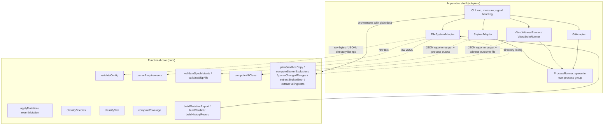

# Design Document

## Overview

The mutant engine is the `trick-or-test` npm package in `packages/engine`. It attacks a Target_Project with two kinds of mutants, mechanical mutants from StrykerJS and spec mutants (Oathbreakers) written by a Kiro agent, runs the Target_Project's own Vitest suite against each one, and reports which acceptance criteria of a Kiro spec would notice a broken promise.

The engine makes no LLM calls (ADR 0004): spec mutants arrive as files under `<mutants dir>/<spec name>/`, already written by an agent session. The engine's job is to validate, apply, witness, run and report them, and to drive StrykerJS for the mechanical half.

Three findings from exploratory runs against `examples/pricing` shape this design and are treated as hard constraints, not implementation details to revisit later:

1. **Mechanical attribution is single-run.** StrykerJS with `disableBail` already runs every test against every mutant and records `killedBy` per mutant plus `testFiles` on the report. A second run to separate "would examples alone kill this" from "would properties alone kill this" is unnecessary and would double the mutation run time for no new information: the same `killedBy` list, split by test classification, answers both questions.
2. **Witnesses must run inside the target's Vitest, not plain Node.** The target project's test files use extensionless imports and TypeScript syntax that only resolve through the project's own Vite/Vitest transform pipeline; a plain `node witness.ts` fails to resolve those imports. Vitest also swallows `console.log` output from passing tests, so the witness cannot report its outcome by printing. It must write the outcome to a file that the engine reads back.
3. **Spec mutant attribution is also single-run per mutant.** One Vitest run with the JSON reporter per spec mutant produces the list of failing tests; examples-only, properties-only, both and unattributed are computed by classifying each failing test after the fact, never by running an examples-only suite and a properties-only suite separately.

### Design decisions added with the latest requirements

- **One run attacks exactly one spec.** The CLI chooses the spec in the load stage with the pure function `selectSpec(specNames, requested?)` (Requirements 9.5, 9.16): with `--spec <name>` it attacks that spec; without the option it attacks the only spec directory that has a `requirements.md`; when several such directories exist and `--spec` is absent, it fails with an error that lists the names and asks for `--spec <name>`. The shell supplies the directory listing, so the function does no file system access. Because a run covers one spec, criterion ids (`<requirement>.<criterion>`) and mutant ids keep their plain format and are unique within the run, and the report, verdict and history layout carry no spec qualifier.
- **Paths in outputs are project-relative, produced in the core.** The core receives the project root as plain data and relativizes at report construction (Requirement 8.17). Absolute paths exist only in the shell and at run time.
- **Symlinks in a Sandbox.** A symbolic link whose target resolves inside the Target_Project is recreated in the Sandbox as a relative link to the corresponding location inside the Sandbox. A symbolic link whose target resolves outside the Target_Project is skipped (not copied) and a warning is logged. Skipping is chosen over rewriting because a link that leaves the project has no meaningful counterpart inside the Sandbox (Requirements 5.17, 5.18).

## Architecture

The engine follows ADR 0005 (functional core, imperative shell). The core is deterministic, synchronous, and free of file system, process, and network access. The core imports nothing from `node:` except `node:crypto` in `core/mutant-id.ts`, where `createHash('sha256')` is a pure function of its input. Everything that touches the outside world (the file system, child processes, StrykerJS, Vitest, git and operating-system signals) is an adapter or shell code behind a small interface that the core depends on through a parameter, never an import.



The CLI (`packages/engine/src/cli/`) is the only orchestrator. It calls adapters to gather raw data, passes that data into core functions, and calls adapters again to write output. No core function is aware that StrykerJS, Vitest, or the file system exist.

### Run sequence

```mermaid
sequenceDiagram
    participant CLI
    participant Git as GitAdapter
    participant FS as FileSystemAdapter
    participant Core as Functional core
    participant Stryker as StrykerAdapter
    participant Vitest as VitestAdapter

    CLI->>CLI: install SIGINT/SIGTERM handlers
    CLI->>FS: remove leftover .trickortest/sandboxes/*
    CLI->>FS: read trickortest.config.json
    CLI->>Core: validateConfig(raw)
    CLI->>FS: list spec directories that contain requirements.md
    CLI->>Core: selectSpec(specNames, requested?)
    alt several specs and no --spec, or --spec names no spec
        CLI->>CLI: print error that lists the spec names and asks for --spec name to stderr, exit 1
    else one spec chosen
        CLI->>FS: read requirements.md
        CLI->>Core: parseRequirements(text, filePath)
        CLI->>FS: read mutants/spec-name/*.json, skipped.json
        CLI->>Core: validateSpecMutants / validateSkipFile / checkCrossFileRules
    end
    alt a requirements file, mutant file or skip entry is invalid
        CLI->>CLI: report errors in seconds, no baseline, no StrykerJS
    else all valid
        CLI->>Vitest: run baseline suite once, with --exclude '.trickortest/**' (records duration)
        Vitest-->>CLI: baseline result (file-level failures count as Failing_Tests)
        alt baseline has a Failing_Test
            CLI->>CLI: abort, print failing tests, no Verdict_File
        else baseline passes
            opt --since <ref> given
                CLI->>Git: git diff --relative, limited to the project, paths relative to it
                CLI->>Core: parseChangedRanges(diff, sourceGlobs)
            end
            CLI->>FS: list project directories and symlinked directories
            CLI->>Core: computeStrykerExclusions(listing)
            CLI->>Stryker: run once (incremental, disableBail, JSON reporter, vitest runner, files in .trickortest/)
            Stryker-->>CLI: mutants with locations + killedBy + testFiles, or an error line
            CLI->>FS: remove StrykerJS temp dir (also on failure)
            CLI->>FS: create pristine Sandbox under .trickortest/sandboxes/
            CLI->>Vitest: run all witnesses of the spec on the original code (one run, one outcome file per mutant)
            CLI->>FS: read original outcomes, remove pristine Sandbox
            loop each Spec_Mutant
                CLI->>Core: planSandboxCopy(listing, outputDir) then FS copies the plan
                CLI->>Core: applyMutation(source, mutant)
                CLI->>Vitest: typecheck sandbox
                CLI->>Core: compare original outcome with expected (InvalidWitness, keeps both outcomes)
                CLI->>Vitest: run this mutant's witness in the sandbox (witness config, outcome file, timeout)
                CLI->>Core: compare mutated outcome with original outcome (Ghost; a witness timeout is a difference)
                alt witness shows a difference
                    CLI->>Vitest: run suite in sandbox with --exclude '.trickortest/**', JSON reporter, suite time limit (one run)
                end
                CLI->>FS: remove Sandbox
            end
            CLI->>Core: classifyTest, computeKillClass, computeCoverage
            CLI->>Core: buildMutationReport, buildVerdict, buildHistoryRecord (project root passed as data)
            CLI->>FS: write report, verdict; append one line to history.jsonl
        end
    end
    Note over CLI: On SIGINT/SIGTERM at any point: kill child process groups, remove sandboxes, exit 130/143
```

## Components and Interfaces

### Core (pure, `packages/engine/src/core/`)

| Module | Exports | Responsibility |
| --- | --- | --- |
| `config.ts` | `validateConfig(raw: unknown): Result<EngineConfig, ConfigError>`, `resolveConfigPaths(config, projectRoot)` | Requirement 1. zod schema with defaults; resolving paths is a pure string-join function given a root. Only a missing file gives defaults, and that decision is made by the caller, which does not call `validateConfig` for a missing file. `validateConfig(null)` (a file that parses to JSON `null`) is an error that names the file, as is any other non-object value. |
| `select-spec.ts` | `selectSpec(specNames: string[], requested?: string): Result<string, SpecSelectionError>` | Requirements 9.5, 9.16. Pure. `specNames` is the list of spec directories that contain a `requirements.md`, supplied by the shell from a directory listing. When `requested` is given and is in the list, it returns `requested`; when `requested` is given and not in the list, it returns an error that lists the names. When `requested` is absent and the list has exactly one name, it returns that name. When `requested` is absent and the list has more than one name, it returns an error whose message lists the names (sorted) and asks for `--spec <name>`. When the list is empty, it returns an error that says no spec was found. The CLI prints the error message to stderr and exits with code 1. |
| `requirements.ts` | `parseRequirements(text: string, filePath: string): Result<Criterion[], ParseError>` | Requirement 2. Line-oriented Markdown scan; no file I/O. A Criterion is identified by its plain id `<requirement>.<criterion>`. A repeated id is a plain duplicate-id error that names the file, the id and both line numbers (2.5). Lines inside a fenced code block (opened by ``` or ~~~ and closed by a fence of the same character) are neither headings nor criteria. |
| `species.ts` | `classifySpecies(mutatorName: string, replacementText: string): Species` | Requirement 3.11-3.13, 8.14. Table lookup, total function, loaded from `.kiro/steering/bestiary.md` species table (embedded as a data constant checked against the steering file by a unit test, not parsed from Markdown at run time). |
| `mutation.ts` | `applyMutation(source: string, mutant: SpecMutant): Result<{ mutated: string; span: Span }, NotApplicableError>`, `revertMutation(mutated: string, mutant: SpecMutant, span: Span): string` | Requirement 5.2. Pure string surgery: find `original` text, require exactly one occurrence. The returned `Span` holds the character offsets and the `Location` (1-based start and end line and column, the convention of `mutation-testing-report-schema` and of StrykerJS), so the 8.15 same-change check compares like with like. |
| `spec-mutants.ts` | `validateSpecMutant(raw: unknown, filePath: string): Result<SpecMutant, LoadError>`, `validateSkipFile(raw: unknown, filePath: string): Result<SkipEntry[], LoadError>`, `checkCrossFileRules(specName, mutants, skipEntries, criteria): LoadError[]`, `isSafeRelativePath(p: string): boolean`, `isSafeMutantId(id: string): boolean` | Requirement 4. Per-file validation is pure. `validateSpecMutant` rejects (4.11) a `file` or `witness.from` that is absolute (POSIX `/`, Windows drive letter or UNC prefix, or a leading `~`), contains a `..` segment, contains a backslash or a NUL character, or is empty; and rejects (4.12) an `id` that does not match `^[A-Za-z0-9._-]+$` or contains `..`. Each error names the mutant file and the field. Cross-file checks (duplicate id within one spec, requirement exists in that spec, 4.9's strict skip-vs-mutant rule) take the already-loaded list of the one spec under attack. A duplicate id is a plain error that names both files (4.5). |
| `sandbox-plan.ts` | `resolveInside(root: string, relative: string): Result<string, PathEscapeError>`, `planSandboxCopy(entries: ProjectEntry[], outputDirRelative: string): CopyPlan` | Requirements 5.17-5.19. `resolveInside` joins and normalizes and fails when the result is not inside `root`; the sandbox adapter calls it for every write. `planSandboxCopy` takes a listing of project entries (`{ path, kind: 'file' \| 'dir' \| 'symlink', target?: string }`, all project-relative, with symlink targets already resolved by the shell and expressed relative to the project root) and returns, for each entry, `copy`, `skip` or `link` (with the relative link target inside the Sandbox). It always skips `node_modules`, `.git`, `.trickortest`, `.stryker-tmp` and exactly the entry whose project-relative path equals `outputDirRelative`; a directory with the same name at another depth (`src/reports/` when the output directory is `reports`) is copied. A symlink whose resolved target is outside the project is `skip`; one inside is `link`. |
| `stryker-exclusions.ts` | `computeStrykerExclusions(listing: ProjectEntry[], buildRoots: string[]): { nonBuildDirs: string[]; symlinkedDirs: string[]; ignorePatterns: string[] }` | Requirements 3.7, 3.8. A top-level directory is a build directory when it is the first path segment of a source or test glob (`buildRoots`). Every other top-level directory is listed in `nonBuildDirs`; every directory entry of kind `symlink` whose target is a directory is listed in `symlinkedDirs`. `ignorePatterns` is the union of both lists, `.stryker-tmp`, `.trickortest` and the output directory, each as a glob (`<dir>/**`), sorted and de-duplicated. It is a pure function of the listing; the shell supplies the listing. |
| `changed-ranges.ts` | `parseChangedRanges(diffText: string, sourceGlobs: string[]): ChangedRange[]` | Requirements 3.9, 3.10. Parses the output of `git diff --relative --unified=0` (paths already relative to the Target_Project) into `{ file, start, end }`, keeps only files that match the source globs, drops pure-deletion hunks (zero added lines), and returns them sorted by file then start line. An empty result means "no line changed". |
| `stryker-output.ts` | `extractStrykerError(output: string): string`, `shouldRetryWithIgnoreStatic(attempt: StrykerAttempt): boolean` (`StrykerAttempt = { exitCode: number; output: string }`), `parseStrykerReport(raw: unknown): Result<StrykerReport, ParseError>` | Requirements 3.5, 3.6, 3.16, 3.17. `extractStrykerError` returns the first line whose level is ERROR, or the last non-empty line when no ERROR-level line exists; it is total on any string. `shouldRetryWithIgnoreStatic` is true only when the attempt failed (non-zero exit) and its output contains the real dry-run-failure line of StrykerJS 10.1.1 (the `ERROR DryRunExecutor One or more tests failed in the initial test run` line, copied from captured output). StrykerJS prints no "static mutants" text when the dry run fails, so the retry marker is the failed dry run itself, with or without static mutants. A failure after a successful dry run is never retried (3.17). The exact log markers are copied from the captured StrykerJS 10.1.1 fixtures, not guessed. `parseStrykerReport` validates the Stryker JSON with zod and keeps each mutant's `location` (start and end line and column). |
| `suite-result.ts` | `extractFailingTests(vitestJson: VitestJson): FailingTest[]` | Requirements 3.15, 5.9, 5.10 and the Failing_Test definition. Every test with status `failed` is a Failing_Test. A test file whose status is `failed` and which has no assertion results (an error at import or collection) is one Failing_Test whose name is the file path and whose `filePath` is that file. A failed file that also has failed assertions yields only those assertions. |
| `suite-time-limit.ts` | `computeSuiteTimeLimit(baselineMs: number, timeoutMs?: number): number` | Requirement 5.15. Returns `timeoutMs` when set, otherwise `baselineMs * 1.5 + 5000`. |
| `witness-compare.ts` | `matchesExpectation(expected: WitnessExpectation, actual: WitnessOutcome): boolean`, `compareOutcomes(original: WitnessOutcome, mutated: WitnessOutcome): "same" \| "different"` | Requirements 5.6, 5.7, 5.12, 5.16. A `WitnessOutcome` is `value`, `error`, `timeout` or `no-outcome` (the outcome file was not written; it carries a message). Values are compared by deep structural equality over their JSON form (each value is serialized and parsed before comparison), so `-0` and `0` are equal. A `timeout` or `no-outcome` never matches an expectation, and a `timeout` of the mutated code against any original outcome that is not itself a `timeout` is `different`. The caller never maps a witness `timeout` to the Mutant_Status Timeout or Killed. |
| `test-classification.ts` | `classifyTest(test: { filePath: string; bodySource: string }, propertyTestGlobs: string[]): "property" \| "example"` | Requirement 6.3-6.5. Glob match on `filePath` (the matcher expands braces, so `test/**/*.{property,prop}.test.ts` matches `test/a.property.test.ts`), or a syntactic scan of `bodySource` for a call to `fc.assert`, `fc.check`, or `test.prop`. |
| `kill-classification.ts` | `computeKillClass(killingTests: ClassifiedTest[]): KillClass` | Requirement 6.6-6.10. |
| `mutant-id.ts` | `computeMutantId(file: string, original: string, replacement: string, occurrenceIndex: number): MutantId` | Requirement 8.7. Used for Mechanical_Mutants only. `test/core/mutant-id.test.ts` checks only the 32-character hex format of the id. One exact-id pin test for a fixed input lives with the CLI-phase tests. Content hash computed with `createHash('sha256')` from `node:crypto` (hex-truncated), never a hand-written hash, never a timestamp and never a line number. The `occurrenceIndex` is the Occurrence_Index: the 0-based position of the mutant among all Mechanical_Mutants with the same file, original text and replacement, ordered by location (start line, then start column, using the real location StrykerJS reports). It keeps two mutants with the same file, original text and replacement at different locations apart. `computeMutantId` does not compute the index. The pure helper `assignOccurrenceIndexes(mutants): Map<…, number>` in `core/occurrence.ts` (no `node:` import) groups the Mechanical_Mutants by (file, original, replacement), sorts each group by line then column, and returns each mutant's position in its group; the CLI passes the positions in. Because the index depends only on the order inside a group, ids stay stable when unrelated lines move. `core/mutant-id.ts` is the only core module that imports from `node:`. Spec_Mutants do not pass through this function: a Spec_Mutant keeps the id from its file (`oath-<criterion>-<slug>`), which Requirement 4.5 makes unique. The CLI passes the ids to `report.ts` as data, so `report.ts` does not import `mutant-id.ts`. |
| `coverage.ts` | `computeCoverage(criteria: Criterion[], mutantResults: MutantResult[], skipEntries: SkipEntry[]): CriterionCoverage[]` | Requirement 7. Called once per run with the criteria, results and skip entries of the one spec under attack. |
| `paths.ts` | `relativizePath(projectRoot: string, p: string): string`, `scrubAbsolutePaths(text: string, projectRoot: string): string`, `containsAbsolutePath(text: string): boolean` | Requirement 8.17. `relativizePath` turns a path under the root into a project-relative path with `/` separators and turns any other absolute path into `<outside-project>/<basename>`. `scrubAbsolutePaths` applies the same rule to every absolute path found inside free text (error messages, mutant descriptions, NotApplicable read errors, NoOutcome messages). `containsAbsolutePath` is the detector the property test and the e2e test use (a POSIX path starting with `/` that is not part of a URL, or a Windows drive or UNC path). |
| `report.ts` | `buildMutationReport(input): MutationTestingReport`, `buildVerdict(input): Verdict`, `buildHistoryRecord(verdict, previousRecord): HistoryRecord`, `serializeHistoryRecord(record): string`, `parseHistoryLines(text): Result<HistoryRecord[], HistoryError>` | Requirement 8. The `input` of the builders includes `projectRoot` as plain data and every builder relativizes every path and scrubs every free-text field through `paths.ts` before it creates a field, so no builder can emit an absolute path (8.17). `serializeHistoryRecord` returns the record as a single-line JSON object with no embedded newline. `parseHistoryLines` parses each non-empty line as one complete JSON object, in order, and returns an error that names the line number for a malformed line. The History_File `history.jsonl` is JSON Lines: one HistoryRecord per line, and appending a run adds exactly one line and leaves earlier lines unchanged (8.8, 8.9, 8.16). Each record is validated with its zod schema before the line is appended (8.10). The viewer (bestiary-viewer spec) reads exactly this format through `trick-or-test/report`. `buildMutationReport` records whether the `ignoreStatic` retry happened in the schema's free-form `config` object (Requirement 3.5), and `buildVerdict` records it in `ignoreStaticRetried`. It writes the start and end line and column of each Mechanical_Mutant from the Stryker data into the schema `location` (3.16), and the span's location for each Spec_Mutant. Takes mutant ids as input (Spec_Mutants keep their file ids, Mechanical_Mutants carry the hash computed by the CLI) and never computes them. Deduplicates same-change spec/mechanical pairs by comparing file, start and end location and replacement, not ids (8.15), maps statuses (8.3-8.4), computes newly-killed ids (8.9) from the previous history record passed in as data. For an InvalidWitness mutant it writes `originalOutcome` and `expected` into the Verdict (5.6). |
| `result.ts` | `Result<T, E>` union, `ok`, `err` helpers | ADR 0005. Used by every fallible core function; exceptions are reserved for programming errors. |

### Adapters (imperative, `packages/engine/src/adapters/`)

| Module | Interface it implements | Responsibility |
| --- | --- | --- |
| `file-system-adapter.ts` | `FileSystem` (`readFile`, `writeFile`, `copyPlan`, `removeDir`, `exists`, `listProject`) | All disk access. `listProject` returns the `ProjectEntry[]` listing (with `lstat` kinds and symlink targets resolved with `realpath`, expressed relative to the project root) that the core plan functions consume. Sandbox copy and teardown live here, never in the core. |
| `process-runner.ts` | `ProcessRunner.run(command, args, options): Promise<ProcessResult>`, `ProcessRunner.killAll(signal)` | Requirement 9.15. Spawns every child (Vitest, StrykerJS, tsc, git) with `spawn` and `detached: true`, so each child leads its own process group, and registers it. `killAll` sends the signal to each group with `process.kill(-pid, signal)`, then `SIGKILL` after a short grace period. The per-run `timeout` option kills the group the same way. Adapters never use `exec` or `execSync`. |
| `stryker-adapter.ts` | `MechanicalRunner.run(options): MechanicalRunResult` | Requirement 3. Owns every StrykerJS-specific detail. Builds the Stryker config object with `plugins: ['@stryker-mutator/vitest-runner']`, incremental mode, the JSON reporter, and `disableBail: true` so one run yields `killedBy` and `testFiles` for every mutant (finding 1). By default StrykerJS writes `reports/stryker-incremental.json` and `reports/mutation/mutation.json` into the target, so the adapter sets `incrementalFile`, the JSON reporter's `fileName`, and `tempDirName` to paths under `.trickortest/`; StrykerJS then writes nothing outside `.trickortest/` (3.14). It sets `cleanTempDir` to `'always'` and, in a `finally`, removes the temp dir itself, so a failed run leaves no `stryker-tmp` behind (3.19). Sets `tsconfigFile` to a nonexistent path only when the resolved TypeScript is 7 or newer (the TS7 workaround belongs here, not in the core, because it depends on reading the target's installed TypeScript version). Runs the binary found in `node_modules/.bin/stryker`, searched from the Target_Project root upward through its ancestors (npm workspaces hoist it to the repository root); when none is found it runs `npx --no-install stryker`, so `npx` never downloads a package (3.18). Builds `mutate` patterns as `file:start-end` from the `ChangedRange`s given by `parseChangedRanges` when `--since` is given (paths already relative to the Target_Project root), and reports zero mutants without invoking Stryker when the list is empty (3.9, 3.10). Passes `computeStrykerExclusions(listing).nonBuildDirs` through Stryker's sandbox exclusion (`ignorePatterns`) together with the detected `symlinkedDirs` (3.7) and `.stryker-tmp` (3.8). Reads each mutant's `location` from the Stryker JSON through `parseStrykerReport` and keeps it in `MechanicalMutant.location` (3.16). Retry: when the first attempt fails, it calls `shouldRetryWithIgnoreStatic`; it is true when the output shows the failed initial test run. Only then does the adapter run exactly once more with `ignoreStatic: true` and flag `ignoreStaticRetried` in its result (3.5). A failure after a successful dry run is returned as an error without a retry and without the flag (3.17). A non-retryable error returns `extractStrykerError(output)` of the first attempt, and a failed retry returns `extractStrykerError` of the retry's output, as a `Result` error, with no Verdict_File (3.6). Its tests use captured real StrykerJS 10.1.1 output (see Testing Strategy). |
| `vitest-witness-runner.ts` | `WitnessRunner.run(sandboxRoot, witnesses): Record<MutantId, WitnessOutcome>` | Requirement 5.4-5.7, 5.16. Witnesses run twice per mutant: once on the original code and once on the mutated code, because 5.6 (InvalidWitness) needs the original outcome and 5.7 (Ghost) compares the two. First, one Vitest run in one pristine sandbox executes every witness of the spec against the original code. Then each mutant's witness runs alone in that mutant's own sandbox after the mutation is applied. For each witness the adapter generates one file, `.trickortest/witnesses/<mutant id>.witness.test.ts`, inside the sandbox; the id is already validated as a safe file name by the loader (4.12) and the path goes through `resolveInside` before writing. It imports the witness's `export` from `witness.from`, calls it with `witness.args`, and writes the JSON-serialized outcome (`{ kind: 'value', value }` or `{ kind: 'error', className }`) to its own outcome file `.trickortest/witnesses/<mutant id>.outcome.json`. It never prints the outcome, because Vitest hides console output of passing tests. If the process exceeds the witness time limit, the adapter kills it and returns `{ kind: 'timeout' }`; if the outcome file is missing or does not parse, it returns `{ kind: 'no-outcome', message }`. A witness `timeout` on the mutated code is a difference, handled by `compareOutcomes` (5.16); the Mutant_Status Timeout comes only from the suite time limit (5.11). The generated files stay out of the target's test globs, and are generated under `.trickortest/`, which every suite run excludes (5.21). They run through a generated Vitest config, `.trickortest/witnesses/vitest.config.ts`, that extends the target's config (so `resolve`, aliases and transforms match, and extensionless imports and TypeScript syntax resolve as in the tests) but sets `include` to only the witness files (finding 2). |
| `vitest-suite-runner.ts` | `SuiteRunner.run(root, options): SuiteResult` where `SuiteResult` holds `durationMs`, `failingTests: FailingTest[]` and, per test file, each test's name, status and start line | Requirement 3.15, 3.20, 5.8-5.11, 5.15, 5.21, 6.2, 9.1. Runs the target's own Vitest config with the JSON reporter and `includeTaskLocation` enabled, so each test carries its start line, and always passes `--exclude '.trickortest/**'` (in addition to the config's own excludes), so neither the Baseline_Run nor a Sandbox run executes a StrykerJS sandbox, a generated witness file or a copied Sandbox (3.20, 5.21). The adapter reads the JSON reporter output file and gives it to `extractFailingTests`, so a test file that fails to load counts as a Failing_Test named after the file: it fails the baseline and kills a mutant. It runs once for the baseline, whose duration is recorded, and once per spec mutant (finding 3) with the suite time limit passed as the process timeout; when the limit is exceeded the process group is killed and the result is `timedOut: true`. The time limit is the baseline duration times 1.5 plus 5 seconds, the same formula StrykerJS uses, unless `timeoutMs` is set in the config, which replaces it (1.1, 1.7, 5.15). The limit is computed by the pure function `computeSuiteTimeLimit(baselineMs, timeoutMs?)` in the core. |
| `test-body-extractor.ts` | `extractTestBody(fileText: string, startLine: number): string` | Requirement 6.2-6.4. See "Test bodies" below. |
| `git-adapter.ts` | `Git.diff(ref, projectRoot): string` | Requirement 3.9-3.10. Runs `git -C <projectRoot> diff --relative --unified=0 --no-color <ref> -- .`: `--relative` makes paths relative to the Target_Project even when it is a subdirectory of a larger repository, and the `.` pathspec limits the diff to that directory. The adapter returns the text; `parseChangedRanges` (core) filters it by the source globs. A git failure becomes a `Result` error naming the ref. |
| `sandbox.ts` | `Sandbox.create(projectRoot, id, options): SandboxHandle`, `Sandbox.destroy(handle)`, `Sandbox.removeLeftovers(projectRoot)` | Requirements 5.1, 5.13, 5.17-5.20. `examples/pricing` has no `node_modules` of its own: npm workspaces hoist `vitest` and `typescript` to the repository root, so a copy in the system temp directory could not resolve them. Each sandbox is therefore created inside the target project, at `.trickortest/sandboxes/<id>/`, so module resolution walks up to the same `node_modules` folders as the original. The copy follows the `CopyPlan` from `planSandboxCopy`: it excludes `node_modules`, `.git`, `.trickortest`, `.stryker-tmp` and the configured output directory by its project-relative path only (5.19). Before every write (file, directory, link, mutated file, generated witness file) the adapter calls `resolveInside(sandboxRoot, relative)` and aborts the copy with an error when the path would leave the Sandbox (5.17). Symlinks follow the plan: a link pointing inside the project is recreated as a relative link inside the Sandbox, a link pointing outside is skipped (5.18). The adapter also writes `.trickortest/.gitignore` containing `*`, so any target ignores the engine's working files. `destroy` runs in a `finally`, so a failing, timing-out, or crashing mutant run never leaves a sandbox behind or touches the real working tree. `removeLeftovers` deletes everything under `.trickortest/sandboxes/` and is the first action of every run (5.20). |
| `typecheck-adapter.ts` | `Typecheck.run(sandboxRoot): Result<void, CompileError>` | Requirement 5.3. Runs `tsc --noEmit` (or the target's configured type-check command) against the sandbox. |

### CLI (`packages/engine/src/cli/`)

Two commands, `run` and `measure`, parsed with a minimal, dependency-free argument parser (no new runtime dependency, per `tech.md`). Both commands call the same orchestration function with a different output directory; `measure` always targets the configured output path meant for `reports/`. The repository root `package.json` defines the npm script `measure`, which runs the built CLI as `trick-or-test measure --project examples/pricing --spec cart-pricing` with the output directory `reports` (Requirement 9.12). After it finishes, `reports/` holds the Mutation_Report, `verdict.json` and `history.jsonl` (9.13). Files in `reports/` are generated only through `measure` and are never edited by hand (9.14). The CLI never changes its exit code based on survivors (Requirement 9.7-9.8): exit 0 for a completed run regardless of survivors, exit 1 for configuration, parsing, baseline, StrykerJS, or runtime errors, exit 1 with usage text for an unknown command or option.

**Signal handling (Requirement 9.15).** The shell module `cli/shutdown.ts` installs one handler for `SIGINT` and `SIGTERM` at the start of `run` and `measure`. On a signal it (1) calls `ProcessRunner.killAll(signal)` so every Vitest, StrykerJS, tsc and git process group stops, (2) removes the Sandboxes the run created and the StrykerJS temp dir, through the same `Sandbox.removeLeftovers` and temp-dir removal used at normal exit, (3) exits with code 130 for `SIGINT` and 143 for `SIGTERM`. The handler is idempotent, so a second signal during cleanup does not start a second cleanup. The orchestration function does not catch the resulting rejection as a runtime error (which would exit 1). Nothing of this lives in the core. Writing the Verdict_File and the History_File is the last step of a run, so an interrupted run writes neither.

### Test bodies

`classifyTest` needs the body of each killing test. The engine gets it in three steps:

1. The line comes from the runner. Vitest's JSON reporter with `includeTaskLocation` gives each failing test's start line (Spec_Mutants). StrykerJS's report gives each test's location in `testFiles` (Mechanical_Mutants). A file-level failure (Failing_Test named after the file) has no start line and no body; it is classified by its file glob alone.
2. The adapter reads the test file and `extractTestBody` takes the text from that line to the end of the test call. A small scanner finds the end by matching brackets while it skips string literals, template literals, regular expression literals and comments. The scanner treats a `/` as the start of a regular expression when the previous token is an operator, an opening bracket, or one of the keywords `return`, `typeof`, `case`, `in`, `of`, `delete`, `void`, `throw`, `new`, `instanceof`, `yield`, `await`; otherwise it treats `/` as division.
3. The body text goes to the pure `classifyTest`.

TypeScript 7 has no JavaScript API, so the engine does not use the TypeScript compiler for this. Limit: a test that reaches fast-check only through a helper function has no `fc.assert`, `fc.check` or `test.prop` in its own body, so it is classified by its file glob alone.

### Report subpath

`trick-or-test/report` re-exports only the report types and zod schemas from `core/report.ts` and the other type and schema modules in `core/`. It does not import `core/mutant-id.ts`, because that module imports `node:crypto`. No `node:` import appears anywhere in the subpath's dependency graph (Requirement 10.4), so `apps/viewer` can import it directly.

## Data Models

### File layout

```
<output dir>/            # `reports/` for the measure script
  mutation-report.json   # Mutation_Report (mutation-testing-report-schema)
  verdict.json           # Verdict_File, rewritten each run
  history.jsonl          # History_File, JSON Lines, append-only, one HistoryRecord per line
```

One run attacks one spec and writes one set of three files. Working files stay under `.trickortest/` (`sandboxes/`, `witnesses/`, `stryker-tmp/`, Stryker incremental file and JSON report).

### Identity

A run attacks exactly one spec, so identities are plain. A Criterion is identified by its id `<requirement>.<criterion>`. A mutant is identified by its `MutantId` in every output: the Verdict_File, the Mutation_Report and the HistoryRecord.

```ts
// Branded ids (ADR 0005)
// A Spec_Mutant's MutantId is the id from its file (oath-<criterion>-<slug>), unique within the run (Requirement 4.5).
// A Mechanical_Mutant's MutantId is the sha256 hash of file, original text, replacement and Occurrence_Index (Requirement 8.7).
// Occurrence_Index: 0-based position among Mechanical_Mutants with the same file, original and replacement,
// ordered by start line then start column (real locations from StrykerJS).
type OccurrenceIndex = number;
type MutantId = string & { readonly __brand: "MutantId" };
type CriterionId = string & { readonly __brand: "CriterionId" }; // "<requirement>.<criterion>"
type TestId = string & { readonly __brand: "TestId" }; // file path + test full name; for a file-level failure, the file path

// 1-based, as in mutation-testing-report-schema and in StrykerJS output
type Position = { line: number; column: number };
type Location = { start: Position; end: Position };
type Span = { startOffset: number; endOffset: number; location: Location };

type Criterion = {
  id: CriterionId;
  requirement: number;
  criterion: number;
  text: string;
  line: number;
};

type Species =
  | "Borderling" | "Miscount" | "Two-Face" | "Hollow" | "Impostor"
  | "Oathbreaker" | "Unclassified";

type MutantStatus =
  | "Killed" | "Survived" | "Timeout" | "Ghost"
  | "InvalidWitness" | "CompileError" | "NotApplicable";

type KillClass = "examples-only" | "properties-only" | "both" | "unattributed";

type CoverageStatus = "guarded" | "unguarded" | "unattacked" | "skipped";

type Witness = {
  from: string; // relative, inside the project, no ".." (Requirement 4.11)
  export: string;
  args: unknown[];
} & ({ expected: unknown } | { expectedError: string });

type WitnessExpectation = { expected: unknown } | { expectedError: string };

type WitnessOutcome =
  | { kind: "value"; value: unknown }
  | { kind: "error"; className: string }
  | { kind: "timeout" }                       // the witness process exceeded its time limit
  | { kind: "no-outcome"; message: string };  // the outcome file was missing or unreadable

type SpecMutant = {
  id: MutantId; // safe file name: ^[A-Za-z0-9._-]+$, no ".." (Requirement 4.12)
  requirement: CriterionId;
  file: string; // relative, inside the project, no ".." (Requirement 4.11)
  original: string;
  mutated: string;
  why: string;
  witness: Witness;
};

// A mutant that StrykerJS produced, with the real location from its report (Requirement 3.16)
type MechanicalMutant = {
  id: MutantId;
  file: string; // project-relative
  mutatorName: string;
  original: string;
  replacement: string;
  location: Location;
  status: MutantStatus;
  killedBy: TestId[];
};

type SkipEntry = { requirement: CriterionId; reason: string };

type FailingTest = { id: TestId; filePath: string; fileLevel: boolean }; // fileLevel: the file failed to load

type MutantResult = {
  id: MutantId;
  species: Species;
  status: MutantStatus;
  requirement?: CriterionId; // present for Spec_Mutants, absent for strays
  location: Location;
  killingTests: TestId[];
  killClass?: KillClass; // present only when status is Killed; a Timeout has no failing tests, so no kill class
  // Present only when status is InvalidWitness (Requirement 5.6)
  invalidWitness?: { expected: WitnessExpectation; originalOutcome: WitnessOutcome };
  // Present for NotApplicable and for a no-outcome failure; already scrubbed of absolute paths (Requirement 8.17)
  message?: string;
};

type EngineConfig = {
  specDir: string;
  sourceGlobs: string[];
  testGlobs: string[];
  propertyTestGlobs: string[];
  mutantsDir: string;
  outputDir: string;
  timeoutMs?: number; // unset when absent: suite time limit = baseline * 1.5 + 5 s (Requirements 1.7, 5.15)
};

type CriterionCoverage = {
  criterion: CriterionId;
  status: CoverageStatus;
  reason?: string; // present only when status is "skipped"
};

type RunMetadata = {
  gitCommit: string;
  seed: number;
  engineVersion: string;
  nodeVersion: string;
  strykerVersion: string;
  vitestVersion: string;
  typescriptVersion: string;
  timestamp: string; // excluded from byte-identity comparisons (Requirement 8.13)
};

type Verdict = {
  coverage: CriterionCoverage[];       // one entry per criterion
  mutants: MutantResult[];             // the spec mutants and the strays
  witnesses: Record<MutantId, Witness>;
  ignoreStaticRetried: boolean;
  metadata: RunMetadata;
};

// Serialized as one single-line JSON object per line of history.jsonl.
type HistoryRecord = {
  time: string;
  gitCommit: string;
  seed: number;
  config: EngineConfig; // paths relative to the Target_Project root, never resolved absolute paths (Requirement 8.17)
  mutants: { id: MutantId; status: MutantStatus }[];
  statusCounts: Record<MutantStatus, number>;
  coverageCounts: Record<CoverageStatus, number>;
  newlyKilledIds: MutantId[];
};
```

The resolved `EngineConfig` (absolute paths) exists only at run time. The CLI passes the resolved config and the `projectRoot` to the core builders as data; `buildHistoryRecord` and the other builders turn each path back into a path relative to the Target_Project root through `relativizePath` (a path under the root loses the root prefix; a path outside it, such as the `measure` output directory, becomes a `../` path in the config and `<outside-project>/<basename>` anywhere else). The Verdict metadata holds no paths. The Mutation_Report keys files by project-relative path. Free-text fields (`message`, error text, mutant descriptions, `statusReason`) go through `scrubAbsolutePaths` (Requirement 8.17).

In the Verdict, `kill class` entries exist only for mutants with status Killed. Coverage still counts Timeout as killed (Requirement 7.1). The `mutation-testing-report-schema` document type and all zod schemas live beside these types in `core/`. Every type that crosses an adapter boundary (config JSON, mutant JSON, Stryker JSON reporter output with locations, Vitest JSON reporter output, witness outcome JSON, git diff output) is parsed with a zod schema at the adapter boundary per ADR 0005; the adapter never hands the core an unparsed `unknown`.

## Correctness Properties

*A property is a characteristic or behavior that should hold true across all valid executions of a system — essentially, a formal statement about what the system should do. Properties serve as the bridge between human-readable specifications and machine-verifiable correctness guarantees.*

Each property is implemented as one property-based test in its own `*.property.test.ts` file (Requirement 10.5, 10.6). Properties 18 to 25 are new with the latest requirements and each needs its own `*.property.test.ts` file as well.

### Property 1: Replacement round trip

For any source text and any mutant whose `original` text occurs exactly once in that source, applying the mutant and then reverting it yields the original source text exactly, and applying it changes no character outside the replaced span.

**Validates: Requirements 5.2**

### Property 2: Uniqueness

For any source text in which the mutant's `original` text occurs zero times or more than once, applying the mutant SHALL produce the status NotApplicable and SHALL leave the source text unchanged.

**Validates: Requirements 4.4, 5.2**

### Property 3: No invalid mutant is counted

For any set of mutant results, a mutant with status Ghost, InvalidWitness, CompileError, or NotApplicable is never included in the count of killed mutants or the count of survived mutants.

**Validates: Requirements 7.6, 7.7**

### Property 4: Coverage partition

For any list of criteria, mutant results and skip entries, every criterion is assigned exactly one of guarded, unguarded, unattacked, or skipped, and the four resulting counts sum to the number of criteria.

**Validates: Requirements 7.1, 7.2, 7.3, 7.4, 7.5, 7.8**

### Property 5: Attribution partition

For any set of mutants and their killing tests, each mutant with status Killed is assigned exactly one of the kill classes examples-only, properties-only, both, or unattributed, and the four resulting counts sum to the number of mutants with status Killed. A mutant with status Timeout is never assigned a kill class and is not counted in the sum. A killing test that is a file-level failure is classified by its file path alone.

**Validates: Requirements 6.6, 6.7, 6.8, 6.9, 6.10**

### Property 6: Deterministic ids and location order

For any list of mechanical mutants with locations, each id depends only on the mutant's file, original text, replacement text and Occurrence_Index. The Occurrence_Index is the position of the mutant in its (file, original, replacement) group ordered by start line, then start column, so for two mutants of one group the one with the smaller (line, column) always has the smaller index and a different id. Moving unrelated lines (changing line numbers of mutants without changing their order within a group) does not change any id. For any list that also contains spec mutants, each spec mutant keeps the id from its file. Shuffling the input list does not change the id of any mutant. The report-order clause is checked by shuffling the input of `buildMutationReport` itself and comparing the two outputs for equality, not by comparing against a sorted stand-in. The generators include groups of mutants that share file, original text and replacement, including groups whose members share a line and differ only in column.

**Validates: Requirements 8.7, 8.13**

### Property 7: Report validity

For any generated set of mutant results, the mutation report built from them validates against `mutation-testing-report-schema`, maps every engine `MutantStatus` to a schema status exactly as Requirements 8.3 and 8.4 specify, and parsing the written report back SHALL produce a value equal to the result that was built. The start and end line and column of every Mechanical_Mutant in the report equal the location given in the input, and `ignoreStatic` is recorded in the report's `config` object if and only if the retry happened.

**Validates: Requirements 3.5, 3.16, 3.17, 8.1, 8.2, 8.3, 8.4**

### Property 8: Parser

For any generated requirements document with N requirements of K criteria each, the parser returns exactly the ids `n.k` for n from 1 to N and k from 1 to K, in document order, even when the document also contains fenced code blocks (``` or ~~~) whose lines look like requirement headings, criteria headings or numbered items; for any document with no acceptance criteria at all, the parser returns an error that names the file.

**Validates: Requirements 2.1, 2.2, 2.3, 2.4, 2.7, 2.8**

### Property 9: Species is total

For any `mutatorName` and replacement text, the species classifier returns exactly one species or Unclassified and never throws; for any replacement that only changes a comparison between `<`/`<=` or `>`/`>=` at a boundary, the classifier always returns Borderling; for any Spec_Mutant, the classifier always returns Oathbreaker.

**Validates: Requirements 3.11, 3.12, 3.13, 8.14**

### Property 10: Single-run attribution

For any set of killing tests with known kinds (example or property), the kill class computed from one combined run's results is the same kill class that would be computed from a hypothetical separate example-only run and a separate property-only run of the same mutant.

**Validates: Requirements 6.1, 6.2**

### Property 11: Property-test classification

For any generated test file that mixes test bodies that call a fast-check entry point (`fc.assert`, `fc.check`, or `test.prop`) with test bodies that do not, a test is classified as a Property_Test if and only if its own body calls one of those entry points, or its file path matches one of the configured property-test globs, where a glob with a brace group such as `test/**/*.{property,prop}.test.ts` matches each expansion of the group.

**Validates: Requirements 6.3, 6.4, 6.5**

### Property 12: Skip is not attack

For any list of criteria, any set of mutant results, and any set of skip entries, a criterion that has at least one valid Spec_Mutant is never assigned the skipped status, and every criterion assigned the skipped status carries a non-empty reason.

**Validates: Requirements 4.8, 4.9, 7.3, 7.4, 7.5**

### Property 13: Sandbox isolation

For any sequence of mutant runs, including runs that fail, time out, or crash partway through, the files of the real working tree outside `.trickortest/` and their contents are identical before and after the sequence, and no directory remains under `.trickortest/sandboxes/` afterwards. Leftover sandboxes present before a run are removed at its start. The property runs against a fake `FileSystem` that records every write.

**Validates: Requirements 3.14, 5.1, 5.13, 5.20, 10.10**

### Property 14: History is append-only

For any sequence of runs, appending a new history record adds exactly one line to `history.jsonl` and never changes the bytes of any earlier line, and the `newlyKilledIds` of a record is exactly the set of mutant ids killed in that run that the immediately preceding record did not already list as killed. This set comparison is only meaningful because ids are unique per mutant (Property 6): two mutants that shared an id would hide a newly killed mutant behind an earlier one. The generators therefore include runs with several mechanical mutants of the same file, original text and replacement.

**Validates: Requirements 8.8, 8.9**

### Property 15: One creature per change

For any Spec_Mutant and any Mechanical_Mutant that make the same change (same file, same start and end location, same replacement), the mutation report contains exactly one mutant for that change: the Spec_Mutant, tied to its criterion. A Spec_Mutant without a mechanical twin is always kept, and a Mechanical_Mutant that differs from a Spec_Mutant in file, start line, start column, end line, end column or replacement is always kept. The generators include Spec_Mutants with mechanical twins and Spec_Mutants without them, plus examples in which a Spec_Mutant and a Mechanical_Mutant differ only in the end line, the end column or the start column, so that a deduplication key that ignores any part of the location is caught.

**Validates: Requirements 3.16, 8.15**

### Property 16: Verdict round trip

For any valid Verdict value, including mutants with status InvalidWitness that carry `originalOutcome` and `expected`, and mutants with outcomes of kind `timeout` and `no-outcome`, writing it to a file, reading it back, and writing it again produces identical file content both times.

**Validates: Requirements 5.6, 8.5, 8.10, 8.12**

### Property 17: History lines round trip

For any sequence of HistoryRecord values, serializing each record to one line, appending the lines to `history.jsonl` and reading the file line by line returns the same records in the same order, and each line parses as one complete JSON object (no record spans two lines and no line holds two records).

**Validates: Requirements 8.9, 8.10, 8.16**

### Property 18: Spec mutant path safety

For any generated spec mutant JSON, `validateSpecMutant` accepts the mutant only when `file` and `witness.from` (after the default of 4.3 is applied) are non-empty relative paths without a `..` segment, a backslash, a NUL character, a drive letter or a leading `/` or `~`, and `id` matches `^[A-Za-z0-9._-]+$` and does not contain `..`. For every rejected input the error names the mutant file and the offending field. Generators mix safe values with absolute paths, `..` at the start, middle and end of a path, separators in ids, and ids with spaces and Unicode.

**Validates: Requirements 4.3, 4.11, 4.12**

### Property 19: Sandbox path containment

For any project listing (files, directories and symlinks with targets inside and outside the project, and relative paths that include `..` segments) and any output directory, every path the copy plan writes, and every path `resolveInside` accepts, resolves inside the Sandbox root; every symlink with a target outside the project is skipped; every symlink with a target inside the project is recreated as a relative link that resolves inside the Sandbox; only the entry whose project-relative path equals the output directory is excluded by that rule, so a directory with the same name at another depth is copied; and `node_modules`, `.git`, `.trickortest` and `.stryker-tmp` are never copied.

**Validates: Requirements 5.17, 5.18, 5.19**

### Property 20: No absolute path in any report field

For any generated run input whose strings (project root, file paths, error text, NotApplicable read errors, NoOutcome messages, mutant descriptions, config paths) contain absolute paths under the project root and outside it, every string value anywhere in the Mutation_Report, the Verdict_File and the HistoryRecord built from it satisfies `containsAbsolutePath(value) === false`. Paths under the root appear as the project-relative path, so for any path under the root the output equals the relative path and the round trip `join(root, relativizePath(root, p)) === p` holds.

**Validates: Requirements 8.17**

### Property 21: Failing tests include file-level failures

For any generated Vitest JSON result, `extractFailingTests` returns one Failing_Test for every test with status failed; and for every test file with status failed and no assertion results it returns exactly one Failing_Test whose name is the file path. A result with no failed test and no failed file yields an empty list. Consequently a mutant whose suite run has a file-level failure is Killed, and a baseline with a file-level failure aborts the run.

**Validates: Requirements 3.15, 5.9, 5.10**

### Property 22: A witness timeout is a difference, not a kill

For any original outcome and any mutated outcome, `compareOutcomes` returns `different` whenever the mutated outcome is `timeout` and the original outcome is not; returns `same` for two outcomes with equal JSON form; `matchesExpectation` is false for any `timeout` or `no-outcome` outcome; and no function of the witness stage returns the Mutant_Status Timeout or Killed. The status Timeout is produced only from a suite run that exceeds the suite time limit.

**Validates: Requirements 5.6, 5.7, 5.8, 5.11, 5.12, 5.16**

### Property 23: StrykerJS error selection

For any generated StrykerJS output text, `extractStrykerError` returns the first line whose level is ERROR when there is one, and otherwise the last non-empty line, and never throws; for an empty or whitespace-only output it returns a fixed message that names the missing output. `shouldRetryWithIgnoreStatic` is true if and only if the attempt failed and its output shows the failed initial test run (the dry run); for any attempt that failed after a successful dry run, and for any attempt that succeeded, it is false.

**Validates: Requirements 3.5, 3.6, 3.17**

### Property 24: Stryker exclusion list

For any project listing and any set of build roots, `computeStrykerExclusions` lists every top-level directory that is not a build root in `nonBuildDirs`, never lists a build root, lists every directory reached through a symbolic link in `symlinkedDirs`, always includes `.stryker-tmp` and `.trickortest` in `ignorePatterns`, returns sorted and de-duplicated output, and returns the same output for the same input listing in any order.

**Validates: Requirements 3.7, 3.8**

### Property 25: Changed ranges are relative and match the source globs

For any generated `git diff --relative --unified=0` text, `parseChangedRanges` returns only ranges whose `file` is project-relative (no leading `/`, no `..` segment) and matches a source glob, with `start <= end`, no range for a pure deletion, and sorted by file then start line; an empty list is returned if and only if no added or changed line falls in a file that matches the source globs. Generators produce diffs for files outside the source globs and for files outside the project directory.

**Validates: Requirements 3.9, 3.10**

## Error Handling

- Every function in `core/` returns `Result<T, E>` for an expected failure (invalid config, malformed mutant file, unsafe path, witness mismatch, parse error) and throws only when an internal invariant is violated (a programming error). Adapters catch adapter-specific exceptions (a failed `fs` call, a non-zero StrykerJS exit, a git command failure) at the boundary and convert them into the same `Result` error shapes before handing control back to the CLI.
- Every error that names "the file and the field" or "the file and the id" (Requirements 1.4, 1.5, 2.5, 2.6, 2.7, 4.4, 4.5, 4.6, 4.8, 4.9, 4.11, 4.12) carries structured data (`{ filePath, field?, line? }`) in the `Result`'s error variant, not just a message string, so the CLI can format it consistently and a future caller (MCP server) can act on the structured fields instead of parsing text.
- Spec mutant files and the skip file of every spec are loaded and validated right after the requirements are parsed, before the baseline and before StrykerJS. A malformed mutant, or an unsafe `file`, `witness.from` or `id`, fails in seconds instead of after a full mutation run (Requirements 4.4-4.12).
- A StrykerJS error (Requirement 3.6) and a baseline Failing_Test, including a test file that fails to load (Requirement 3.15), both short-circuit the run before any Spec_Mutant is attempted and before any Verdict_File is written; the CLI's orchestration function checks for these two conditions first and returns early. The StrykerJS error message is the first ERROR-level line of the output, or the last non-empty line when none exists, and is scrubbed of absolute paths only in files, never in the text printed to stderr at run time.
- A StrykerJS failure after a successful dry run is not retried and does not set `ignoreStaticRetried` (Requirement 3.17). The StrykerJS temp dir is removed in a `finally`, on success and on failure (Requirement 3.19).
- A sandbox is always torn down through a `try/finally` in `sandbox.ts`, so a crash inside mutation, type-check, witness execution, or the suite run still reaches `Sandbox.destroy`. Leftover sandboxes of an earlier killed run are removed at startup (Requirement 5.20). A write that would leave the Sandbox is a bug-class failure: `resolveInside` returns an error, the copy stops, the Sandbox is destroyed and the run ends with exit code 1.
- A witness that exceeds its time limit yields the outcome `timeout`. On the original code it makes the mutant InvalidWitness (the original did not match the expectation), and the Verdict_File keeps `expected` and `originalOutcome`. On the mutated code it is a difference, so the suite runs (Requirement 5.16). A missing or unreadable outcome file yields `no-outcome` with a message, scrubbed of absolute paths before it reaches any output (Requirement 8.17).
- `CompileError` and `InvalidWitness` are terminal statuses for a single mutant: they stop that mutant's pipeline (no suite run follows) but do not abort the overall run; they are recorded and reported like any other status, subject to Property 3's exclusion from killed/survived counts.
- On SIGINT or SIGTERM the shell kills every child process group, removes Sandboxes and the StrykerJS temp dir, writes no report, and exits 130 or 143 (Requirement 9.15). This path is not a runtime error and does not exit 1.
- A git failure (unknown ref, not a repository) with `--since` returns an error that names the ref and ends the run with exit code 1; it never falls back to mutating the whole project.

## Testing Strategy

The feature mixes pure transformation logic (well suited to property-based testing) with adapter wiring to external tools and processes (StrykerJS, Vitest, git, the file system), which is not. Per the project's testing conventions (`tech.md`, `no-fake-tests.md`), both kinds are used deliberately rather than defaulting to one.

### Where PBT applies

All twenty-five correctness properties above describe pure, deterministic core functions (`applyMutation`, `validateSpecMutant`, `planSandboxCopy`, `resolveInside`, `computeStrykerExclusions`, `parseChangedRanges`, `extractStrykerError`, `shouldRetryWithIgnoreStatic`, `extractFailingTests`, `compareOutcomes`, `relativizePath`, `classifySpecies`, `computeCoverage`, `computeKillClass`, `classifyTest`, `computeMutantId`, `assignOccurrenceIndexes`, `buildMutationReport`, `buildVerdict`, `buildHistoryRecord`, `serializeHistoryRecord`, `parseHistoryLines`, `parseRequirements`) operating over plain data with a large or structured input space. Each gets exactly one property-based test, using **fast-check**, per Requirement 10.6 ("a property test for each correctness property in design.md"). Properties 18 to 25 are new: each lives in its own `*.property.test.ts` file under `packages/engine/test/core/`.

- Property tests live in `*.property.test.ts` files, never mixed with example tests in the same file (Requirement 10.5, `tech.md`).
- fast-check is configured once in a Vitest setup file with a fixed `seed` and `numRuns` of at least 100 (Requirement 10.6's companion rule in `tech.md`); no test calls `fc.assert` with an ad-hoc seed.
- Each property test opens with the tag comment: `// Property <n>: <title>. Validates: Requirements <ids>`, matching the property's own heading and requirement references above.
- The requirements-document generator used for Property 8 lives in test helpers (`packages/engine/test/helpers/`), outside the published package (Requirement 10.7). The generators for listings (Properties 19 and 24), diffs (Property 25), Vitest JSON (Property 21) and StrykerJS output (Property 23) live there too.
- Generators are built to reach documented boundaries on purpose (per `no-fake-tests.md`): e.g., Property 2's generator produces source texts with the original text occurring exactly 0, exactly 2, and many times, not just "some random count"; Property 9's generator includes the literal operator pairs `<`/`<=` and `>`/`>=` among its replacement samples, not only arbitrary strings; Property 6's generator produces mutants on the same line that differ only in column.

### Where PBT does not apply

The following are infrastructure wiring, external-service behavior, or CLI control flow over a small, discrete option space. None varies meaningfully with a large input domain, so integration and example tests are used instead:

- **StrykerJS invocation** (plugins list, incremental mode, JSON reporter, `disableBail`, the TS7 `tsconfigFile` workaround, the `ignoreStatic` retry, the `node_modules/.bin` lookup and the `npx --no-install` fallback, `cleanTempDir`, the exclusion option wiring) is covered by integration tests of `stryker-adapter.ts`. They do not use hand-written Stryker output. They read **fixtures captured from real StrykerJS 10.1.1 runs** stored under `packages/engine/test/fixtures/stryker-10.1.1/`: a successful run (JSON report with locations), a failed initial dry run with static mutants, a failed initial dry run without static mutants (both are retried), a run that fails after a successful dry run, and an output with no ERROR-level line. A fixture-provenance test checks that each fixture records the StrykerJS version and the command that produced it. The adapter is driven by a fake `ProcessRunner` that replays the fixture, and the tests assert on the options object, on the number of Stryker invocations (one, or exactly two), on the `ignoreStaticRetried` flag, on the extracted error line, and on the locations in the parsed result (Requirements 3.5, 3.6, 3.16, 3.17, 3.19; 10.12).
- **Git adapter** (Requirement 3.9, 3.10) is covered by an integration test that creates a throwaway repository in `/tmp`, places the Target_Project in a subdirectory, makes a change inside and one outside it, and asserts that the diff lists only project files with project-relative paths.
- **Witness execution inside the target's Vitest** and **outcome read from a file, not stdout** are covered by the end-to-end test and by an integration test of `vitest-witness-runner.ts` against a small fixture project, including a witness that times out on the mutated code (outcome `timeout`, difference, suite runs, status not Timeout) and a witness that writes no outcome file (`no-outcome`).
- **Suite runner and InvalidWitness handling** (Requirement 10.13) are tested against **files written to disk**: the tests run the real adapters on a fixture project (one test file that fails to import, one failing assertion, one slow suite for the time limit), then read the written `verdict.json` and assert on `status`, `killingTests`, `invalidWitness.expected` and `invalidWitness.originalOutcome`, never on an in-memory value.
- **CLI commands, flags, and exit codes** (Requirement 9) are covered by example tests, one per documented flag combination and one per error condition (bad command, bad option, StrykerJS error, baseline failure), asserting on exit code and stream (stdout/stderr) contents.
- **Signal handling** (Requirement 9.15) is covered by an integration test that starts the CLI shell against a fixture whose Vitest run sleeps, sends SIGINT and then SIGTERM in two separate runs, and asserts exit codes 130 and 143, that no child process of the process group is alive afterwards, that `.trickortest/sandboxes/` is empty, and that no Verdict_File was written.
- **Suite excludes** (Requirements 3.20, 5.21) are covered by an example test that inspects the arguments the suite runner passes (`--exclude '.trickortest/**'` present for the baseline and for every sandbox run) and by the e2e test (no `.trickortest` file appears among the executed test files).
- **Config defaults and invalid-input messages** (Requirements 1.2-1.6), **loader ordering and per-file error reporting** (Requirements 4.1, 4.3, 4.10), **specific status transitions** (CompileError on type-check failure, Ghost on witness non-difference, Killed/Survived/Timeout from a mocked suite result) are covered by example and edge-case unit tests at the three boundary points each (just below, at, just above) per `no-fake-tests.md`.
- **Output-directory write failure** (Requirement 8.11) and **StrykerJS/baseline error short-circuiting** (Requirements 3.6, 3.15) are edge-case unit tests using a fake `FileSystem`/`SuiteRunner` adapter that is told to fail.
- **Spec selection** (Requirements 9.5, 9.16) is covered by example tests of the pure `selectSpec` at its boundaries: `--spec` names a listed spec, `--spec` names an unlisted spec, no `--spec` with exactly one spec, no `--spec` with two specs (the error lists both names and asks for `--spec <name>`), and an empty list. One CLI example test with two spec directories and no `--spec` asserts that stderr lists the names, the exit code is 1, and neither the baseline nor StrykerJS ran.

### End-to-end test

One end-to-end test runs the real CLI against `examples/pricing` with `.kiro/specs/cart-pricing`, using the real StrykerJS and the real Vitest of that example project, and checks that the mutation report, verdict, and history files are written with the expected shape and that `examples/pricing/src/` and `examples/pricing/test/` remain byte-identical afterward (Requirement 10.8, 10.10). In addition it checks (Requirement 10.11):

- `git status --porcelain` run in `examples/pricing` after the run shows no change outside `.trickortest/`;
- no string in `mutation-report.json`, `verdict.json` or `history.jsonl` satisfies `containsAbsolutePath` (the repository's absolute path is also searched for literally);
- the StrykerJS temporary directory (`.trickortest/stryker-tmp`) does not grow: the test runs the CLI twice and compares the entry count and total size of the directory after each run (it is absent or empty both times);
- no `.trickortest/sandboxes/*` directory remains.

This test is defined with the npm script `test:e2e` and is excluded from `npm test` and therefore from the quality gate run on every turn, because it takes roughly 20 seconds including a real StrykerJS pass (Requirement 10.9). It is the only place that exercises the real combination of the three findings above (single Stryker run attribution, in-Vitest witness execution, single Vitest run per spec mutant) end to end; the adapter-level integration tests exercise each finding in isolation with smaller fixtures for faster feedback.

### Unit test balance

Per `no-fake-tests.md` and `tech.md`: unit tests are reserved for specific examples, edge cases at the three boundary points, and integration points between adapters and the core; they are not used to re-cover input ranges that a property test already covers with 100+ generated cases. Every test name starts with the acceptance criterion id it guards (e.g. `it('5.6 original code must match the expected witness outcome', …)`).
